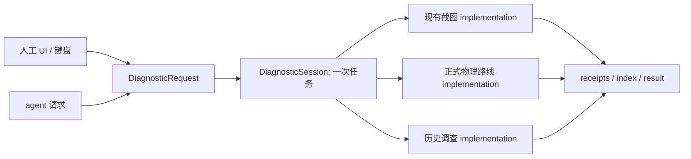

# 实际功能、接口与实现归属

2026-10-19 交接补充：[已完成／未完成工作清单](../reports/japan/passenger-policy-native-check-20261011/through-stations-20261011/ordered-continuation-20261012/chat-handoff-20261017/work-inventory-20261019.md)与[数据结构重构准备](railway-data-overhaul-preparation.md)。后者追加了实际Compact→JS→builder→Swift→诊断数据合同追踪；身份注册表ADR0013仍是提案，尚未切换schema。本表下面的2026-10-18记录是其原复核范围，不表示本次重新验证所有功能。

更新：2026-10-18。当前入口以本文为准；修复历史和逐项验证保留在[联合审计 T8](../reports/integration/function-interface-architecture-2026-10-15.md#t8-按审计落实交互状态唯一实现与数据流2026-10-17)。旧报告前半部分的候选不能直接当作当前缺陷。

采用 Matt Pocock `codebase-design` 和 `improve-codebase-architecture`。本次复核主应用已收敛的调用链，并独立检查正在整合的诊断 App；未重新逐函数审计整个仓库。下表按实际能力列出 interface 和权威 implementation，不把 private helper、按钮数量、文件数量或布局变体当作额外功能。诊断 App 已完成最终增量构建及有界人工、agent、键盘原生观察，结果见[诊断证据](../../ios/auxiliary/RailDiagnostics/Evidence/20261017-remake/README.md)。

## 第一性原理

用户输入 → 负责该事实的 module → 可观察结果。每条业务规则只有一个 implementation；表单、键盘、菜单和 agent 是同一 interface 的不同 adapter。interface 包含输入、前置条件、失败、取消和代价，不能只数 public 函数。

删除测试：删除一个 module 后，若复杂性消失，它可能只是 shallow 转发；若复杂性散回多个调用方，它承担了真实职责，应保留。先减少重复 owner 和同义转换，不为“以后可能换实现”新增 protocol、Manager、Repository 或通用工作流。

一个实现不等于一个巨型对象：文件拆分不产生额外 module；绘图、持久化顺序、资源解码各有真实合同。不同语义的数据不强行合并。Swift Array/Data 的传递本身也不能证明发生深复制。

## 主应用：功能 → interface → 唯一事实所有者

路径前缀：App = `ios/RailMap/`；Core / Application / Presentation = `ios/RailKit/Sources/RailCore/`、`RailApplication/`、`RailPresentation/`。

| 实际功能 | 调用 interface | implementation / 事实 owner |
|---|---|---|
| 启动、依赖生命周期、导航 | `AppShell`、`PrimaryTab` | App `App/AppShell.swift`、`Workspace/RailWorkspaceView.swift` |
| 行程筛选、日期分组、即将出发 | `WorkspaceDerived`、`WorkspaceJourneyRules` | App `Workspace/WorkspaceDerived.swift`；Presentation 的工作区规则 |
| 新建、编辑提交 | `JourneyEditing.addAndPersist/replaceAndPersist` | App `JourneyEditor/JourneyEditing.swift` → `Journeys/ItineraryStore.swift`；Core `StoreOperations` 处理记录规则 |
| 复制、删除、移动、显隐 | `ItineraryStore.duplicate/delete/move/toggleVisibility` | 工作集、选择代次及本次提交结果归 ItineraryStore |
| 行程组 | `ItineraryStore.orderedJourneyGroups` | 同一处去重、排序；工作区、护照、分享读取该结果 |
| 行程搜索、标题、详情 | `JourneySearchMatcher`、`JourneyTitle`、`JourneyDetailSnapshot` | Presentation `Journeys/`；App 详情负责呈现 |
| 车站搜索和选择 | `StationPickerView` + `StationPickerSearchController` | App `JourneyEditor/`；Core `StationSearchIndex` / `StationIndex` 负责索引规则，约束通过参数输入 |
| 草稿时间、字段校验 | `EditorTime`、`RideDraftValidation` | Core `Editor/EditorTime.swift`；Application `Editor/RideDraftValidation.swift` |
| 新行程物理路径候选 | `TripRoutePlanner.plan` | Core `Routing/TripRoutePlanner.swift`，不能按近邻或同名建连接 |
| 本地补全 | `LocalJourneySearch.search`、`LocalJourneyAutofill.proposal` | Core `Routing/`、`Editor/`；UI 接纳提案并提交草稿 |
| 区间、服务、方向编辑 | `RailwayRouteEditing`、`RouteSectionServiceEditing`、`TravelDirection` | Core 对应 owner；站名优先级归 `StationNaming` |
| 物理路线修复 | `RouteRepairSession.search` → `RouteRepairFlow.advance` | Application 编排一次搜索；Core 持有修复规则；草稿和已保存记录各自提交 |
| 一次乘车路线解析 | `RideRouteResolution.resolve(Request)` | Core `Routing/RideRouteResolution.swift`；内部求解、连续性证明不暴露成 UI 手动步骤 |
| 路线资源、缓存、发布 | `RiddenRouteStore.load/resolve` | App `Infrastructure/Persistence/RiddenRouteStore.swift`；Core memo / admission 各自负责复用和准入 |
| 时刻表查询、停站及来源 | `TrainTimetableDatabase.bundled`、`trips`、`trip`、`sources` | Core `Timetable/TrainTimetableDatabase.swift`；按选定资源 URL 共享成功连接，失败抛出 |
| 服务浏览、完整班次与摘录分类 | `TimetableKnowledgeQuery.ClassifiedSources`、`ServicePatternBrowsePolicy` | 不将 Trip 降成 Pattern 再反查；不同资料完整度保留 |
| 线路服务资料与接续 | `LineServiceCatalog.loadBundled`、目录查询 | Core `Timetable/LineServiceCatalog.swift`；成功解码和接续索引在原 owner 内 |
| 历史有效期、直通展示 | `RailHistoryOverlay`、`JapanThroughServices` | Core `History/`、`Timetable/`；展示关系不证明物理可连接 |
| 时刻表物理证据匹配 | `TimetablePhysicalRouteMatch` | Core `Timetable/TimetablePhysicalRouteMatch.swift`；App `TimetableRouteEvidence` 负责加载和临时告警 |
| JSON 文件读取、导入预检和提交 | `ImportFileReader` → `ImportPreflight` → `ItineraryStore.runImport` | 外部格式归 Core `ImportEngine.Session`；Application `ImportStaging` 产出提交候选；store 发布工作集 |
| 截图 OCR 导入 | `TransferGuideOCR.read`、`TransferGuideImport.read/commit` | App 执行平台识别；Core `TransferGuide*` 解释输入；复用已有提交路径 |
| AI 补全与研究 | `JourneyCompletion.requestEligibility/prompt/merge`、`ChatGPTSubscriptionService.complete` | Core 管资格和合并；App 管认证和网络；研究结果与保存分离 |
| JSON 导出 | `ItineraryStore.exportJSON` | Core `CanonicalTrainStoreJSON`、`ResolvedRouteExport` 统一编码及证据合同 |
| 保存、备份、恢复 | `RideLibrary.saveResult/snapshotBackup/restoreBackup` | RideLibrary 合并请求 → RidePersistenceQueue 排序 → RideStorage 原子 IO；各自承担不同保证 |
| 网络、视口与显示资源 | `RailNetworkStore.loadAll/ensure`、`DisplayNetworkCache` | App `Infrastructure/Network/`；Core `DisplayChunkReader`；按地区/版本复用，按视口读取 |
| 地图更新、铁路绘制、标签 | `RailMapView.Surface` → Coordinator | App `Map/`；Presentation `MapUpdatePlan` 判内容变化，`MapRebuildPolicy` 判相机重建 |
| 连续显示曲线 | `ContinuousStroke`、`DisplayParts` | Core `Rendering/`；MapKit adapter 负责原生显示对象 |
| 相机、定位、框选、站点链接 | `RailMapController`、`MapCameraPolicy`、`StationPlaceLink` | 原生相机归 App；可移植策略归 Presentation；地点查询失败明确标记按坐标打开 |
| 里程、覆盖率、统计范围 | `MileageStatisticsStore.load` → `MileageMatching.match` | App 统计状态；Application 匹配；Core 聚合，使用 source geometry |
| 统计卡、票面和分享画布 | `StatsWidgetView`、`TicketFaceCard`、`ShareComposerModel` | 分享直接使用既有渲染实现；`ShareCardRenderController` 持有预览图；版式是参数 |
| 单行程图片与系统分享 | `JourneyPoster.render`、`ActivitySheet(items:)` | App `Sharing/JourneyShareImage.swift`；共享系统分享 adapter |
| 播放与视频 | `PlaybackController.start/togglePause/previous/next/setSpeed`、`PlaybackVideoExporter.start/cancel` | Core `Playback` 编译路径；App 控制和编码；画幅、速度是参数 |
| 显示设置、语言、字体 | `DisplaySettings`、`AppLocalization.text/stationName`、`AppTypographyPolicy` | 各事实一个 owner；appearance 由 App 根持有，字体范围保留 |
| 键盘、菜单、弹窗 | `RailCommandBridge`、窗口 `PresentationHost` | 共享业务动作；每窗口一实例、绑定真实 UIWindow，一个可取消的待呈现请求 |

## 诊断 App：一个产品、一个任务 interface

当前 workspace 只登记 RailMap 和 RailDiagnostics。RouteWorkbench / RailAlignmentInspector / ThroughWorkbench 的目录是内部 implementation，不再是三个独立的活动 app target。三份已知旧安装副本已可恢复地迁走，精确清单见诊断证据；Main 保持独立。

| 功能 | interface | implementation / owner |
|---|---|---|
| 人工新任务、导入、agent 提交 | `DiagnosticRequest`；文件交给同一个 App（`open -a APP REQUEST`） | `DiagnosticTaskComposer` 产出同一请求；文件/人工导入共用 `loadRequest→start`，`DiagnosticSession.open` 校验、准入和执行 |
| 一条线路自动截图 | workspace `alignment`，action `prepare/capture/retryFailures` | InspectionKit 选精确 line / interval / station；`BatchCaptureController` 执行；`InspectionEvidence` 原生快照 |
| 比例、画幅、主题、图像模式 | `DiagnosticCaptureSettings` | zoom 10…20、1× 宽高、light/dark、选定 PNG 模式；覆盖间距随视口和缩放变化 |
| 精确范围恢复、失败重试 | 原请求 + sessionDirectory | 原请求不可变；依赖和 receipts 决定复用；保留广范围旧目录映射，不扩范围代替失败 |
| 物理路线诊断 | workspace `route`，action `prepare/solve` + inputPath | `DiagnosticSession.runRoute` → `RouteWorkbenchModel` → 正式 `RiddenRouteStore`，不复制求解器 |
| 历史直通调查 | workspace `through`，action `prepare/inspect` + patternID / reviewDay | `DiagnosticSession.runThrough` → `WorkbenchStore` → actor `WorkbenchSession` / `WorkbenchCore` |
| 交互地图、取证与几何检查 | 选中工作区的模型动作 | 复用原内部工作区；线路/区间批采集回到统一请求入口 |
| 持久状态和结果 | `run-status.json`、`result.json`、`capture-index.json` | DiagnosticSession 汇总；截图 receipt / checkpoint 由批采集 owner 持有，截图完成不等于线路通过 |
| 截图查看 | capture-index 中已采集视点 | `DiagnosticCaptureGallery` 读实际 receipt 文件；缩略预览与原图 Quick Look |
| 审查记录 | `DiagnosticSession.saveReview` | 绑定候选和依赖的 reviewer notes，不修改生产几何 |
| 键盘和菜单 | `DiagnosticTaskCommandBridge` + 当前工作区 command bridge | UI、菜单共用动作；快捷键在 UI 持续标注；模态呈现期间禁止背景动作 |

### 六项简化的来源与落实

以下保留简化前的调用链作为问题证据。六项已落实并完成最终增量构建与有界原生验证；没有测量运行成本，也没有新增框架。

| 优先级 / 判断 | 代码证据 | 最小修改方向 | 如何判断完成 |
|---|---|---|---|
| P1 / Strong：仍可进入第二条路线启动管线 | `RouteWorkbenchView.swift:151` 的 task 调 `RouteWorkbenchModel.importLaunchArguments`（`:291`）；旧 `--inspect-input/--inspection-report` 直接 read/start/自动写报告；统一入口另有 `DiagnosticSession.runRoute`（`:205`） | 删除旧启动解析及仅供它使用的报告状态；保留交互 read/start 和统一请求执行，不再增加 facade | 当前产品只解析统一任务参数；输入保护及报告输出仍由统一执行路径负责 |
| P2 / Strong：进度轮询重写完整证据 | `DiagnosticSession.swift:192-197` 每 500ms `persist()`；`:344-375` 重写 index、候选和结果并增加 evidenceRevision；gallery `:56` 随 revision 重读整份 index | 进度只写已有 run-status；候选在 scope 建立时写，index/result 在 receipt 或终态变化时更新；gallery 只响应实际证据变化 | 未产生新 receipt 的进度变化不重写 index；最后一张图、暂停和失败仍可观察 |
| P2 / Strong：生成未请求的图再删除 | `InspectionEvidence.swift:106-132` 编码全部 basemap/display/smooth/reference；`BatchCaptureController.swift:405-410` 再解码 basemap 验尺寸并过滤 PNG | 把选定模式传给既有 capture；在原生 snapshot 上验尺寸，只绘制/编码请求的模式；共享一次原生底图 | smooth-only 等请求不编码其它模式；实际尺寸和 receipts 仍严格一致 |
| P2 / Worth exploring：全量资料跨 actor 只为算摘要 | `WorkbenchSession.swift:71-74` 编码四份完整资料 → `WorkbenchStore.swift:122` 转发 → `DiagnosticSession.swift:252` 在 MainActor 算 SHA256 | 在拥有 document 的既有 actor 内计算并返回依赖摘要；保持同一规范编码，避免把资料字节暴露给调用方 | 相同输入摘要不变，修改有效输入会失效；不增加第二份 document 或全局缓存 |
| P2 / Strong：同一采集完成规则两份 | `DiagnosticSession.refreshWorkspaceCaptureResult`（`:141-153`）和 `runAlignment`（`:197-202`）分别过滤 scope、判断不可用几何、统计并决定 partial/evidenceReady | 在现有 capture owner 内提供一个 scoped summary，供完成、刷新和导出读取；prepare 等任务状态仍由 session 决定 | 两条入口对同一 checkpoint 得出一致的计数和完成状态 |
| P3 / Worth exploring：精确范围重复物化 | `InspectorModel.configureBatch`（`:189-193`）两次调用 `alignmentInputs`，session（`:160`）再选一次 | 准入后复用一次 scope，给候选和采集配置；保持请求类型中的选择规则唯一 | 错误 ID 仍拒绝，候选与实际采集范围严格一致；不新增 ScopeManager |

简化前 `InspectorModel.swift:174-185` 保留旧 `--batch-all/--batch-output` 和 Info.plist 输出配置。交互模式当前不配置批量计划，所以不能据此宣称启动了全国采集；这些退役入口及本地启动 fallback 现已删除。不要将历史证据目录一并删除。

优先处理旧路线启动管线，因为它绕过统一任务的依赖准入与结果合同；再收敛高频完整写入、未请求 PNG 和跨 actor 字节传输。A→B 已足够，均可在现有 owner 内完成。

截图 gallery 当前通过 index 文件读回内存，属于人工 UI 复用 agent 导出的 adapter。若减少写入后仍有具体代价，可直接读取同一 owner 的 typed rows；不同时保留两份可修改截图状态。`WorkbenchStore` 的可观察 UI 生命周期和 `WorkbenchSession` 的串行文档修改仍有不同职责，删除的是只返回摘要所需字节的多余接口，而不是整个 actor seam。

133视角的实际审查暴露了图库连续导航和编号错配问题，现已补上上一/下一视角按钮及常显⌃⌘J/K。`DiagnosticCaptureGallery.moveSelection` 同时接受按钮和既有 `DiagnosticTaskCommandBridge` / Diagnostics 菜单调用，picker 仍写同一个 selected；显示原始 itemID / zero-based pointOrdinal。没有另一份截图状态或导航算法。最终增量构建及实际首端、按钮/快捷键同路、modal 后台禁用结果见 `oito-west-complete/gallery-navigation/README.md`。

诊断 alignment 的既有 `DiagnosticRequest.inputPath` 可选指定 Japan compact JSON；省略才使用 bundled 输入。`InspectorModel.load` 通过同一 `DisplayParts.LoadedPackage.load` 加载，人工 picker 复用既有 retained-input adapter；workspace capture 保留该来源。显式坏路径直接失败，结果记录实际路径与来源，改变 own geometry 后不能复用旧 receipts。没有新建候选 App、第二套采集实现或包转换层。该 interface 已用于鳩原34视角候选及正式数据复用；技术输入关闭自动纠错和自动大写，以保留路径与ID原文。

## Web、构建与资源 interface

| 能力 | 当前 interface / implementation | 归属判断 |
|---|---|---|
| Web 行程 CRUD / 编辑 | `app-store-ops.js`、`app-editor.js` | 保持规则在实际写入 owner；classic-script 全局绑定不等于语言级封装 |
| 导入、保存、恢复、JSON/HTML 导出 | `ImportController`、`PersistenceService`、`exportTrainStore` | `app-import-controller.js`、`app-import.js`、`app-persistence.js`、`app-store-ops.js`；只在明确导出时序列化 |
| 地区会话切换 | `CountrySession.switchTo` | `app-country-session.js`；保存完成后切资源/缓存 |
| 物理路线 | `RouteService` | `app-route-service.js`、graph/solver；预计算宿主使用同一规则 |
| 地图及 worker 资源解码 | `RailMap`、`RailNetwork.loadNetwork` | `railmap*.js`、`rail-network.js`；真实 worker 与主窗口是执行 adapter，共用载入规则 |
| 统计、播放、视频 | `scheduleMileageStats`、`Playback`、`PlaybackVideo` | `app-stats*.js`、`app-playback.js`、`app-playback-video.js` |
| 本地化、历史、设置 | `i18n`、`AppDatasets`、显示/历史载入 | `i18n*.js`、`app-datasets.js`、`app-rail-history.js`、`app-display-settings.js` |
| 当前资源读取 | `app/shared/artifact-inputs.js`、静态 `./api/*.json` / `./rail/*.json` | builder 注册的文件 interface；静态发布 hasBackend=false，旧请求字符串不代表存在在线后端 |
| 本地站点组装 | `build-static-site.mjs` | 产物构建，不能当作产品后端 |
| 路线预计算 | `PrecomputeAdapter.solveStore/solverContexts` | 离线执行 adapter，调用同一 RouteService |
| 铁路、站名、历史、时刻表 builders | `app/scripts/railway/`、保留的 `ios/tools/` | 真实输入格式和出处不同，不凭脚本数量合并 |
| 当前可选检查/启动 | `ios/verify.sh swift/build/diagnostic` | 显式选一个模块，不串起全国验证流水线 |

## 分层与数据流的裁定

图表示当前源码的统一主路径；旧路线参数旁路已删除。

- **RailApplication 保留**：导入预检/暂存、修复、匹配有实际规则与测试合同；不是每个 Core 函数的转发目录。Presentation 保留无原生 UI 的展示决策；RideLedger 已归 Core。不按调用方数量机械解散 target。
- **保存三步保留**：合并请求、排序、原子 IO 是三种不同保证，不能为减少箭头删掉并发正确性。
- **source geometry / display geometry / MapKit 坐标保留区分**：[ADR 0004](../decisions/0004-wgs84-mapkit-datum-boundary.md) 要求共享 WGS84，在 MapKit seam 转换一次。显示平滑和共线排布不能回流为物理证据；进出站沿本铁路轨迹，邻近或交叉铁路不能决定走向。
- **headers / viewport chunks / 完整求解包不强行统一**：读取范围和生命周期不同。当前 DisplayNetworkCache 已有共享；不新造常驻五地区 RegionDataset。
- **布局差异以参数表达**：同一种统计摘要用一个 renderer；详情图表和摘要卡承担不同任务，不因展示同一数据就合并成万能视图。真实平台 adapter 保留。
- **保留待测项**：预计算 canonicalize、RouteNetwork.Line 的多份几何表示、RouteResolutionMemo 键投影和 legacy 第二遍求解，需要实际命中/耗时证据再决定。未证明无用之前不删除来源、日期、缺口或物理身份。

## 证据与剩余事项

首轮新增文档并更新结构/功能导航；用户随后要求直接落实，六项现已修改产品源码。实现阶段随后完成最终构建与有界原生/UI 验证，见上方诊断证据链接。源码抽查包括 Package.swift、workspace 引用、资源缓存、车站选择调用、分享 scope、行程组、呈现 owner、静态后端配置，以及上列诊断调用链；独立 reviewer 只读检查诊断 module。历史审查由 T8 明确覆盖，不能据本文把全部库标为验证通过。

主应用 T8 的 `bundledConnectorServices` 失败已由后续 T9 定位为 JP/jp 国家码比较问题并修复，原断言保留，22 项聚焦测试通过；以 T9 取代旧失败现状。诊断最新源码已编译并完成目标原生观察，三份已知旧 App 副本已可恢复地退役。未测量 CPU、内存、帧率或启动时间；本报告不宣称获得性能收益。

落实位置：旧启动路径删除于 RouteWorkbenchView / RouteWorkbenchModel；InspectorModel 只生成一次 admittedCaptureInputs；BatchCaptureController.scopedSummary 统一完成规则，evidenceRevision 仅代表持久证据变化；DiagnosticSession 分开进度与证据写入；InspectionEvidence 在编码前使用请求模式和验证实际尺寸；WorkbenchSession.dependencyDigests 在文档 actor 内返回摘要。源码独立复核与最终运行结果继续记入 RailDiagnostics 的证据目录。

诊断批量 capture 的 `captureSettings.basemapStyle` 支持 `standard`（默认）和 `imagery`。人工 Basemap picker 与 agent JSON 使用同一设置和 `MKMapSnapshotter`；卫星图没有独立采集器。imagery 写入 renderer style contract，不能误复用 standard receipts；既有 standard contract 保持不变。横滨7/7、糸鱼川29/29原生影像视点已实际生成，用于区分本线站台及邻线。

Native JSON file opens and the existing picker share `DiagnosticWorkspaceView.loadRequest`: strict decode/validate, security scope and existing start/DiagnosticSession. Direct file actions require no second Run; labelled Run/Command Return resumes current or selected recent tasks. Native direct dispatch is now verified: the latest Debug app completed the Miyazu request 28/28, 0 failed, without an extra Run action; result/run status identify PID 52148 and invocation `A0B99B1B-9B1E-4639-B349-CC356793051A`, and the parent inspected the completed UI. One authorized `open -n` returned 0 and subsequent process observation retained only that same Debug executable/PID; this was single-process retention, not launch rejection. The earlier sandboxed -10827 attempt is not the native outcome. Evidence: `ios/auxiliary/RailDiagnostics/Evidence/20261018-direct-dispatch/`. Earlier preview-flow valid/invalid/busy and 14/14 candidate capture evidence remains in `Evidence/20261018-hot-open/`. No second request format or queue engine. Inspector initial selection uses the requested line (incremental build succeeded; performance remains unmeasured).

`DiagnosticCandidate.tasks(selected:context:)` 同时生成所选区间的 `sharpTurn` 候选（转向 ≥20°），复用现有候选列表和 JSON 导出。`corner` 给出从零开始的显示顶点索引、坐标、角度与前后段长度；人工和 agent 读取同一个候选实现。无第二扫描器或自动删点规则。三项聚焦回归已通过；共享增量构建及曳舟原生观察已完成，人工列表与 JSON 的两个约87°候选一致。证据见 `ios/auxiliary/RailDiagnostics/Evidence/20261018-sharp-turn/`。

## Exact alignment viewpoints (2026-10-18 source implementation)

Optional `DiagnosticRequest.viewpointIDs` and the New task Viewpoint IDs field select exact scoped plan IDs. Admission uses the retained actual plan; the existing BatchCaptureController.start(viewpointIDs:) implementation captures them. Retry filters failures before captureLimit; session progress and scoped index/result share the selected IDs. Existing omitted-field requests retain full scoped capture.13 focused DiagnosticRequestTests passed; shared Release compilation and actual exact-viewpoint keyboard/button/resume observations completed; evidence: ios/auxiliary/RailDiagnostics/Evidence/20261018-exact-viewpoints/. Run remains labelled Command Return; no additional capture engine or keyboard-only implementation.
