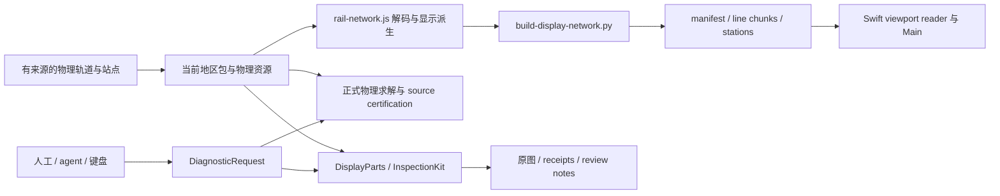

# 铁路数据结构重构：准备与交接

日期：2026-10-19。状态：准备完成后供实施使用，**尚未迁移 schema、身份、生产几何或乘车记录**。本文采用 Matt Pocock 的 codebase-design / domain-modeling：先明确事实所有者与调用 interface，再删除重复表示和转发，不增加假想 adapter。

## 从哪里继续

- [工作完成度、修复与未完成清单](../reports/japan/passenger-policy-native-check-20261011/through-stations-20261011/ordered-continuation-20261012/chat-handoff-20261017/work-inventory-20261019.md)是本次静态交接快照；后续执行状态仍更新既有 [audit-status](../reports/japan/passenger-policy-native-check-20261011/through-stations-20261011/ordered-continuation-20261012/chat-handoff-20261017/audit-status.md)，不新建另一份可变状态数据库。
- [实际功能与实现归属](function-interface-map.md)描述主 App、Web、诊断和构建的现有 interface；[修复流程](railway-repair-workflow.md)记录已采用的操作方式。
- [ADR 0013](../decisions/0013-railway-identity-registry.md)已经提出稳定身份注册表、公司车站层、历史改键、CN 归并和 NA 入库。它仍为 **Proposed**；本文接续适用的计划，不另选一套 ID 或建立第二套注册表。其NA入库阶段与当前 ios/AGENTS.md 的“North America is retired”约束冲突，故不纳入实施。
- [ADR 0004](../decisions/0004-wgs84-mapkit-datum-boundary.md)、[0008](../decisions/0008-chunked-display-network-database.md)、[0010](../decisions/0010-unified-station-tables.md)、[0011](../decisions/0011-dated-rail-history-overlay.md)、[0012](../decisions/0012-per-ride-resolution-and-catalog-eligibility.md)仍是迁移约束。旧 ADR 中引用的退役验证脚本以当前 [验证政策](../../ios/VERIFICATION.md)为准。

## 当前事实与计划的区别

2026-10-19 只读核对：JP `compact-v1`、版本 `2025.5.2`，当前658个 line ID 与排序输入的658个唯一 ID 集合完全相同；排序输入含9580个区间。这个集合相等不是全部铁路、区间或站台已验收。

ADR 0013 计划的 `app/data/registry/`、`app/scripts/build/rail-database/registry.mjs`、`app/scripts/build/mint-registry.mjs`、`app/scripts/railway/validate-registry.mjs`在本次核对时不存在；现有 `app/scripts/build/rail-database/load.mjs`仍写 `schema_version=3`。因此不能把 P0、稳定 ID 铸造或新记录格式写成已实施。ADR 中数据库统计是其调查快照，不能外推为所有运行时资源的当前数量。

## 必须分开的事实

| 事实 | 应由谁拥有 | 不能由什么推导 |
|---|---|---|
| 公司、铁路、公司车站的稳定身份 | ADR 0013 的身份账本及明确外部引用；目前仍为计划 | 不能按可变名称、同名、最近坐标生成物理等价关系 |
| 站群、公司车站、具体乘降面 | 各自身份与有来源的归属 | 一个共享 N02 group ID、蓝色大矩形、站名 POI 不能证明同股道或完整站台端点 |
| 客运线路与运行模式 | 有日期的运营关系、方向、停站顺序和来源 | CN relation 的方向分支不自动是独立铁路；设施关系也不等于双向客运列车关系 |
| 原始物理轨道与连接 | 有原始节点／边身份和版本的 source geometry、已审阅接点 | 不能由 display 交叉、站群、直线、吸附距离或接近零的接缝建立拓扑边 |
| 审阅来源 | 独立 provenance 引用 | 审阅编号不能替换源轨道身份；CN 已观察到 `source_id` 污染轨道匹配的问题 |
| 显示曲线、共线排布与跟随 | 当前 display owner 的派生数据 | 平滑或 lane placement 不能回写为物理路径／里程证据 |
| 日期、停运、替代巴士及准入 | 既有 history/service owner | 几何存在不表示某日可乘；无连续描边不等于 Main 普通区间路径不可见 |
| 采集、审阅、修复应用、Main 确认 | 对应作用域的证据与状态 | 完成截图或测试通过不能代替地理归属、平台中心或最终组合像素验收 |

术语见根目录 [GLOSSARY](../../GLOSSARY.md)。当前包中名字拼接 ID、绘图 `-pN` 与物理身份的关系应显式映射；迁移中不得仅去后缀、改名或按名字合并。

## 当前数据经过哪些 interface

图是现有主要读写流，不是建议增加新中间层。更细的当前符号与文件见下文 interface 追踪。持久化的 source、display 与 viewport chunk 并不天然冗余：消费范围、测量空间和生命周期不同。Swift Array/Data 传递不证明深拷贝；本次没有新测 CPU、内存、像素或延迟。

### 已经收敛，不要重复改造

诊断六项简化已实现并有增量构建／有界原生证据：移除第二条路线启动旁路；精确范围只准入一次；完成统计由 capture owner 提供；进度写状态而非反复写完整证据；只绘制／编码请求 PNG；through 摘要在持有文档的 actor 内计算。人工、文件、agent、键盘走同一 `DiagnosticRequest` / `DiagnosticSession`。不要恢复三款活动诊断 App、另一套截图算法、后台 watcher 或自动全国 runner。

### 本轮实际暴露的迁移风险

1. **数组序号具有当前含义。** 修复脚本、区间、part、follow 和 evidence candidate 使用索引；稳定实体 ID 不能隐式改变它们的序列语义。先输出明确旧 ID／旧区间序号／旧 part 到目标引用的映射。
2. **测量空间不能混用。** 原始 N02/source ruler、display/groomed ruler、序列化后的 ruler 均有实际消费者。北松江自跟随后缀只应 rebased source 区间，target part1 的150→0保持；不能以统一四舍五入或全局 mapper 替代具体合同。共享几何的精确 support 度量也不能降成一位小数。
3. **几何相同不等于证据相同。** named immutable plan、station IDs、完整 own-line render dependency、render contract、camera/settings 都影响 receipt 适用性。新比例尺的 point ordinal 不是旧相机；先读新 plan 再选视点。不存在的 named plan 不能靠文件尺寸补证。
4. **provenance 与可变审阅状态分开。** 已 apply 的证据顶层状态可能参与生产 provenance；补 Main 结果应写其后续 metadata，不能随手改顶层状态破坏幂等。迁移后应让事实身份、几何修订和审阅结论各有清楚的归属，而非一枚总 hash 兼任所有含义。
5. **chunk 是一次构建的一组产物。** candidate 的 manifest、per-line catalog、blob、joins 和资源 revision 必须一致。只替换 region checksum 或 JSON 不能证明 Main 实际读取新几何。归零的 overlay 也不能当作没有地理缺陷。
6. **边界比内部替换先确定。** 西野尻 v9..12也有侧偏，随后偏差反转；布崎窄替换产生24.37°新接头。重构不能让这些已否决候选变成默认数据或自动兜底。

## 实施顺序与交付边界

下列是准备好的顺序，不是已完成的实施清单。沿 ADR 0013 分期，每期只有一个实际写入 owner；兼容读取若有必要，集中在现有导入／解码 interface，不让所有调用方同时理解两套身份。

| 顺序 | 具体交付 | 本期不改变 | 结束条件 |
|---|---|---|---|
| 0：冻结迁移输入 | 当前 schema、旧 ID、外部引用、各数据事实 owner、已有修复 authority 与例外清单 | 不改铁路几何和历史事实；不重新跑全国基线 | 当前读写链及已知坏例子能逐项定位；本文件与工作清单供执行 |
| P0：身份账本 | 依 ADR 0013 唯一 mint 入口、只读 builder、旧身份 crosswalk、例外与同名报告 | App、compact 包、display-network、乘车记录不切换；CN 不在此期归并 | 聚焦验证唯一性、只追加、retire/alias、歧义拒绝和重跑稳定；不得靠猜测归并 |
| P1：公司车站与记录引用 | 由既有 alias/import interface 解析旧记录，按 ADR 决定的 company-station 层写新引用 | 不从站群制造乘降面／换乘物理边，不猜 missing identity | 旧记录可读且无歧义升级；新记录往返稳定；已知同名异站不误合并 |
| P2：历史改键 | 有效期与改名／运营者关系按稳定身份引用，缓存依赖对应升级 | 不补造开通日期、不丢失半开区间规则 | 已知日期边界和旧记录解析结果保留 |
| P3：CN 单独归并 | 设施 line 与 route pattern 分开；原始 way/node 与来源保留 | 不把返回几何、展示匹配、整车完整与客运认证合成一个布尔值 | 固定车次逐项差异可解释，GZS/SBT/PNE等未证边界仍显式存在 |
| P4：ADR中的NA入库计划已被产品约束排除 | 仅保留离线归档与身份讨论的历史记录 | 按 ios/AGENTS.md，US/CA不得打包、载入、迁移或提供兼容；不实施此期 | 明确记录ADR旧计划与当前约束的冲突，不恢复已退役NA路径 |
| P5：下游切换 | Swift/JS、builders、chunks、history、cached routes、diagnostic identity 全部切到已决定的引用 | 不保留第二套长期 writer／renderer／求解器 | 受影响字段有可追踪映射，临时兼容有明确移除条件，产品读同一事实 |

开始 P0 前先按 ADR 0013 的既定 opaque ID／JSONL 选择实施；如果实际需求要求改变选择，更新原 ADR 的决策状态与理由，不在本文件静默改方案。P1 乘车记录 schema 与导出版本的发布关系仍需落实；“准备重构”不等于已授权提交、推送或发布。

## 迁移必须携带的保护样例

| 已知样例 | 保护的事实 |
|---|---|
| 横滨相铁、糸鱼川大糸本线站台 | 共享站 ID 不覆盖本线显示端点与自身进出站方向；邻线不决定路径 |
| 品川／大崎、京叶 shared forks | 分支、主线共用 supports 和精确 follow ruler；保留共同段及各自端点 |
| 北松江 #6 | 仅删15/17/19，物理站点／公里不变；自跟随 source 后缀重测，target part1 150→0不改 |
| 渡良濑花轮 #8 | 已删后一组v5，前一组v2/v3继续未决；不能用一个 accepted 标记吞并两组 |
| 宫津 #9/#15 | 同一 authority 保留前次已接受修复，不能被后次 export 覆盖 |
| 夷隅 substitute_bus | 保留服务状态及 Main 普通区间绘制；不凭 continuous part 数推断可见性 |
| 宫福、布崎、西野尻 rejected | 保留否决理由，不能迁为 accepted repair 或自动 fallback |
| CN source_review_id 与地铁误标 | 原始轨道身份与审阅 provenance 不混用；源铁路不能被最近地铁显示身份替换 |
| 广州南／沈阳北／攀枝花南、楚雄—丽江 | 返回部件与真实连接缺证分别迁移；不得由公司站群或近邻节点补边 |
| Manyo 旧23对与缺失 named plan | 先前作用域验收保留，但缺失计划不伪造成新 identity 复核通过 |

验证从改动和具体失败问题开始：P0无需启动原生 App；P1读取／往返用现有聚焦合同；只有 renderer／schema decoder／资源构建改变才做相应一次增量构建；有地理或组合显示变化再选有代表性的现有 Main 同相机 ON/OFF。运行一个 heavy/native job，复用未变依赖的有效证据；不重建退役矩阵或全树 hash 工作流。CN冻结88×2仅在其相关行为变化时按既有 owner 执行，不由本准备文档自动触发。

## 当前 interface 追踪

本节由实际源码的有界盘点补充；不是新抽象设计。

### 实际调用链与事实所有者

| Boundary | Exact current implementation | Contract / owner |
|---|---|---|
| Compact package input | `app/public/rail/jp-2025.json`; `app/public/rail/README.md`; Swift `ios/RailKit/Sources/RailCore/Data/CompactPackage.swift`, `CompactPackage.Line`, `Station`, `Segment` | Current package line/station IDs (not yet the proposed name-independent registry), station order, `[distanceKm, continuesFromPrevious, coordinates]`. Original interval mileage is stored data; display geometric length must not replace it. Display aliases are separate `displayStationCoordinates`, `displayIntervalCoordinates`, plus explicit lead-ins/reversal branches. |
| Source interval decode | `app/public/rail-network.js:910 decodeIntervals`; Swift `CompactPackage.decodeIntervals` at :252; Python `app/scripts/railway/build-display-network.py:352 decoded_intervals` | Prepend previous endpoint for continued rows; weld endpoints to authoritative station coordinates; loops wrap station index. “Source” here is decoded station-welded input, not necessarily untouched raw N02 points. Raw evidence must retain its own identity. |
| Display aliases and own-line grooming | JS `displayLineForCoordinates` :895 → `displayPartsForLine` :1379, `continuousCoordinatesForLine` :1811. Swift `CompactPackage.decodeDisplayIntervals` :290; `DisplayParts.parts` :1255 / `continuousCoordinates` :1479 | Explicit display interval/station coordinates affect drawing only. Own station anchoring, branch/retrace/reversal handling create display parts. Swift `DisplayParts` is an own-line port, with explicit JS-math parity comments; not the full shared-corridor/lane/family network compositor. |
| Rare topology decode | `ios/RailKit/Sources/RailCore/Rendering/DisplayParts.swift:233 LineTopology`, :307 `LoadedPackage` | `LoadedPackage.init(from:)` decodes `CompactPackage` and the separate topology shape from the same decoder; topology carries `reversalTails` and `extraSegments`. These must survive any schema consolidation. This is an observed separate schema adapter, not a measured second full-geometry decode. |
| Web network composition | `rail-network.js buildNetworkFromCompactPackage`, `reviewedSharedCorridorOverrides`, `serviceSplitForLine`, `drawsContinuousStroke`; `sourceGeometryForIntervals` :4656 | Joins review/display overrides, creates own display parts and rendering stroke model, source interval section index, station/line indexes. `sectionByCode.coordinates` comes from `decodeIntervals(compactLine)` (:3975), distinct from display parts. Service splitting is drawing policy; nearby rails/shared ink do not establish physical connection. |
| Native measured-row authority | `app/scripts/railway/build-display-lanes.mjs:458 partRowsForLine`, `deriveDisplayRows` :2248, `computeHubOverrides` :1017, `snapSharedFollowEndpoints` :1919, `deriveFamilyWindows` :1989 | Derives line/part indexes and metre rulers from actual JS display parts. Own per-region lane rows, follows, family windows, hubs, loop direction/exclusions, chain boundaries and releases belong to this derived artifact. A geometry repair must update concretely dependent ruler rows, including a line used as someone else’s follow leader. Do not infer part counts or measure ranges from raw vertex counts. |
| Native display compiler | `app/scripts/railway/build-display-network.py build` :2857; `chains_from_parts_rows` :970, `chain_from_interval_range` :762, `build_region_history` :2644 | Reads compact packages + `shared-corridors.json` + `display-lanes.json` and optional history. Creates `{region}.display.bin` line chunks, station table, overview chunks where applicable, history file, manifest with offset/length/digest/bounds/dependsOn. Current builder is the authority to regenerate native display outputs; a local repair should not independently reproduce all native compilation. |
| Plain native parts | `build-display-lanes.mjs` :426 row contract; Python `chain_from_interval_range` :762 | Row `[lineID, partIndex, firstInterval, lastInterval, vertexCount, totalMetres, null, null, withheld]` is a plain interval-backed run. Nonplain row uses `-1,-1,kind,coordinates`. Plain is admitted by vertex-exact comparison, not only length/count. Python builds display intervals first (:3073–3091), applies display aliases before reconstructing plain runs; null embedded coordinates do not mean canonical-only rendering. |
| Measured rows → runtime | `ios/RailMap/Infrastructure/Network/RailDisplayNetworkFormats.swift:268 RailDisplayNetworkFile.LineFragment`, `FollowRow`, `FamilyWindowRow`; `RailNetworkStore.loadDisplayChunk` :1411 | Fragments carry parts, continuous/chain/joinPrevious, laneRows/totalMetres, follows, withheld and familyWindows. Follows refer to explicit canonical lineKey+chain+from/to ruler; not an OSM/physical route relation. Manifest `dependsOn` ensures required leader/family chunks are available. |
| Main viewport loading | `RailNetworkStore.loadAll` :420, `ensure(regionsIntersecting:cameraZoom:)` :603, `activateDisplayLines` :844, `loadDisplayChunks` :1349; `RailDisplayNetworkIndex` and `RailDisplayNetworkManifest` | Loads manifests, overview/full detail as needed, follows dependencies, then prepared DrawnLine/DrawnStation state. Display chunks are whole line documents, not geometry tiles; per-interval culling and line-level load scope are separate duties. |
| Byte-range interface | `ios/RailKit/Sources/RailCore/Data/DisplayChunkReader.swift:27 slice` | A checked byte-range request returns `blob.subdata(in:)`; documented as a zero-based copy. Region blob is memory-mapped by the resource reader. This is an observable copy boundary, not evidence that it is currently a bottleneck. |
| Resident full source/layout/routing | `ios/RailMap/Infrastructure/Network/DisplayNetworkCache.swift`, `package(country:)`, `lineParts(country:)`, private resident package/layout/network + in-flight tasks | Cache already shares one current region/resource revision’s full decode/layout/network; subscribers join in-flight work. Do not propose a new universal region cache on the assumption each caller fully decodes independently. Lightweight headers/station directory and display chunks have different lifecycles. |
| Routing source vs display | `ios/RailKit/Sources/RailCore/Routing/RouteNetwork.swift:149 Line` and initialization paths; `RailIntervalCodes` used by its interval index | `Line` retains `parts`, `intervals`, optional `compactLine`, and calculated metrics. These are multiple observable representations with different consumers. Swift value storage sharing/deep copy and peak residency are unmeasured. Preserve physical interval identity and source routing/mileage even when display parts change. |

### 服务状态与历史

- JS `rail-network.js:2274 serviceSplitForLine` reads compact `serviceSpans` `[firstStation,lastStation,code]`, maps suspended/substitute-bus spans one interval at a time across display parts, and keeps disconnected strokes separate. Service code mapping includes `substitute_bus` (:2185 onward). `drawsContinuousStroke` and `serviceSplitForLine` decide whether a line enters strokeModel.
- `build-display-lanes.mjs computePartsByRegionRows` emits `strokeExcludedByRegion` for lines not entering that stroke model. Python compiler reads that explicit exclusion list (:2888 onward) instead of guessing a second service-status rule. Preserve this boundary when redesigning plain part rows.
- Swift `CompactPackage.Line` currently decodes `serviceStatus` but has no `serviceSpans` field. Do not silently “normalize” away spans merely because this one decoder does not expose them. Main native drawing consumes the compiled display network; the diagnostic centreline can still be visible for a service-excluded railway. Inspector visibility is not evidence that Main should draw a substitute-bus interval.
- `ios/RailKit/Sources/RailCore/Timetable/LineServiceCatalog.swift loadBundled/coverage/serviceKinds/timetableTrips/continuations` owns dated evidence-backed service classes/trips and their provenance. It is not a replacement for compact map suspension spans.
- `ios/RailKit/Sources/RailCore/History/RailHistory.swift RailHistoryOverlay`, `RailHistoryStations.swift`, and `RailMap/Infrastructure/Network/RailDisplayNetworkFormats.swift RailDisplayHistoryFile` carry era/validity/overlay facts. Python `build_region_history` derives display-era rows; Main `loadDisplayHistories` and history fields on DrawnLine/DrawnStation consume them. `JapanThroughServices`/timetable continuation display does not establish a physical connection. No history/timetable freshness or complete cross-artifact identity audit was performed here.

### 诊断与审阅身份

1. `ios/auxiliary/RailDiagnostics/Sources/DiagnosticSession.swift runAlignment` :169 calls the existing `InspectorModel.load`, admits requested exact scope, uses `DiagnosticCandidate.tasks`, computes lineRender dependency/settings and produces `alignment-geometry.json` with selected intervals plus complete own-line DisplayParts. `inputPath` is explicit or bundled; it must never silently switch source on a bad path.
2. `ios/auxiliary/RailAlignmentInspector/Sources/InspectorModel.swift makeInputs` :531 derives `source` from `CompactPackage.decodeIntervals` and `display` from `decodeDisplayIntervals`. They are not full network lane/follow/family composition.
3. `InspectionKit/Sources/RailInspection/BatchInspection.swift:31 BatchInspectionCoordinateIdentity` freezes Double IEEE bitPatterns, and `BatchInspectionIdentity` binds itemID, from/to station IDs and both source/display arrays. `BatchInspectionPlan.captureDirectoryIndices` assigns slots from sorted immutable inventory; pointOrdinal belongs to that plan. Re-sorting a narrowed list and reusing the old slot is wrong.
4. `BatchCaptureController.configure`/identityPlanURL retain `identity-plan-<digest>.json`, `plan.json`, checkpoints and per-view state. Captured receipts remain bound to named immutable identity plan + interval/render/reference dependencies + exact output modes/file integrity. Their ownership is not the external per-line prose report.
5. `BatchCaptureController` view metadata (:385–418) explicitly states: complete own-line DisplayParts smoothed, clipped to immutable viewport; isolated centreline; **no lanes/follows/joins/family collapse**. `sourceCoordinates`, camera, renderContract, named identity, original part indices and sampled distances accompany the original PNGs. Distances are not Apple pixel residual or physical topology verdicts.
6. `DiagnosticSession.persist` :365 emits index on capture evidence revision, candidate-tasks once, result with paths/dependencies/counts; `persistRunStatus` handles progress. These prior simplifications are already present. Do not list old 500ms full-index rewrite as an outstanding current defect.
7. `DiagnosticSession.saveReview/loadReviewNotes` :287/:316 and `DiagnosticReview.swift` bind candidate notes to current requestID/dependencies and explicit evidenceSHA256 paths, preserve history, and reject stale evidence. Capture completion, human/agent image review, source attribution, candidate native pixels and Main final composition remain distinct states. A new schema must not collapse them into “passed”.

### 已观察到的重复表示／转换（不是性能排名）

- Python builder explicitly constructs `source_intervals_by_line`, then a separate `intervals_by_line` via `_copy_display_interval` before display changes (:3073). `DisplayInterval` preserves pre-weld coordinates and source km; temporary provenance is later stripped by `_drop_memory_only_fragment_fields`. This separation prevents display edits leaking into source provenance. A redesign may change storage, not remove the semantic distinction.
- Native “plain” rows avoid embedding full coordinates; nonplain rows embed coordinates already derived from JS display parts. Both additionally carry vertexCount/totalMetres and relevant measured rows. The metadata is a checked reconstruction/measure contract, not automatically redundant data that can be deleted.
- Web network objects contain line parts/geometry, source section coordinates, and stroke model representations; Swift RouteNetwork.Line contains parts + intervals + compactLine. Observed simultaneous fields do not prove each owns an independent deep copy or that a field is unused. Measure retention and consumer use before eliminating one.
- `DisplayParts.LoadedPackage` adapts one decoder into CompactPackage and topology shape; consolidating the line schema could simplify ownership, but current code does not prove duplicated full JSON input reads there.
- Diagnostic `runAlignment` serializes typed selected intervals to Data, reparses that Data through `JSONSerialization.jsonObject`, then serializes the enclosing geometry object. This is an observed encode→parse→encode conversion at export time. Separately, bitwise identity plan stores both source/display arrays even if equal, and each view stores clipped source geometry plus distance metadata. These are evidence/export custody choices; disk/CPU/retention benefit from changing them is not measured.
- `BatchCaptureController` writes sampled distances both as view metadata and dedicated evidence artifacts (see capture assembly/write around :418–454). The image/report consumer contract should be inventoried before choosing one canonical representation with references.
- Native manifest headers, per-region station tables, per-line chunks, overview chunks and history files overlap some identity/style metadata. They serve distinct load scope and era needs. Existing mapped blob + per-line slice boundary is a targeted measurement opportunity, not justification to load all geometry into one universal object.
- Repair modules use whole package/dependency `structuredClone` and serialized package hashes to prepare guarded candidates. Example `repair-three-reversal-extents.mjs refreshDependencyReferences` :214 updates naming/coverage input references; `applyPreparedWrites` :233 compares exact pre-write snapshots. Those update owners and stale-write guards must survive any transaction/schema change. Current audit did not measure clone cost, identify a bottleneck, or authorize replacing historical proof/replay records.

### 此次源码盘点的边界

- Inventory each coordinate stage by semantic owner: raw source evidence → station-welded physical interval → explicit display interval/frame → own-line display part → network follow/lane/family composition → smoothed/MapKit output. Keep WGS84 and MapKit seam per ADR0004; no MapKit-adjusted coordinate may become physical source.
- Treat IDs and index spaces explicitly: stable line/station IDs; interval occurrence/code; raw/display vertex ordinal; display part index + metre ruler; native chain; immutable capture pointOrdinal. A schema migration must define mappings rather than reuse one integer for several stages.
- Preserve source km, passenger route attribution, current serviceSpans/substitute_bus behavior, dated history and provenance. Do not infer physical branches from follow/family drawing dependencies.
- Define which artifacts are authoritative and which are regenerable: compact/evidence + reviewed corrections versus display-lanes measured contract versus compiler-produced chunks. Existing builders remain the single implementations; no second migration runner or generic validation framework is proposed.
- Already done here: exact interfaces/owners and observable representation boundaries read; parent has bounded per-line audit evidence elsewhere. Not done here: migration design or edits, schema compatibility decision, runtime Main/diagnostic parity measurement, CPU/memory/IO profiling, all-artifact consumer census, all-country fixtures or benchmark results. These are open preparation items, not newly discovered failures.

## 下一位实施者的起点

先读本文件、工作清单、ADR 0013 和实际 interface 追踪。检查当前其他聊天是否改变相关资源；当前 native 空闲的消息不能永远当作窗口许可。保留所有原图、旧 receipts、失败/被否决候选、生产修复 authority 和用户工作树修改。`/private/tmp` 只作操作线索，迁移所需事实以仓库内报告／来源及可重建的正式 builder 为准；不要删除仍需引用的本地大源数据。

本次准备仅做文档、源码和已有证据核对，没有运行测试、构建、截图、数据库重建或迁移，没有提交／推送。仍未证明全国完整性、全 App 性能下降、平台中心全覆盖或所有路径真实逐轨归属。
