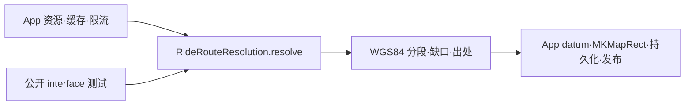

# 架构深化落地 — 2026-10-12

按用户明确选择，落实 #1 乘车路线解析 deep module、#2 中直接相关的 physical-path walk，以及 #3 AI 补全资格统一。基于当前包含前一轮修复的工作区实施，没有回退到 `75031837`；原报告的历史行号不作为当前位置。#4 地图 diff、#5 datum 总拥有者及 Statistics 等其他 stage 不属于本轮改动。

## 结果

### 每次乘车的解析进入 RailCore

[RideRouteResolution.swift](../../../ios/RailKit/Sources/RailCore/Routing/RideRouteResolution.swift) 的 `resolve(Request)` 接收原始/规范化乘车记录及已有源数据、网络索引和时刻表出处，返回逐段 source/drawn WGS84 geometry、物理选择、缺口、时间出处和 disposition。完整顺序在这个 module 内：显式/推断区间、源几何认证、official interval/physical graph 求解、独立区段重试、日期有效性与边界连接证明、历史路径与显示路径对应。

[RiddenRouteStore.swift](../../../ios/RailMap/Infrastructure/Persistence/RiddenRouteStore.swift) 保留资源 IO/富化、输入和派生缓存、worker 限流、datum/MKMapRect 转换、路线缓存与发布。其当前解析函数原本已是 `@concurrent nonisolated`；本轮修复的是策略仍归 app target、完整策略缺少包内测试面的 seam，而不是把它描述成仍在主 actor 上求解。

显式选定区间失败时不偷偷换轨；独立重试只保留能独立证明的腿，不授予直通连接。没有已证明几何时保留 unavailable 结果，不生成站点间直线。原始 train 的策略、规范化日期/区间以及数据库出处分别保留。历史几何不被拉到今日显示线路上。

官方区间索引仍延迟到需要的求解路径才构建：锁保护的 graph-free owner 由 app 原有、最多两项的 revision-keyed 缓存持有。mutable graph 仍归一个顺序 worker；没有新增 unchecked Sendable graph wrapper。输入快照保持自己的有界 memo。native datum/bounds 转换逐段检查取消，并在写缓存前再次检查，保留抽取前该阶段的取消边界。

`RouteSolver` 的 7 个实现方法及 2 个内部载体改成 internal；`public static func` 从本轮前的 36 个减至 29 个。app 不再调用这些求解步骤，缓存装配仍使用必要的 section-boundary 语义查询。预计算缓存的物理选择 metadata 共用 core factory。新生产文件已归入 `ios/source-ownership.json` 的 RailCore 范围。

### PhysicalPathWalk 拥有耦合状态

[RouteSolver.swift](../../../ios/RailKit/Sources/RailCore/Routing/RouteSolver.swift) 的 private value owner 集中 `steps/frontier/arrivedByRail/pending/skippedAnchor` 及不可变的图、日期、hint/anchor 上下文。原 helper 的巨大循环状态参数表消失；原始遍历顺序、1 m 容差、anchor span、日期、identity、junction/connector 限制和终点歧义规则保留。其他算法的 inout 不是本轮批量改写对象。

### 一个 catalog-aware AI 资格入口

[JourneyCompletion.swift](../../../ios/RailKit/Sources/RailCore/Import/JourneyCompletion.swift) 的 `requestEligibility(train:catalogs:...)` 返回已解析 train、denial 和完整资格。完成页、编辑器 adapter 和截图导入均通过它查询。视图不再各自查站点或解析名称。

只接受实际 catalog 所属的 StationKey：未知显式 code 不被名称救回，歧义名称/跨区域重复 source code 不被任意选中。唯一实际跨区域 identity 仍可识别；没有新增 code-prefix 地理猜测。busy/provider 优先级、同一站点上的明确有效时间、编辑器尚未确认的 picker 时间语义及原有研究锚点规则保持。

截图导入继续只提供日本 catalog。Grok 4.7 xhigh 的有界只读查询和父任务核对确认：`TransferGuideImport.entries` 明确说明 Yahoo 日本行程范围，Yahoo/JR East 来源、日文 OCR、Japan clock 和用户指南一致。这是现有产品决定；本轮没有扩大截图解析地区。

## 实际验证

遵循 `ios/VERIFICATION.md`，先源码/依赖 review，协调一个 heavy job，复用 scratch/DerivedData。

- `/private/tmp/jtm-architecture-focused.log`：**56 tests / 4 suites 通过，exit 0**。实际选择为 RideRouteResolution、JourneyCompletion、OnEdgeCertification 的小型 synthetic cases，以及匹配的 JunctionApproach case；不把未匹配的 `EditorAIEligibilityTests` 名称当作执行结果。没有运行 OnEdge suite 的 national-resource census。
- [RideRouteResolutionTests.swift](../../../ios/RailKit/Tests/RailCoreTests/RideRouteResolutionTests.swift) 最终使用普通 `import RailCore`，不访问 solver 内部。**9 tests / 1 suite 通过，exit 0**，日志 `/private/tmp/jtm-architecture-public-interface-final2.log`。覆盖 surveyed bend、无路径/不造直线、独立腿与未证明 boundary gap、同一 worker 下的半开日期范围、显式区间不被替换、recorded-only unsupported、source/drawing 分离及数据库出处、历史路径/出处、pending confirmation。
- 普通 import 检查曾发现测试夹具用了 Provenance 和 Interval 的 internal 构造器，编译失败；改用既有 public JSON decoder、compact-line decoder 和 interval builder。没有为了测试扩大生产 interface，也没有把失败编译记为通过。夹具仅内存中的小型 surveyed 数据，不读全国数据、不写仓库数据。
- `/private/tmp/jtm-architecture-native-build.log`：主 app Catalyst 增量编译通过。补回 native 转换后取消 fence 后，`/private/tmp/jtm-architecture-native-final.log` **最终增量编译通过，exit 0**；复用同一 DerivedData，两个 jobs。仍有既有 UIKit trait-change deprecation 和可选 AppIntents metadata 警告，不声称零警告。
- 两个独立 Sol reviewer 完整复核解析/walk 和 AI 接口/adapters，并复核最终取消 fence 与 public-import fixtures；没有剩余已确认的范围内问题。结果 `/private/tmp/jtm-architecture-review-resolution.md`、`/private/tmp/jtm-architecture-review-completion.md`。父任务核对实际源 diff，不只依赖工作者口述。

代码/测试先后和证据界限：新 tests 在规划 interface 时开始书写，但新 module 在写 tests 期间出现；采集占用 heavy slot 时没有执行 RED。以上是实际编译/通过证据，不宣称严格运行了 red-green。原有独立 topology/parser 测试保留，没有为了新的 seam 删除有意义覆盖。

未运行完整矩阵、旧 runners、全国 builders/census、全树 hashes 或自动循环；没有测量 pixels、geographic residual、leak、性能或取消延迟。native 构建会执行既有 bundle 资源阶段，只写 DerivedData，不等于全国源数据重建。没有提交、推送、发布。

采集聊天获授权协调，暂停原 PID/plan 于 captured 78146、failed 6、pending 14064。此次没有 build Inspector 或替换其 executable/debug library，没有改 capture plan/输出/地理数据。heavy jobs 已退出，owner 确认恢复同一 PID/plan，captured 从 78146 增至至少 78163；既有采集的 failed 从 6 增至 7，失败原样保留，owner 不自动重试。恢复中的旧进程不作为新解析接口运行证据。

设计：[design](../../superpowers/specs/2026-10-12-ride-route-resolution-design.md)。决定：[ADR 0012](../../decisions/0012-per-ride-resolution-and-catalog-eligibility.md)。Exact before copies 留在 `/private/tmp/jtm-architecture-resolution-before`、`/private/tmp/jtm-architecture-walk-before` 和 `/private/tmp/jtm-architecture-completion-before`，保留此前未提交修复与 source moves。
