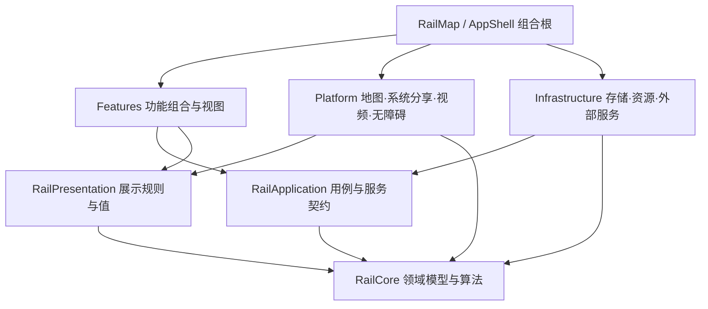

# iOS 全代码库重构方案

> Historical record retained during the 2026-10-10 documentation cleanup. Dates, measurements and unresolved findings below apply to the recorded inputs. Old execution commands are not current instructions; follow [the current verification policy](../../../ios/VERIFICATION.md).

## 第 37 阶段续批（2026-10-09）

核对 Sakura770 新岩国的既有停车→通过修正，修复过时的 marker 总数断言并新增一条精确回归；22项包测试和质量门禁通过，未修改产品数据或 golden。完整验证旧轮在102套通过后因该断言停止，新轮需按171套／1446函数重新验收。全地图直接内核采样仍超过2GiB；Stats、RouteStress、M、完整覆盖率及原性能／泄漏目标继续开放。精确范围见[阶段记录](refactor-phase-commits.md)。

## 第 36 阶段续批（2026-10-09）

使辅助功能容器的形状符合实际工作区视口，修正原始屏幕边界用例；六项原始菜单用例、Debug／双架构 Release 构建及新增 lint 门禁通过，没有新增内存所有者。全地图普通第二轮仍超过2GiB；VM trace 可读不代表内存通过。统计页底部、完整171套／1445函数覆盖率、RouteStress、M 和原始性能／泄漏验收继续开放。精确范围见[阶段记录](refactor-phase-commits.md)。

## 第 35 阶段续批（2026-10-09）

保持根布局的窗口高度，避免键盘展开时改变 resident sheet 的 detent 集合；Compact 内容保持挂载但隐藏，滚动底部含一点评估余量。普通候选三轮共9次菜单原断言、3项编辑、一次日期复核及3项 iPad 检查通过，Debug／双架构 Release 构建和新增 lint 门禁通过。没有新增缓存、监听器或计时器；这些结果不替代全地图 RAM／泄漏及完整性能验收。完整包171套／1445函数覆盖率仍在执行；原始 S0–S6/M 其余门槛继续开放。精确范围见[阶段记录](refactor-phase-commits.md)。

## 第 34 阶段续批（2026-10-09）

Phase33 质量 CI 已通过。Phase34 消除所选日本行程与纽约 DEBUG 相机覆盖同时启动的测试条件冲突，保持原断言及超时；当前版本全部7个相机用例通过，峰值约801MB，未增加生产内存所有者。完整包1445函数／171套件的覆盖率验证仍在执行；全地图2GiB、其余布局／平台及 M 等原始门槛尚未完成。精确范围见[阶段记录](refactor-phase-commits.md)。

## 第 33 阶段续批（2026-10-09）

Phase33 缩小每条普通图边的可选物理接点存储，保持值语义及真实几何。固定日本／台湾 Release 场景三组严格配对通过：稳定内存中位数下降0.65%，峰值下降43.52%；当前 Main32 的双架构构建、原路线／统计测试及零新增 lint 债务通过。保留此前失败样本，稳定占用的小幅变化不外推到全地图。全地图2GiB压力、完整覆盖率、布局／平台及 M 门槛仍开放，整体未完成。精确验证范围见[阶段记录](refactor-phase-commits.md)。

## 第 31 阶段续批（2026-10-09）

Phase30 内存采样 CI 已通过。Phase31 用现有所选记录与 active ticket 的完成状态消除分享导出启用时序问题；原三次串行分享和 Console 全流程、13 查询检查、58 生命周期检查、App 构建及零新增 lint 债务通过。保持批量失败的未知里程展示和重试，未增加持久内存所有者，未放宽原断言。精确范围见[阶段记录](refactor-phase-commits.md)。这是功能收口，不宣称配对 RAM 或零泄漏通过。菜单候选重新展开输入仍失败，未交付；严格内存、完整覆盖率、平台、目录及 M 门槛仍开放，整体未完成。

## 第 29 阶段后的当前验收入口（2026-10-09）

本节覆盖下方历史时点，原始 S0–S6/M 门槛不变。Phase28 `bf70a5ad` 已推送，CI 37950156025 SUCCESS；Phase29 从该基线提取统计线路展示规则到 RailPresentation，保持原数据所有权、顺序、身份和 Double 数值，不增加加载、缓存、任务或持久状态。5 个定向测试 / 8 个用例、六类别旧规则等价、App Debug 构建、281 项生产归属、509 Swift 的 270 旧 findings / 零新增债务及格式检查通过；原统计日历和年度流程通过。分享导出失败已在原 Main28 二进制复现，仍开放；本阶段不声称实测 RAM 减少。

- 内存候选仍未合入：Edge stride 824→184；原 25 项历史包候选通过，实测峰值 686,917,168 B。但双地区 Release 三组配对稳定中位数 438,587,016→517,606,616 B（+18.02%，FAIL），峰值 1,201,524,168→673,287,240 B（-43.96%）。不能以峰值改善抵销稳定占用失败。同一候选 Debug 地图另触及 2,344,833,608 B，原断言与 2 GiB 守卫不放宽；配对时存在其他验证负载，不能作为安静性能验收。
- 当前 Main 包验证：原 1,437 函数 / 169 套插桩清单已确认前 63 套通过；第 64 套原 RailHistoryPackageTests 触及 2,204,289,640 B，被守卫中止。完整包及 Domain/global coverage 未通过；候选历史包成功不替代 Main 或剩余套。先前失败及短套采样缺口保留。
- 后段 iPhone UI 的 24 次原选择运行完成：63 PASS、13 FAIL、11 SKIP，共 87 项，不能称完整 137 项 / 39 类矩阵通过。失败覆盖缩放、菜单布局、压力往返、站点、日期及一次五地区输入选择错误。输入错误保持原失败记录，纠正夹具后同 Main 原五地区公开路线/统计测试通过，112 样本、单 PID、峰值 1,249,725,920 B；不等同于配对 RAM 或泄漏验收。

继续关闭实际内存及功能失败，完成全量覆盖率、责任目录、iPad/Catalyst、启动/首图/stall/增量构建/泄漏及 M；整体仍为**执行中，未完成**。CLI 工作树不包含于本阶段，临时 outputs/tmp 收据的精确摘要以此提交和[阶段记录](refactor-phase-commits.md)为准。

## 第 26 阶段后的当前验收入口（2026-10-09）

此节更新下方第 18 阶段时点的“当前”状态，原始 S0–S6/M 目标及门槛不变。已推送 `main` 为 `922b7541b0e5048ca6f95269437055f726adf7a9`，阶段 20–26 的实现和精确验证见 [阶段交付记录](refactor-phase-commits.md)。并行 CLI 工作树不属于这些提交的验收。

- 质量：固定版本复杂度 >15／函数长度 >60 校准已交付；新增 lint 债务硬门禁已接入 CI 并通过，保留 270 条既有全 Swift 清单 findings，不用删除旧债抵扣别处新增。生产代码既有 167 条及通常 ≤10／≤40 目标继续开放；格式检查仍为 advisory。
- 功能：原 Console 分享 composer 流程、两个组名编辑/保存重启、两个本地自动填入/Undo/pending 服务保存重启分别通过。Undo 保留精确草稿相等守卫，先同步派生方向再捕获快照。五活动地区真实行程全部公开路线生成及 All regions 统计检查通过；该次峰值 1,188,285,896 B，只证明预算内正确性，不是五地区配对 RAM 或泄漏验收。
- 当前完整包：全部 1,437 注册函数、169 套的覆盖率插桩清单按套执行中；337 个服务 pattern 的 674 次 required/optional 检查已全通过，实测峰值 1,277,986,616 B。其余套及 Domain/global 导出未完成前，不宣称整套或覆盖率达标。先前失败及短套采样缺口保留。
- 当前设备矩阵：Main26 精确 507 Swift 文件与实际二进制测试清单一致，137 项/39 类；尚未执行的后段功能已继续逐类验证。旧全矩阵失败、当前缩放 150 ms 门槛失败仍开放，不能把独立修复收据累计为当前全平台 PASS；并行验证也不能替代安静环境性能对照。
- 内存：原双地区 Release 三组对照稳定 footprint -0.54%、峰值 -20.43% 的范围不扩大。区域切层/平移仍会超过 2 GiB：稀疏精确 junction 查询和单帧几何缓存候选分别触及 2,251,821,856 / 2,551,501,816 B，均未交付。Main26 DEBUG 诊断第七次全国图构建期间触及 2,205,766,504 B；事件证实 fallback 活动，尚未归因分配者。下一步细分真实构图峰值，铁路源顶点、拓扑、日期及 pending 守卫不变。
- M：同一静态五姿态公开路径检查证实 iOS 默认参考 5,000 顶点及逆 map-point 偏差 0、所有显示 scale 为 3；像素/同步门槛仍未通过。exact 参考控制具有不同实测描边宽度，不能当作等效精度对照。仅保留诊断候选，不进入默认地图。

继续顺序为关闭实际内存/功能失败、完成全部测试与真实覆盖率，再验收责任目录、iPad/Catalyst、启动/首图/stall/增量构建/零确认泄漏和 M。每个独立验收阶段 commit 并 push main，整体状态仍为**执行中，未完成**。本地 `outputs/` 与 `/private/tmp` 收据是执行附件，精确摘要保存在提交内；临时文件不作为可永久克隆的证据。

## 2026-10-09 最新交付核对：原始路线图继续执行

本节覆盖下文历史段落中的“当前”“最新”“未提交”等时点表述；原始 S0–S6/M 设计继续作为主计划。原始核对基线为 `14d294653fa11e87b6fbfbe3b4eba43f40b65225`，本节生产实现基线为已推送的 `f240ada65564466af2c74de59c2ba98ad32a6b9e`。工作区另有 CLI 数据、分享、新建行程和地图修改，不能把工作树等同于提交版本。逐阶段源码、验证范围和失败收据见 [阶段交付记录](refactor-phase-commits.md)；该记录是本计划的证据账，不替代本计划。

用户已授权自动完成重构，并要求每阶段 commit/push `main`、严格减小 memory footprint。已交付 18 个独立阶段，保留 CLI 的未提交内容和两项暂存图标删除。

| 原始目标 / 批次 | 当前提交证据 | 尚需完成的验收 |
| --- | --- | --- |
| S0 / PR-00：资源、归属、冻结基线 | 资源打包可重复；源码归属 280 项、7 checker 与永久字号门禁通过；固定 Main 资源验证无 LFS 指针 | 当前全量测试及全平台矩阵；旧全量进程峰值 2,286,816,064 B 被 2 GiB 守卫中止，未豁免 |
| S1–S3：责任、依赖与生命周期 | Application dated physical proof、地图标签碰撞/选中站点、分享 composer/render owner、NewTrip 保存验证已逐批接线并定向验证；保持三 target 依赖边界 | 稳定功能目录迁移及所有受影响用户流程；不得仅凭文件变短判定完成 |
| 热点 / PR-05：严格降低内存 | 图/输入/显示/统计缓存有界，重型工作串行，取消后拒绝过期结果；Phase 18 的真实 JP/TW Release 三组对照：稳定中位数 418,910,024 → 416,632,456 B（-0.54%），峰值 1,521,208,992 → 1,210,404,320 B（-20.43%） | 仅双地区夹具通过，尚非五地区或零泄漏验收；Phase 17 稳定 footprint +17.37% 的失败保留。Tokyo builder CPU 中位数 +11.25%，后续优化需实测 |
| S4：行为回归 | Compiled graph、严格物理拓扑、缓存取消、日期证明、分享、NewTrip 与双地区真实路线/统计均有局部通过记录；历史 browser boundary 全断言单独通过，峰值 1,938,131,584 B | 当前 Main 全部 SwiftPM：覆盖率插桩构建通过，完整测试清单按套新进程执行中；不得把局部测试相加宣称整套通过 |
| S5：coverage 与质量 | 已交付 LLVM 导出、changed-lines 工具和固定版本 advisory CI；Application 局部 445/464 行 95.905%，该批 changed-lines 49/49 100% | 原目标 changed-lines 75%→85%、Domain/UseCase 80%→90%、global 70–80% 且不回归；需全模块真实覆盖率。复杂度 >15/通常≤10、函数长度 >60/通常≤40、新增 lint 0 尚未完整执行 |
| S6：设备与性能 | 多批 Release arm64/x86_64 构建及定向公开 UI 通过，收据按阶段绑定源码身份 | 全 iPhone/iPad/Catalyst 回归、启动 P95 -15%、首图 P95 -20%、stall -30%、增量 Debug ≤+10%、峰值及零确认泄漏；旧设备记录不可冒充当前整套 |
| M：单地图全视口固定遮罩 | 默认生产方案未替换；公开转换 frame-leading 实验仍有 3–4 device px 偏移及 347.675 ms 帧间隔，NO-GO | 满足底图上/自有铁路下、全视口约 10%、单地图/public API、相机动作和设备性能后才可交付；不放宽 1 px / 150 ms，不改为瓦片遮罩 |

继续顺序：先完成当前 Main 的全量测试和覆盖率，修复实际失败及图构建 CPU/内存热点，再完成质量、设备/性能、稳定责任目录和 M。每个可独立验收阶段都提交并推送 `main`；未运行、失败或未测量项目继续列为开放项。铁路源顶点、真实连接、历史日期、里程和用户 pending 语义不为满足预算而修改。

本地原始收据位于 `outputs/refactor-20261009-resume/`，可能不随 clone 携带；可持久审阅的源码/结果摘要保存在提交内的阶段记录，CI 链接见 Phase 4。整体重构仍未完成。

原计划日期：2026-10-03；最新路线图核对：2026-10-08。状态：**结构迁移、北美退役与严格物理拓扑边界已有落地记录；整体验收仍未收口。最新执行入口见下方核对章节，历史进度见 [执行记录](refactor-execution-2026-10-03.md)。**

本方案覆盖整个 `ios/` 的生产代码、测试、资源装配与相关 CI。采用责任边界迁移，保留已验证的领域算法和活动五地区的用户数据格式；北美数据与兼容功能已按用户要求退役。地图整屏遮罩属于单独的渲染行为变更，不能用目录拆分或普通 MapKit overlay 冒充完成。

## 2026-10-08 外部路线图核对与下一批执行计划

自动执行的冻结输入、修复与最新门禁结果见 [本轮执行记录](refactor-execution-2026-10-08.md)。

2026-10-09 续批：显示网络/合并 scope 缓存共用一个槽、布局 seed 一个槽、重型构建串行，并补原 actor 生命周期检查。详见执行记录；切地区冷暖时延与整 App 峰值仍需实设验收。CLI 正在独立优化 NewTrip 校验，本批避免修改其文件。

**最新优先级：严格降低内存 footprint。** 先收口图缓存和求解并发，再继续目录迁移。App 图缓存跨全图/区域/走廊最多保留一张、100,000 节点；超限图只用于当前求解，不能裁剪物理铁路来满足预算。求解并发固定为 1。以固定输入对照真实 physical footprint；节点预算不等同于字节上限，Host 结果不能代替 iPhone Release 验收。验证使用小规模输入与受控编译并发，暂停已观察到 17.8 GB 的全量历史基线。

本节是本次核对后的执行入口；后文保留原 S0–S6/M 设计和历史证据。最初核对阶段范围为**核对报告、更新可执行计划**；用户随后授权开始执行，并要求考虑 CLI 中正在运行的任务，实际进度见下方执行补记。外部报告中的 PR 编号为候选批次，不表示已经创建 GitHub PR。

### 核对基线与本次实际结果

- 当前 HEAD 为 `14d294653fa11e87b6fbfbe3b4eba43f40b65225`，与附件一致；工作区存在大量已修改及未跟踪文件，HEAD 不能代表此次读取的源码。下一执行批次须记录 HEAD、工作树 diff、未跟踪文件清单及资源 revision，并确认文件 owner，保留已有修改。
- 本机当前工具链：Xcode 27.0（27A266a）、Apple Swift 6.4、arm64 host。CI 配置使用 `xcode-27` runner；本次没有核验 runner 在线状态、可用模拟器或远端 required-check 设置。
- 本次实际运行 `./ios/verify.sh --boundaries`：永久字级限制检查 PASS；源码归属检查 FAIL，原因为 `ios/RailMap/StatisticsArea.swift` 未登记到 `ios/source-ownership.json`。脚本在此退出，后续 checker 自测未运行。该文件是当前未跟踪源码；本次不替其 owner 修改实现或清单。
- 本次未运行 app/Catalyst build、完整 SwiftPM、native harness、UI、coverage 或 Instruments。后文执行记录中的通过和失败均是历史结果，不能回填为今日基线。
- [执行记录](refactor-execution-2026-10-03.md) 后段的较新完整包记录为 exit 1：Core Swift Testing 853 tests / 106 suites、105 issues，全部归于 TrainServicePatternRouteTests；Presentation 333、Application 26、Core XCTest 48 项记录通过。它取代早期 166 issues 作为“最后记录结果”的参考，但该次编译后仍有业务改动，不能作为当前工作树通过证明。同记录中明确已清理的临时收据，不应再宣称可访问。

### 附件建议与当前实现的差异

| 附件建议 | 当前可核对证据 | 执行调整 |
| --- | --- | --- |
| 从 Feature MVVM + Domain/Repository 建立边界 | [Package.swift](../../../ios/RailKit/Package.swift) 已有 RailCore、RailPresentation、RailApplication；[归属清单](../../../ios/source-ownership.json) 已列功能 owner 与验证入口 | 延续现有编译边界；Presentation/Application 各自依赖 Core，互不导入。不为套用模板新增 ViewModel 或通用 Repository |
| 首先把 RailMapView 的计算移出 View | [RailMapView.swift](../../../ios/RailMap/RailMapView.swift) 为 4,765 行，但已有 Coordinator、MapStationLabelCoordinator；[MapLineGeometry.swift](../../../ios/RailMap/MapLineGeometry.swift) 已承接几何准备 | 行数只作为阅读热点。先验证剩余标签布局/命中/挂载职责，再选一个可独立测试的 seam；不复制现有 builder/controller |
| 将 parsing/route 工作移出 MainActor | [RiddenRouteStore.swift](../../../ios/RailMap/RiddenRouteStore.swift) 已有 `@concurrent` 解码/求解及 revision/ticket 接纳；[RailNetworkStore.swift](../../../ios/RailMap/RailNetworkStore.swift) 已有后台加载 | 追踪实际主线程耗时后再改；保留取消、旧结果拒绝、渐进发布与权威状态 owner |
| 从零建立 CI 与性能测量 | [verify.sh](../../../ios/verify.sh)、[Port parity](../../../.github/workflows/port-parity.yml)、[UI smoke](../../../.github/workflows/ios-layout-smoke.yml)、[RailSignpost](../../../ios/RailMap/RailSignpost.swift)、[RailBench](../../../ios/tools/bench/README.md) 已存在 | 先恢复当前门禁并补设备测量记录。Host arithmetic benchmark 不能证明 MapKit 帧时或启动改善 |
| 导入 SwiftFormat/SwiftLint/Sonar/Danger | 本次文件检索未发现这些工具的仓库配置 | 作为后续评估项；先固定工具版本、检查范围、legacy baseline，初期 advisory。不因缺少工具名称阻断现有行为验证 |
| PR-02 大范围搬目录，PR-07 再补测试 | 已有模块边界、源码路径契约，且工作树包含并行功能修改 | 每次抽取同步补行为测试；目录移动等 owner 稳定后单独处理。保留本文件作为唯一主计划，不另起平行路线图 |

产品约束以 [AGENTS.md](../../../ios/AGENTS.md) 为准：永久字级范围、iPhone 竖屏、北美退役、严格物理铁路连接、全视口底图遮罩层级均须保留。物理连通缺口与 legacy parity 差异分开登记；不得添加邻近/同名桥接或刷新 golden 来让结构重构通过。现有计划 M 的 NO-GO 是历史状态，本次未验证新渲染实现，不能宣称遮罩已完成。

### 可独立评审的执行批次

每批开始先指定唯一负责人及文件白名单。以下 owner 是责任角色，尚未分配具体人员；时间按前置验收推进，不沿用附件的固定八周日历。

| 批次 / 优先级 | Owner、文件范围与交付 | 前置与验收 | 回退 |
| --- | --- | --- | --- |
| PR-00A / P0：恢复基线入口 | 统计功能 owner + 验证 owner；核对 StatisticsArea 的统计职责、实际 target 成员及资源装配，再仅更新 `source-ownership.json` 对应 group；在本节登记当前工作树身份和 gate 结果 | 无；`verify.sh --boundaries` 全部通过，保留 checker 断言。当前仅确认缺少归属；不预判其他门禁全绿 | 撤销本批清单差异，不删除新增统计源码或既有功能改动 |
| PR-00B / P0：重建行为与性能基线 | 验证 owner；本文件、既有执行记录和功能矩阵中的基线记录；复跑 native、完整包、app/Catalyst build、关键设备流程；使用现有 signpost/bench 记录数据身份和性能 | 00A；结果按 PASS/FAIL/未运行列出；每个失败附复现命令、日志、所属契约和 owner。性能必须有固定设备/OS/Release 配置、冷暖缓存与重复次数 | 仅撤销记录/测量配置；保留失败证据，不改生产行为 |
| PR-00C / P0：既有行为缺口分流 | 路线/编辑 owner；先复核执行记录提出的 RouteConfirmationRepair 明确 pending 迁移、TripRoutePlanner/NewTripView 全程确认问题，以及 TrainServicePatternRouteTests 历史失败；确认仍存在后分别列源码/测试白名单 | 00B 的冻结输入；先用当前源码复现并分类，不依据旧 review 直接改实现。确认为产品缺陷的行为修复须先于相关结构提取；严格物理端点证据、用户明确 pending 与服务显示保持各自契约 | 每个行为修复独立撤销，不混入地图提取或 schema 变更 |
| PR-01 / P1：有证据的清理 | 对应功能 owner；00B 后列精确候选白名单，初期不批量格式化 | 编译引用、运行时/资源引用及人工审核共同确认；受影响检查通过。Periphery 若引入先 advisory；数据生产工具与离线归档不按“无 Swift 引用”删除 | 逐项恢复本批删除；不重置整个工作树 |
| PR-03/04 / P1：一个地图职责提取 | 地图 owner；`RailMapView.swift` 内 MapLabelCollisionGrid/标签布局是候选，相关 MapStationLabelCoordinator、归属清单及新测试按实际 seam 列白名单 | 00B 已区分现有失败；明确坐标/样式/命中/缓存生命周期合同。相同输入结果等价，native 及相应站点、图层、相机 UI 回归通过；不引入新渲染器 | 撤销单个抽取，保留外部接口与既有几何算法 |
| PR-05 / P1：已测热点优化 | 性能 owner + 对应地图/数据 owner；仅修改 trace 指向的函数和相关回归 | 00B 同设备重复基线，结构抽取先完成；先通过语义等价、取消/过期结果测试，再比性能预算。没有 trace 证据则不安排 CPU/缓存重写 | 撤销优化差异；只有实际双实现且值得保留时才加短期 adapter，不预建 feature flag |
| PR-02 / P2：目录迁移 | 功能 owner + 构建 owner；一组功能文件、Xcode 引用、归属清单、路径型 harness | 并行修改与 owner 稳定；move-only，无逻辑修改；边界、相关 native、app/Catalyst 构建通过 | 逆向移动并恢复引用；保留期间功能修改 |
| PR-06/07 / 随批执行：数据合同与回归 | 数据/功能 owner；仅在发现真实边界缺口时抽 DTO/repository；每次实现同步加入相关单元、集成及 UI 验证 | 不等“测试阶段”才补；保存队列、备份交错、取消、缓存身份、历史日期、pending 路线及五地区数据往返可复现；schema 变化单独立项 | 恢复该 seam 的原实现；schema/资源变更独立回退 |
| PR-08/09 / P2：质量 gate 与可选模块化 | 验证/架构 owner；工具配置与 CI，或一个已稳定功能 target；两个主题分批 | 00B 覆盖与构建时间已有实测；新 gate 先 advisory。新增 module 必须说明隔离或构建收益，且依赖无环；没有收益证据则保留当前三 targets | gate 退回 advisory；撤销单个 target 拆分 |

**实施从 PR-00A 开始，结果见下方执行补记。** PR-00B 可逐项积累证据，但在当前工作树和资源身份未固定时，不做候选与基线性能归因。完整包存在历史失败，必须当前复跑后分类；既有失败既不能自动豁免，也不能归咎于下一次重构。

本次 Grok 4.7/xhigh 仅作限定文件的只读核对，Codex 复核并采纳了三 target 已存在、后段 105 issues 历史记录、行为缺口应先分流及临时证据生命周期的建议。Grok 未运行测试、未修改文件；其旧行号和推断不作为当前源码的验证结果。

### 执行命令与证据格式

从仓库根目录执行。完整包/设备验证耗时较长，应分批保存日志；运行前确认 scratch 与已有任务无冲突。

```sh
./ios/verify.sh --boundaries
SCRATCH=/tmp/jtm-roadmap-native ./ios/verify.sh --native
SCRATCH=/tmp/jtm-roadmap-swift ./ios/verify.sh --swift
SCRATCH=/tmp/jtm-roadmap-app ./ios/verify.sh --app
xcodebuild -project ios/RailMap.xcodeproj -scheme RailMap \
  -destination 'platform=macOS,variant=Mac Catalyst' \
  -derivedDataPath /tmp/jtm-roadmap-catalyst build
xcrun simctl list devices available
```

`--native` 不执行完整包测试；`--swift` 包含完整包与 app 验证，但不包含 UI。UI 流程从归属清单和功能矩阵选取；以实际可用 simulator/OS 指定 destination，不复制附件的 `JTM` scheme。性能复用 RailSignpost 的录制入口和 RailBench README，设备轨迹至少覆盖冷启动、首次可用地图、大数据平移缩放、站点选择、播放及反复进入退出。

每次记录必须包含：日期、HEAD、工作树 patch/未跟踪输入身份、数据 revision/hash、工具链、设备/OS、配置、命令、退出码、原始日志/xcresult/trace、结果与未覆盖项。性能另记录冷暖缓存、样本数、P50/P95/帧时分布、峰值内存和测量噪声。临时目录只存本地证据；PR/CI 长期证据应保存为 artifact，并在执行记录链接，不能只引用会被清理的 `/tmp`。

### 质量目标与交付判定

附件中的 changed-lines 75%→85%、Domain 80%→90%、启动 P95 改善 15%、地图 20%、stall 30%、内存 5% 和构建 10% 都是**待评估目标，本次未测量、未启用**。先确定 coverage 导出/差分口径、当前值及代表数据，再冻结各类变更的阈值；纯提取要求行为和性能不回归，不能为满足百分比做无证据优化。函数长度/复杂度用于选 review 热点，不作为强制切文件指标。

单批完成条件：相关构建和行为检查通过，未运行项明确标记；当前基线失败与新回归有依据区分；不新增依赖违规；性能变更有同条件前后证据；新文件登记 owner；回退只涉及本批差异。完整重构完成仍须满足后文第 2 节及功能矩阵，不能以清单登记、定向测试通过或文件变短代替整体验收。

### 2026-10-08 执行补记：PR-00A 与隔离基线

用户已授权开始实施。本批只修改 `source-ownership.json` 的一行登记及本计划的状态记录；不修改其他任务的统计分区、路线、新建行程、资源或 UI 实现。

并行工作核对：本聊天没有附加 app terminal；通过只读进程检查及本项目 CLI 近期任务记录，确认 `JTM NewTrip 1` 上的新建行程/保存 UI 测试正在运行，数据整合及服务图标收集任务也仍有进程；统计分区任务刚完成一次实现。进程存在不等于这些任务成功完成。本批不停止进程、不复用其 scratch/模拟器、不发送消息或更改其任务。设备及性能基线等待并行任务释放对应资源后执行，当前不得宣称已测量。

| 检查 / 交付 | 本次结果与范围 |
| --- | --- |
| 新源码归属 | `StatisticsArea.swift` 包含统计地区、StatisticsScope 和 JapanAreaGrid，登记到既有 `statistics-passport` group；没有新建架构层或改变模块依赖 |
| Target / 资源静态核对 | Xcode 的 RailMap target 使用 `PBXFileSystemSynchronizedRootGroup` 纳入 RailMap 目录，没有该文件的排除项；`jp-area-grid.json` 与源码同目录，JapanAreaGrid 按 bundle 名称读取。这里只核对装配定义，未运行新 bundle 的资源加载验收 |
| 修改前 boundaries | FAIL：StatisticsArea 未登记；永久字级检查 PASS；checker 自测尚未运行 |
| 修改后 boundaries | PASS：275 个生产 Swift 源文件归属完整；永久字级检查 PASS；7 项 checker 自测通过；门禁退出码 0 |
| 并发变更检查 | 对归属清单、StatisticsArea、区域 grid、Xcode project、verify.sh、本计划的前后 SHA-256 核对，在更新本计划之前仅归属清单发生预期变更；这不代表整个工作树已冻结 |
| RailKit 隔离输入 | 复制 Package.swift、Sources、Tests 等 package 文件，排除 `.build` / `.swiftpm`；283 文件、20,086,717 bytes。原文件复制前后与快照 SHA-256 全部一致，使用独立 build/cache 目录，不使用正在变化的 checkout 编译输入 |
| Application 测试 | PASS：隔离快照 26 tests / 4 suites，0.015s，退出码 0；该时间仅为测试执行，不含初次编译。首次运行因主机沙箱禁止写 ModuleCache，在 manifest 编译阶段退出 1，尚未执行测试；受控提权重跑成功 |
| 编译警告 | 3 处：StationIntervalResolver.swift:259 不可达分支；PhysicalEndpointTrimTests.swift:388、418 未使用表达式。未修改其他 owner 的实现，不记为无警告门禁通过 |

本批证据目录为 `/tmp/jtm-refactor-start-20261008/`：`before.json`、`status-before.txt`、`source-ownership.before.json`、`boundaries-before.log`、`boundaries-after.log`、`changed-since-before.json`、`railkit-snapshot-sha256.json`、`application-tests*.log` / `.exit`。它们是本机临时证据，不是已上传的 CI artifact。快照仅固定 package 输入，不包含完整仓库数据 fixture，不能据此直接启动所有 Core/Presentation 数据测试。

本次 Application 命令（`--jobs 2` 限制并发；首次 SwiftPM 仍会编译所有测试 targets，实际只执行过滤后的 suites）：

```sh
swift test \
  --package-path /tmp/jtm-refactor-start-20261008/snapshot/ios/RailKit \
  --scratch-path /tmp/jtm-refactor-start-20261008/package-build \
  --cache-path /tmp/jtm-refactor-start-20261008/package-cache \
  --jobs 2 --filter RailApplicationTests
```

PR-00A 的源码归属修复已完成；PR-00B 仅推进独立 package 输入与 Application 聚焦基线。完整包、native、app/Catalyst、设备 UI、coverage 与性能均未在本批验收。后续继续保留并行任务的成果，在它们明确完成并固定输入后，按上表复跑当前行为基线和 PR-00C 缺口分流。

## 1. 依据与本轮已完成事项

方案结合本地代码检查、Grok 4.7/xhigh 的只读清点、GPT-6.1 Sol/medium 对旧计划的核对，以及 [ChatGPT Pro 架构咨询](https://chatgpt.com/c/6ac0946b-2768-83ea-8eee-77f6f7cf8a78)。网页使用 Chat 模式与 Pro 档位，已读取完整答复；咨询没有执行本地代码。最终取舍和事实核对由 Codex 完成。

本轮清点的六个源码目录如下，排除同步冲突副本；它们是目录级统计，不代替 S0 的编译 target 成员核验。

| 目录 | Swift 文件数 | 行数（含注释） |
| --- | ---: | ---: |
| `RailMap` | 147 | 62,757 |
| `RailKit/Sources/RailCore` | 71 | 38,727 |
| `RailKit/Sources/RailPresentation` | 29 | 5,152 |
| `RailKit/Tests/RailCoreTests` | 102 | 28,245 |
| `RailKit/Tests/RailPresentationTests` | 30 | 5,218 |
| `RailMapUITests` | 33 | 7,799 |
| 合计 | 412 | 148,552 |

生产代码 247 个文件、106,636 行。规模用于评估迁移范围，不作为拆分目标。较大的协调入口包括 `RailMapView.swift`（4,754 行）、`RideEditorView.swift`（3,699）、`ContentView.swift`（2,982）、`RiddenRouteStore.swift`（2,030）、`RailNetworkStore.swift`（1,782）、`StatisticsView.swift`（1,701）。这些是读取时快照，工作区仍有并发修改。

已经确认的现状：

- `AppShell.swift` 中的 `ContentView` 创建共享 stores 和唯一 `PlaybackController`；`ContentView.swift` 中的 `RailWorkspaceView` 连接地图、工作区和呈现。
- `WorkspaceTabs`、`WorkspacePanelPage`、`WorkspacePanelActions`、`WorkspacePresentations`、`WorkspaceSheetContent` 已存在，不能重新列为待从零提取的模块。
- 地图已有 `RailMapController`、`MapNetworkBuildState`、`MapNetworkGeometryCache`、`MapOverlayInstaller`、`MapLineGeometry`、`MapPlaybackLayer` 等边界。
- `ImportFlow` 已捕获 store generation，提交时及备份挂起后均核验；`RiddenRouteStore.resolve` 已使用 `@concurrent` worker、取消、loadRevision、per-ID ticket。后续应验证并保留，不能按旧计划重新修一次。
- `RailCore` 的实际边界是 Foundation 加只读时刻表 SQLite 例外；`RailPresentation` 依赖 Foundation/RailCore。以 `RailKit/Package.swift` 和当前导入为准，旧文档的“仅 Foundation”描述不完整。
- `REFACTOR_EXECUTION_PLAN.md` 的 2026-09-07 验收及 `AUDIT_PLAN.md` 的旧故障是历史记录，不是今日测试基线。旧的“取消平行车道”等结论也不适用于现有 `MapLineGeometry`。
- 本轮已移除线路高亮时的 `.default`/`.muted` 底图配置切换，更新两处现有测试预期，并完成 arm64 iOS Simulator app build。日志：`/tmp/jtm-remove-highlight-dim-build.log`。本轮没有运行完整 UI 或全部单元测试。

## 2. 重构范围与完成定义

最新产品边界和路线验收以 [功能矩阵的最新规则](refactor-feature-matrix.md#最新产品规则与待办范围2026-10-03) 为准：优先核验有依据的直通轨道连接；只有唯一可达且搜索未截断才自动填入区间和推测通过站。行程继续显示推测通过站，默认“通过、时刻未知”，不据此推断停车。多路径支持地图点选与 VoiceOver 卡片；不确定时保存待确认，不强连、不计未确认区间的精确里程。直通车名称和运行系统独立保留。

北美 US/CA 功能和兼容链已移除，仅留仓库备份；Root 已核验三份归档清单的大小/hash 及精确库存覆盖：171 + 21 + 810 = 1,002 个唯一 payload 文件；raw 810 项为当前归档基线，不能作为迁移前原件字节一致的独立证明，编号与兼容功能不列待办。iPhone 已配置永久仅竖屏；scene 根及 UIKit preferred-font 的字号永久限制为 `.xSmall ... .xLarge`，iPad 继续支持四种方向；当前 app/native 构建门禁已通过，iPhone 8 项与 iPad 4 项字号/方向相关检查通过，两台实设系统 AX5 均观测 xLarge；其他设备行为继续按矩阵验收。Web 后端与 Web 工作区不属于本轮 iOS 重构未完成项。设计文档其余后续方案须先确认是否纳入交付范围。底图不透明度与全屏变暗合并验收固定、轻微的整屏遮罩，层级在底图与铁路之间，不新增透明度滑块。


当前用户已明确授权物理连通规则改造：App 使用按轨道身份隔离的 `.physicalRailway` 图与 `.physicalRail` 求解，换乘、同名、邻近和显示直通不再建立列车连接。只有有证据、真实已有同坐标端点、日期有效的 PhysicalJunction 可加入零距离接续；求解几何仅使用源轨道顶点，不补显示站点/continuity anchor 直线。既有直通显示目录独立保留；旧 parity 显式验证旧图契约，新独立测试验证物理正确性。

覆盖仍有明确缺口：五地区清点 756 个源属性轨道身份及 829 个共享源顶点候选，候选未逐条审查、不会自动入图。四个东京已审查接续在完整日本源图被接纳，最新 18 项独立拓扑检查通过（已包含于 40 项 / 4 suites 聚焦检查）；不能据此宣称全网真实接续齐全。其余接续需追溯来源、方向/层级/日期与几何后再加入独立证据目录，未确认区间继续保留未解决状态。本轮 app、最新整套 native（含新 production component）与 Catalyst 构建已通过，实际 Catalyst 嵌套编辑取消无崩溃；完整 Swift 已结束且整体失败：Presentation 333 与 Application 25 项通过，Core Swift Testing 837 项运行、166 issues（路线 57、History 109）；旧 XCTest 缓存/策略断言另行三项修正后通过，不能替代整套复跑。两个 browser golden 的 History 聚焦复跑已失败（10 issues / 419.913s）；返回结果的源顶点、源长度、无 connector 断言通过，生产守卫与原 golden 保留；详见 [物理路线缺口](../routing/physical-route-gaps-2026-10-03.md)。七条修复定向 UI 流程已在不同轮次分别通过，最终分享覆盖两种图像各明暗主题及日期/地区断言，不等于完整 UI suite 通过。

范围包括工作区/导航、地图/站点/命中、行程编辑、路线求解与发布、统计/Passport、历史日期、时刻表、播放、文件导入、图片/视频导出与分享、数据管理、设置/本地化、AI 服务适配、持久化、缓存、资源工具和验证流程。

“完整重构完成”要求同时满足：

1. 每个活动源文件都有责任归属、依赖方向、状态所有者和对应验证入口。
2. 跨功能共享状态只有一个权威所有者；页面不会为了迁移再创建地图、播放器或同一份可变 store。
3. 副作用通过少量明确边界调用；用例能够用确定输入、受控时钟/挂起点和替身服务验证。
4. 所有现有功能完成迁移矩阵核对，临时桥接已删除，或记录为有理由的长期边界。
5. 活动五地区的数据兼容、当前基线回归、支持平台构建、资源可复现及性能门槛都有实际记录。
6. 全屏遮罩单独标记“已验证上线”或“未实现”。渲染原型失败不阻止其余结构重构，但不能宣称遮罩需求完成。

不以缩短文件、增加协议数量、统一采用某个框架作为完成标准。保留 SwiftUI/UIKit/MapKit、iOS 17+、iPad 和 Mac Catalyst。没有理由时不更换 TCA、SwiftData、MapLibre，成熟的 `OverlapLanes`、`ContinuousStroke`、`Statistics` 和时刻表匹配算法继续保留；`RouteSolver` / `RouteGraph` 的本轮变更限于上述用户授权的物理身份、接续和遍历边界，独立测试与旧 parity 分开记录。

## 3. 目标结构与依赖

首轮最多新增一个 `RailApplication` package target。Features、Platform、Infrastructure 先是 app 内责任分区，不立即全部变成 framework。先抽取责任，再安排物理移动，避免跨数百文件搬迁与行为变更混在一起。



箭头表示编译依赖，具体服务实现由组合根注入。`RailApplication` 与 `RailPresentation` 不互相依赖：前者处理用例输入输出，后者把结果转换为展示决策。若抽取时需要相互导入，先重新检查责任或共用值类型归属。

建议目录（拟议，不表示本轮已创建）：

```text
RailMap/
  App/                    AppShell、启动与依赖装配
  Features/
    Workspace/            页面组合、局部呈现、筛选和搜索
    Journeys/             列表、详情、编辑器、行程分组
    Statistics/           统计与 Passport 页面、展示组合
    Timetable/            搜索、发现、匹配与服务选择
    DataManagement/       导入、备份、数据管理
    PlaybackExport/       播放入口、导出流程界面
    Settings/             显示设置与偏好
  Platform/
    Map/                  MapKit 桥接、相机、铁路、站点和命中
    Media/                图像、视频、系统分享适配
  Infrastructure/         存储、资源、缓存、网络与认证适配
  Localization/           本地化资源与显示格式
RailKit/Sources/
  RailCore/               保留领域规则与 SQLite 例外
  RailPresentation/       保留无 UI 框架的展示规则
  RailApplication/        逐项加入确有独立测试价值的用例
```

`PassportWorkspaceView` 归属 Statistics 功能；共享卡渲染使用 Platform/Media，播放与视频导出调用 PlaybackExport 的既有流程。Statistics 对这一整条用户路径负责验收，不能在两组模块之间遗漏。

`History` 是跨路线、日期、展示的领域能力，不为目录整齐复制成另一套数据源。地图平台代码仍留在 app target，避免为了 SwiftPM 主机测试将 UIKit/Catalyst 条件编译扩散到领域包。

## 4. 状态与副作用所有权

| 责任 | 当前入口 | 目标边界及不变量 |
| --- | --- | --- |
| 生命周期和依赖装配 | `AppShell.swift` | 保留共享 store、单一地图/播放器生命周期；创建和注入，不吞并功能规则 |
| 用户记录与持久选择 | `ItineraryStore.swift` | 权威内存记录、store generation、现有选中 ID/最近查看 ID 语义不变；迁移不得在 Workspace 再设第二份全局选中状态 |
| 工作区呈现 | `ContentView.swift`、`JourneyWorkspaceStates.swift`、`ManualDates.swift` | 局部菜单、草稿、搜索、筛选和呈现状态按现有作用域保留；跨地图和列表的选择仍走同一入口 |
| 普通编辑 | `JourneyEditing.swift`、`RideEditorView.swift` | 输入/校验/变更命令与页面布局分开；普通修改保留排队快照保存语义 |
| 导入事务 | `ImportFlow.swift`、`ImportPreflight.swift` | 检查报告绑定文本、地区及 store generation；备份挂起后再次核验，成功语义仍包含等待保存 |
| 写入顺序与磁盘 | `RideLibrary.swift` 内 queue、`RideStorage` | 保留失败不阻断队尾、saveSequence、删除与保存排序、未启动批次合并等现有语义；actor 本身不等于跨 await 事务 |
| 路线和网络加载 | `RiddenRouteStore.swift`、`RailNetworkStore.swift` | MainActor 保留发布所有权；后台接收 Sendable 值，结果按 revision/ticket/请求身份接纳；保留缓存优先级、缺区间和累计发布 |
| 地图生命周期 | `RailMapView.swift` | Coordinator 负责挂载、委托和组合；标签、命中、诊断等独立责任对象持有各自缓存，不另存权威行程 |
| 相机与播放 | `RailMapController.swift`、`PlaybackController.swift`、`MapPlaybackLayer.swift` | 相机命令一个入口；播放时间由现有播放器负责，绘制层消费快照；保留播放期间的网络重建延迟规则 |
| 统计、Passport 与时刻表 | `MileageStatisticsStore.swift`、`CategoryIndexes.swift`、`StatisticsView.swift`、`PassportWorkspaceView.swift`、时刻表相关源文件 | 计算规则在 Core，展示规则在 Presentation，用例协调在 Application/功能入口；地区、日期、数据 revision 明确传入 |
| AI 与系统集成 | `ChatGPTSubscriptionService.swift`、`ChatGPTSubscriptionAuth.swift`、`JourneyCompletionView.swift` | 网络与认证留平台适配；AI 输出是候选结果，采纳仍走已有编辑/保存入口；不扩大外部发送范围，不复制认证状态 |
| 本地化与设置 | `AppLocalization.swift`、`DisplaySettings.swift`、各 Strings 文件、`SettingsView` | 显示偏好不改变身份键、数字格式或 canonical 数据；North America 已下线，不保留其开关、编号或兼容功能待办 |

协议只出现在真实替换边界，如存储、资源读取、外部服务、时钟。抽取的用例不得引用 app 内具体 store 类型；接口应接收明确快照并返回命令结果，或调用窄服务契约。迁移期间适配层转发原实现，不能同时运行两套写入或两套结果发布。

## 5. 分阶段迁移

每阶段先列文件白名单和责任 owner。拆分与行为修复分别验证；回退仅撤销该阶段差异，遇到并发修改进行三方合并，不重置当前工作树。

| 阶段 | 主要触点与交付 | 前置 | 验收与回退 |
| --- | --- | --- | --- |
| S0 当前基线 | target 成员、源码/资源 revision、现有 diff；生成“源码→责任→验证入口”清单，复跑基线并登记已有失败 | 无 | 活动编译源无歧义，测试结果区分通过/失败/未运行；仅记录，不改变行为 |
| S1 组合与用例边界 | `AppShell`、Workspace 组件、`Package.swift`；先抽一个无平台用例及其测试，再决定加入 `RailApplication`；功能目录逐项映射 | S0 | 依赖无环、实例身份不变、导航/面板/选择回归通过；原入口适配可局部恢复 |
| S2 数据与任务边界 | `ItineraryStore`、`RideLibrary`、`JourneyEditing`、`ImportFlow`、route/network stores；记录保存时序，抽取快照服务边界 | S1 契约 | 保存顺序、备份交错、取消、过期结果、缓存命中等价；旧文件经新实现保存后仍能回退读取 |
| S3 完整功能链 | 统计/时刻表/历史/本地化先行；编辑/导入/AI 应用次之；分享/视频/播放整合随后；每条链包含错误、取消与 scope | 只读链依赖 S1；写入链依赖 S2 | 对应功能测试和设备路径通过，Passport 的作用域统计/分享卡/播放/导出逐项核对；每条功能链可独立回退，保留现有用户数据 |
| S4 地图责任拆分 | `RailMapView`、`RailMapAnnotations`、现有 Map 辅助类；提取标签协调、命中/选择交互、诊断；保留 MapKit 后端 | S1 | 相同输入几何/样式/命中等价，重挂载/旋转/播放时生命周期正确；不混入新渲染器 |
| M 渲染可行性原型 | 单一 Apple 底图 + 独立铁路面 + 整屏遮罩；详见下一节 | S0 固定数据与测量 | 先通过相机同步和性能门槛；失败则不上默认路径，不阻塞 S1–S5 |
| S5 资源与 CI | `copy-rail-packages.sh`、`verify.sh`、`ios/tools`、Xcode build phase、`.github/workflows` | S0 | 干净/增量构建资源身份一致，检查分项报告；脚本与匹配资源产物一起回退 |
| S6 整体验收 | S0 清单逐项销账、删除临时桥接、更新职责/命令/ADR、回退读写验证 | S1–S5；M 独立决定 | 完成定义全部满足，当前失败明确记录；不得把 M 未通过写成遮罩已实现 |

建议开始的六个可独立审查变更包：

1. 固定基线清单、测试选择和资源身份；保留已有高亮底图修复。
2. 从现有无平台流程中选一个完整用例，在原位暴露窄输入输出并建立直接测试；如仍依赖具体 stores，先留 app 内，不建空 package。
3. 建立 `RailApplication` 的首个实际用例及真实服务边界，保留组合根的原实现适配。
4. 提取地图诊断，再提取命中交互与标签协调；每次保留现有缓存、相机与发布代次合同。
5. 按固定挂起点覆盖保存/导入/路线发布顺序后，迁移对应生命周期边界。
6. 迁移一条统计或时刻表读取链，完整验证地区/日期/revision/取消，然后逐条扩展到编辑器和导出。

独立并行：S0 后资源构建工作和 M 原型可分别推进；S1 后 S4 与统计/时刻表读取链可并行。共享 `ContentView.swift`、`RailMapView.swift`、`Package.swift` 设一个整合 owner；不让多个执行者同时整文件改写。生成数据、fixture 与生产代码迁移分开。

## 6. 地图整屏遮罩与独立铁路渲染

### 已有证据的适用范围

当前 Mac Catalyst 探针里，在 `MKBasicMapView` 与 `MKScrollContainerView` 之间放 UIKit 遮罩，仍导致 `MKPolylineRenderer` 实心红线约按 10% 衰减。该路径的覆盖层与底图共用合成表面；视图树中的 overlay 容器并不代表存在独立可插入的绘制层。试验代码已撤回。

这不是对所有 MapKit/OS 版本的普遍结论，但足以拒绝把这版私有视图层级插入方案作为当前实现。全世界多边形/`MKOverlayRenderer` 黑色填充仍受分块绘制影响，也不符合要求。

### 待验证目标

```text
工作区控件 / 无障碍交互
自有铁路、站点、标签、选中效果、播放绘制面
固定覆盖整个地图视口的 UIKit 黑色遮罩（初始候选强度 10%）
单一 MKMapView，默认 Apple 底图和相机手势
```

只通过公开接口实现。屏幕遮罩不作为 tile 或世界坐标 overlay，不等待地图资源加载。铁路不再依赖底图遮罩后的合成颜色，也不靠提高铁路颜色来补偿。

原型顺序：

1. 用固定路线、平行车道、站点和播放头建立最小场景，记录 canonical WGS84 到显示 datum、再到屏幕的转换边界。
2. 先证明拖动、惯性、连续缩放、旋转、受支持俯仰、日期变更线、iPad/Catalyst 尺寸变化时的相机同步。不能仅比较静止截图。
3. 测量逐顶点公开投影、批量几何缓存及可见范围裁剪的成本，再决定 Core Graphics/CALayer 或 Metal 后端。当前不预选 GPU 实现，也不假设现有 MKOverlayRenderer 可以直接挂到独立 UIView。
4. 对齐铁路描边、虚线、车道偏移、站点标签、透明度过渡、命中区域和播放动画；屏幕绘制与命中使用一致的场景/相机版本。
5. 对比浅色/深色、无铁路、全网络、大量行程、低 zoom、高 zoom、快速选择与取消、减少动态效果、VoiceOver。
6. 通过下述门槛才接入可切换后端，并逐项迁移；最后删除过渡代码。任何时刻只让一个后端产生可见铁路及交互结果。

GO 门槛：

- 遮罩在整个视口连续存在，地图加载/缩放过程中没有 tile 边界、渐次变暗或局部遗漏；强度不随相机变化。
- 固定画面 A/B 对比中，铁路实心内部像素保持原色；抗锯齿边缘按新背景正常合成，不误用逐像素完全相同要求。
- 标记点与独立参考投影的静态、动态屏幕误差符合 S0 预先冻结门槛；覆盖俯仰和地图边缘，不能仅验证中心点。
- 主线程/帧时/内存与电量代表指标满足预先确定的设备预算；不得通过关闭既有功能、删除站点或改低 LOD 获得通过。
- 命中、手势、播放、导出、无障碍和全部支持平台完成验证。

NO-GO 时保留现有 MapKit 后端与固定 `.default` 底图；统一遮罩继续标记未实现。相机帧同步或性能无法证明时，不默认转向双地图、私有 API 或静态截图底图。

## 7. 数据、并发与资源的迁移合同

### 数据身份不变

保留 JS Number/String 兼容坐标键、整数格式、舍入行为、train ID、区间身份、数组必要顺序、路线缺区间、历史有效边界、日期归属与时区规则。几何只使用已有数值容差，不给身份/字符串/记录数量引入模糊容差。

WGS84 是求解、统计和缓存的 canonical 空间；Apple datum 仅在平台显示边界转换，不回写缓存或用户记录。保留平行车道及源几何，不把屏幕简化后的线用于统计。

执行“旧文件读取 → 新实现编辑保存 → 旧实现重新读取”的往返测试。存储 schema 或身份格式若确需变化，另设版本化迁移方案、备份与回退兼容验证；不夹带在职责提取中。

### 并发合同显式化

MainActor 拥有 observable 状态及 UIKit/MapKit 可变对象。后台 worker 只接收不可变值；取消不是唯一接纳条件，保留 loadRevision、per-ID ticket、geometry request ID、scale key 等现有检查。每项代次由一个 owner 管理，不能在适配层复制第二套计数。

持久化先记录当前 `RideLibrary` 的排队、备份、合并、失败、删除与确认时序，保留 `saveSequence` 语义。现有 actor/队列可以直接适配；不把“换成 actor”当作顺序正确的证明。测试挂起点允许旧请求在新请求后完成，验证它不能覆盖较新状态。

### 构建资源合同

保持 canonical 来源在 `app/public/rail`、`app/data`、相关生成器与 `port-fixtures`。区分：源数据 → 有摘要/revision 的生成产物和 DB 快照 → app bundle。首次未命中仍能生成，普通增量构建可重用内容身份相同的产物；缺失或陈旧必须明确失败或重建。

`ios/tools` 的大量时刻表 normalizer 是数据生产工具。先登记哪些进入生产构建/发布链、哪些是一次性取证脚本；优先统一稳定入口和重复基础设施，不逐个机械改写或自动删除历史证据。SQLite 快照继续包含已提交 WAL 内容，资源 revision 继续反映真实打包内容。

## 8. 验证矩阵与基线命令

以下是执行阶段要求；没有列出实际结果的条目均不能视为本轮已通过。

| 范围 | 现有入口 | 验收内容 |
| --- | --- | --- |
| 领域与身份 | `RailCoreTests`、共享 `port-fixtures` | 求解/车道/日期/统计/时刻表结果；数值保持已有容差，身份和序列严格一致 |
| 展示/用例 | `RailPresentationTests`，新增 `RailApplicationTests` | 空/载入/失败/播放状态优先级、筛选、选择、用例取消及实际保存结果 |
| 生命周期 | `verify-route-resolution-cancellation.py`、`verify-route-progress.py`、`verify-map-worker-lifecycle.py`、`verify-store-ordering.py`、`verify-editor-validation.py` | 运行真实生产逻辑的可控时序测试；抽取后改为模块入口，保留断言含义 |
| 地图 | `MapCameraIntentTests`、`MapZoomPerformanceTests`、`MapLargeDatasetTests`、`MapLayerToggleTests`、`MapDetailLevelTests`、`BasemapRenderingTests`、站点及 route stress 测试 | 选择仍为 basemapMuted=0；平移缩放/覆盖复用/站点命中/重挂载/旋转/大数据/播放 |
| 完整功能 | 编辑、导入、保存、分组、分享、时刻表、统计/Passport、播放/导出 UI suites | 从用户输入到保存/展示/取消的整条路径，不只验证视图可以创建 |
| 支持平台 | iPhone、wide iPad、Mac Catalyst | 构建与实际交互分别记录；旧 iPad hittability 故障重新验证，不自动豁免 |
| 资源与外部服务 | timetable artifact、subscription auth/service harness、资源 revisions | 干净与增量资源一致；认证/网络失败及候选应用路径正确，使用替身，不发送真实私人行程 |
| 性能 | 现有 signpost、地图/route benches、固定相机轨迹 | 冷/热启动、首条可用路线、求解、发布/安装耗时、帧时 p50/p95/p99、峰值内存及重复进入退出后的保留量 |

性能首先在同工具链、同设备、同数据 revision、同温度/缓存状态记录重复基线。S0 在观察基线噪声后冻结阈值并保留已有有效阈值；不能看过候选结果后放宽。新渲染器额外记录相机错位随帧的分布。减少对象数、减少 rebuild 次数或编译通过均不等于运行性能已改善。

已有可用命令（从仓库根目录执行；每阶段只跑受影响检查，里程碑再跑完整集）：

```sh
(cd ios/RailKit && swift test)
SCRATCH=/tmp/jtm-refactor-baseline ./ios/verify.sh
SCRATCH=/tmp/jtm-refactor-ui-iphone ./ios/tools/verify-layout-ui-smoke.sh iphone
SCRATCH=/tmp/jtm-refactor-ui-ipad ./ios/tools/verify-layout-ui-smoke.sh
xcodebuild -project ios/RailMap.xcodeproj -scheme RailMap \
  -destination 'platform=macOS,variant=Mac Catalyst' build
```

工具链和设备名称以执行时可用环境为准。`verify.sh` 不执行 UI 测试；CI 要分别展示 parity、package、app build、生命周期 harness、UI 和性能结果。路径型源码契约随实际 owner 等价迁移，不删除检查换取通过。

## 9. 架构决策记录

| ADR | 决策与理由 | 替代方案及代价 | 状态/生效条件 |
| --- | --- | --- | --- |
| F01 | 最多先新增 RailApplication；真实用例驱动抽取，功能目录留 app | 每页面一个模块增加依赖/可见性成本；仅 extensions 拆文件不改变责任 | 已采纳；四个用例、23 项直接测试，依赖门禁通过 |
| F02 | 暂保留 Core 的 SQLite 只读例外，文档与实际一致 | 立刻拆 RailData 会牵动查询消费者及接口；没有当前收益证据 | 已采纳；SQLite3 例外由导入门禁限制在单文件 |
| F03 | MainActor 权威状态 + 现有顺序写入边界 + 不可变任务快照 | 多 store 副本会分裂选择/保存状态；泛化 actor 不保证事务顺序 | 已采纳；顺序写入/合并/失败恢复/回滚/取消检查通过，状态 owner 不变 |
| F04 | 结构地图重构与渲染器替换分开，单个 Apple 地图保持默认后端 | 私有层级、普通 overlay 遮罩不满足已观察需求；双地图尚未证实 | 已采纳；交互/标签/诊断已拆分，MapKit 后端保留；M 未上线 |
| F05 | 资源生成与 app 编译分层，缓存按输入/生成器身份验证 | 每次重生成增加构建成本；直接跳过生成可能打包旧 DB/旧线路 | 已采纳；禁止编译时重写源树数据库，干净/增量/Catalyst 资源身份相等 |

## 10. 当前开放事项与执行记录

- 物理搬迁前必须核对同步目录的实际 target 成员、当前未提交变更和并发 owner；`sync-conflicts` 或 ` 2.swift` 不自动删除。
- 写入队列责任已迁移，主路径的保存/合并/备份/删除/失败恢复/回滚检查通过；设备端完整覆盖继续按功能矩阵记录。
- 独立铁路面在连续相机操作中的公开接口可行性、性能与俯仰精度尚未证明，只阻止 M 上线。
- 历史测试失败、资源生产工具的发布入口和支持设备性能阈值必须重新建立当前基线。

结构迁移、分享/编辑器生命周期、北美退役和严格物理拓扑边界已实际落地，详见执行记录。四个证据接续及独立结构检查通过；app/native、40 项聚焦检查及 Catalyst 嵌套编辑取消已通过；完整包已结束且失败，History 聚焦复跑同样失败（10 issues），不能称全部 Core 通过；七条定向 UI 流程分别通过，完整 UI suite 未销账。829 个接续候选未逐条审查；组件合成计时不证明全国图性能，设备/性能验收继续保留。计划 M 当前 NO-GO、全屏 dimming 未实现，不能称整库全部完成。用户现有修改始终保留。

### 2026-10-09 当前内存与验收证据

统计索引改为单完成结果、独立串行构建，再减少合并时完整字典复制与反复数组扩容。真实五地区统计的生产 Release 对照：各三次独立进程、六次 UI 测试通过；稳定 footprint 中位数 327.5 → 239.5 MB（-26.9%），进程峰值中位数 376.4 → 311.4 MB（-17.3%），预先定义门禁通过。781 个实际 RailCore 合并场景的完整载荷相同。图的有界策略也清除超预算编译顶点备忘，保持图与物理拓扑完整；同策略宿主驻留对照降低 70.1%，不与 App 百分比相加。

干净／增量资源及两份 Release 包的 1,086 文件逐字节一致，仓库固定基线版本的存储读写回滚合同通过。全国历史单例仍因真实图构建超过 2 GiB 测试预算停止，完整大规模资料验收、其余设备矩阵及 M 全视口遮罩仍开放。以上记录没有将 S6 或整个路线图标记完成。详细逐次采样、首次失败与修正后结果见 `REFACTOR_EXECUTION_20261008.md` 和 `outputs/refactor-20261009-resume/`。
