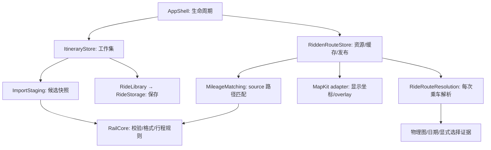
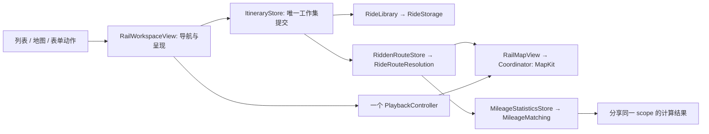

# 实际功能、接口、架构与 iOS 交互联合审计（2026-10-15）

> 实施状态更新于 2026-10-18：主要落实见 T8，后续修复与交付见 T9–T13，剩余接口简化及其验证边界见 T14。前文的行号和“仍成立”描述保留为审计基线，不能当作修复后的当前状态。

## 结论与范围

> 22:40 增补：文末“第三轮”一节逐项复核了上午六路审查，新增内置资源 owner（T2）、静默降级清单（T3）、死代码清单（T4）和 UI 审计（T5，U1–U21），并给出更新后的收敛顺序（T6）。

当前最值得收敛的是时刻表的 `Trip → Pattern → Trip` 往返、分享 scope 重复求值、重复的路线许可/导入规则，以及行程选择恢复和延迟呈现的交互时序。日期载体、路线 singleton 镜像、同步 importJSON 和校验同义类型已经收敛，不再把它们当成待修问题。

本文使用 Matt Pocock `codebase-design` / `improve-codebase-architecture` 的 deletion test：删除一个 module 后，复杂性消失，说明它可能只是转发；复杂性重新散落到调用方，说明它有 depth，应保留。interface 指调用方需要知道的动作、输入、时序、失败和性能合同，implementation 指这些规则的唯一权威实现。

“一个功能、一个接口、一个实现”落实为同一事实一个 owner、同一规则一个 implementation。多个按钮可共用一个动作；主题、语言、画幅和实际设备布局用参数表达，不复制业务实现。A+B 足够就不拆 A→C→D→B，也不为假想变化增 protocol、fallback 或万能快照。

范围覆盖 RailMap 全部功能目录、RailCore/RailApplication/RailPresentation 的主要业务调用面，联合梳理用户动作与状态归属；保留 Web 对应规则、资源 interface、构建入口和辅助诊断产品清单。按业务能力汇总，不把 private helper、文案或纯布局变体计成额外功能。本轮只修改文档，不实施产品重构；源码审查不等于交互、像素或性能实测。

## 当前架构与事实所有者

| 位置 | 实际职责 | 应拥有的事实 | 不应继续扩大的部分 |
| --- | --- | --- | --- |
| `RailMap/App/AppShell.swift` | 创建并持有共享 store、地图控制、播放、设置 | 原生对象生命周期 | 不为同一 store 再建全局镜像 |
| `RailMap/Journeys/ItineraryStore.swift` | 工作中行程、编辑与导入提交、日期分组 | 当前工作集及提交代次 | 不并存两套导入提交路径 |
| `Infrastructure/Persistence/RideLibrary.swift` + `RideStorage.swift` | 合并保存请求、备份恢复、原子文件读写 | 保存状态和磁盘数据 | 不让 UI 直接再写文件 |
| `RailCore` | 行程规则、物理路线、日期、统计、时刻表、格式校验、行程级已乘事实（`RideLedger`） | 可移植业务规则及源数据语义 | 不引入 MapKit，也不按小 helper 新建 package |
| `RailApplication` | 导入预检/暂存、草稿校验、路线修复搜索、路线证明、里程匹配。2026-10-15 deletion test 后保留 product | 一次操作的结果及规则顺序 | 不成为每个 Core 方法的转发目录，也不把这些规则放进 SwiftUI |
| `RailPresentation` | 地区时钟、路线状态、地图更新判定。`RegionClock`/`JourneyClock` 留在此层 | 可移植显示决策 | 不复制可观察 store，不持有已乘事实 |
| `RailMap/Map` | MapKit 生命周期、坐标适配、LOD、标注与 overlay | 原生显示对象和相机状态 | 不把显示几何反向当作物理证据 |
| `app/public` + `app/shared` | 保留的 Web 静态端、JS 参考规则、预计算宿主 | Web 当前会话与 JS 算法 | 不把全局别名对象误认为封装完成 |
| `app/scripts/build`、铁路 builders | 生成静态资源、铁路资料和路线预计算 | 可追溯产物 | 不变成产品运行时的额外业务后端 |

实际依赖见 [Package.swift](../../../ios/RailKit/Package.swift)：RailPresentation、RailApplication 各依赖 RailCore，彼此不依赖。目录分组不等于新增编译 module。已有三层不需要机械改成五层、Repository/UseCase/Manager 全家桶。

2026-10-15 归属裁定：RailApplication 的六个文件都有独立测试面，target 不删。`RideLedger` 从 RailPresentation 移到 `RailCore/Journeys/RideLedger.swift`。`MapUpdatePlan`/`MapDrawChanges` 决定内容差异，`MapRebuildPolicy` 决定相机重建，两者不合并。`RouteNetwork` 的分文件扩展（物理匹配、预计算显示、有向区间）是生产调用面，不因文件数收回。`AppleMapsJourney`/`AppleMapsLink` 没有 Swift 定义；车站链接是 `StationPlaceLink`。删除记录见 [architecture-coverage.md](../../../ios/refactor-parallel/architecture-coverage.md) 的同日收尾一节。

## 原生功能 → 当前接口 → 实际实现

下表的 interface 是已存在的调用面，不是本次建议新增的 facade。路径相对仓库根目录；Core/Presentation/Application 分别表示 `ios/RailKit/Sources/RailCore/`、`RailPresentation/`、`RailApplication/`，App 表示 `ios/RailMap/`。功能表以文件和符号定位；下文 C1–C10 为具体问题提供读取时的行号。

### 行程与工作区

| 功能 | 当前调用 interface | 权威 implementation / 调用位置 |
| --- | --- | --- |
| 启动、共享依赖、导航 | `AppShell` | App `App/AppShell.swift`；`Workspace/RailWorkspaceView.swift` 组装实际工作区 |
| 全部行程、即将出发、日期/地区筛选 | `WorkspaceDerived.days/upcoming/statisticsScope` | App `Workspace/WorkspaceDerived.swift`；Presentation `Workspace/WorkspaceJourneyRules.swift`、`Regions/RegionScopeRule.swift` |
| 新建与保存编辑 | `JourneyEditing.addAndPersist/replaceAndPersist` | App `JourneyEditor/JourneyEditing.swift` → `Journeys/ItineraryStore.swift` 改工作集并保存；Core `Journeys/StoreOperations.swift` 处理记录规则；新增/替换还返回保存任务及条件回滚 |
| 复制、删除、移动、隐藏 | `duplicate/delete/move/toggleVisibility` | App `Journeys/ItineraryStore.swift` → Core `StoreOperations` |
| 日期归组、排序、跨日 | `Dates.sortByDateAndDeparture/daySpan/trainSpans` | Core `Utilities/Dates.swift`，参数与结果都是 `RailCore.Train` |
| 手动日期和工作区派生缓存 | `WorkspaceDerived.scopedDates/trainIDs(spanning:in:)` | App `Workspace/WorkspaceDerived.swift`；缓存避免每次界面更新重复全表过滤 |
| 行程组 | `JourneyGroup` 与工作区组编辑 | Core `Journeys/JourneyGroup.swift`；App `Journeys/JourneyMenuView.swift`、`Workspace/RailWorkspaceView.swift` |
| 列表搜索、标题和详情 | `JourneySearchMatcher`、`JourneyTitle`、`JourneyDetailSnapshot` | Presentation `Journeys/`；App `Journeys/RideDetailView.swift`、`JourneyCardInformation.swift` |
| 路线状态显示、重算 | `RouteStatusResolver.status`、`RiddenRouteStore.resolve` | Presentation `Journeys/RouteStatusResolver.swift`；App `Infrastructure/Persistence/RiddenRouteStore.swift` |
| 地区时钟、即将出发判断 | `RegionClock`、`JourneyClock` | Presentation `Regions/RegionClock.swift`、`JourneyClock.swift`；时刻表文字时间不改写为设备时区 |

### 编辑、路线与时刻表

| 功能 | 当前调用 interface | 权威 implementation / 调用位置 |
| --- | --- | --- |
| 车站查找与选择 | `EditorCatalog`、`StationIndex` | Core `Editor/EditorCatalog.swift`、`Stations/StationIndex.swift`；App `JourneyEditor/` picker 与 `Infrastructure/Network/EditorCatalogLoading.swift` |
| 站点、时间、站台、乘车标记编辑 | `EditorTime`、`RideDraftValidation` | Core `Editor/EditorTime.swift`；Application `Editor/RideDraftValidation.swift`；App `JourneyEditor/RideEditorView.swift` |
| 新行程物理路线候选 | `TripRoutePlanner.plan(package:request:rideDate:)` | Core `Routing/TripRoutePlanner.swift` → 物理图和选择规则；App `JourneyEditor/NewTripView.swift` |
| 本地路线与停站补全 | `LocalJourneySearch.search/choices`、`LocalJourneyAutofill.proposal` | Core `Routing/LocalJourneySearch.swift`、`Editor/LocalJourneyAutofill.swift` |
| 路线区间、线路和服务身份编辑 | `RailwayRouteEditing`、`RouteSectionServiceEditing` | Core `Editor/RailwayRouteEditing.swift`、`RouteSectionServiceEditing.swift`；Presentation `Editing/CatalogLinePreferenceMapping.swift` |
| 路线修复搜索及应用 | `RouteRepairSession.search` → `RouteRepairFlow.advance` | Application `Journeys/RouteRepairSession.swift`；Core `Routing/RouteRepairFlow.swift`；草稿与已保存记录需要不同提交 adapter |
| 逐乘车物理解析 | `RideRouteResolution.resolve(Request)` | Core `Routing/RideRouteResolution.swift`；`RouteSolver`、区间推断、连续性证明是其 implementation，不要求 UI 逐步调用 |
| 路线资源、预计算、缓存和发布 | `RiddenRouteStore.load/resolve` | App `Infrastructure/Persistence/RiddenRouteStore.swift`；Core `Routing/SharedRouteWork.swift`、`RouteResolutionMemo.swift`、`RecordedRouteAdmission.swift` |
| 历史铁路有效期 | `RailHistoryOverlay`、`DisplayNetworkEra` | Core `History/RailHistory.swift`；Presentation `Map/DisplayNetworkEra.swift`；App 路线/显示载入分别使用对应日期 |
| 时刻表搜索和日期匹配 | `TrainTimetableDatabase.trips(matching:)`、`trips(on:)`、`trip(id:on:)` | Core `Timetable/TrainTimetableDatabase.swift`；`TimetableSearch.swift`、`TimetableTripMatch.swift`；App `Timetable/TimetableQuickMatchController.swift` |
| 服务目录、历史运行模式、经由服务展示 | `TrainServicePatterns`、`ServicePatternBrowsePolicy`、`JapanThroughServices` | Core `Timetable/`；App `Timetable/ServicePatternPickerView.swift`；展示关系不授予物理跨轨连接 |
| 时刻表草稿、停站和来源详情 | `Trip.publishedStopsDraft`、`sources(for:)`、`formation(for:)` | Core `Timetable/TrainTimetableDatabase.swift`；App `Timetable/TimetableTripDetailView.swift` |
| 时刻表与物理路线证据匹配 | `TimetablePhysicalRouteMatch` | Core `Timetable/TimetablePhysicalRouteMatch.swift`；App `Infrastructure/Persistence/TimetableRouteEvidence.swift` |
| AI 补全资格、提示和合并 | `JourneyCompletion.requestEligibility/prompt/merge` | Core `Import/JourneyCompletion.swift`；已有共同资格入口，不再给三个页面各建一套判断 |
| ChatGPT 研究与在线补全 | `ChatGPTSubscriptionService.complete` | App `Infrastructure/Subscription/ChatGPTSubscriptionService.swift` + `ChatGPTSubscriptionAuth.swift`；Core `Import/ChatGPTSubscriptionProtocol.swift`；研究输出与保存操作分离 |

### 数据、地图、统计、输出与设置

| 功能 | 当前调用 interface | 权威 implementation / 调用位置 |
| --- | --- | --- |
| 文件/粘贴 JSON 读取 | `ImportFileReader`、`ImportFlow` | App `Import/ImportFileReader.swift`、`ImportFlow.swift`；格式语义归 Core `Import/ImportEngine.swift` |
| 导入预检 | `ImportPreflight.inspect` | Application `Import/ImportPreflight.swift`；App 同名文件只给 Mode 本地化文案，未重复校验 |
| 追加/替换导入提交 | `ItineraryStore.runImport` → `ImportStaging.stage` | App `Journeys/ItineraryStore.swift`；Application `Import/ImportStaging.swift`；取消和代次检查在发布之前 |
| 日本换乘截图 OCR/导入 | `TransferGuideOCR.read`、`TransferGuideImport.read/commit` | App `Import/TransferGuideOCR.swift`、`TransferGuideImport.swift`；Core `Import/TransferGuide*.swift` 和 `JREastGuide.swift` 解析实际输入 |
| 样例读取、合并与全量替换 | `RideLibrary.sample`、`ItineraryStore.merge/replaceAll` | App `Infrastructure/Persistence/RideLibrary.swift`；`Journeys/ItineraryStore.swift`；五地区及特别行程样例 |
| JSON 导出 | `ItineraryStore.exportJSON` | App `Journeys/ItineraryStore.swift`；Core `Journeys/CanonicalTrainStoreJSON.swift`、`Routing/ResolvedRouteExport.swift`；导出物理选择必须保留证据条件 |
| 自动保存 | `RideLibrary.saveResult` → `RidePersistenceQueue.enqueue` → `RideStorage.writeStore` | App `Infrastructure/Persistence/RideLibrary.swift`、`RidePersistenceQueue.swift`、`RideStorage.swift`；分别负责合并、排序、原子 IO |
| 备份、恢复、清空 | `RideLibrary.snapshotBackup/restoreBackup/deleteSavedStore` | App `Infrastructure/Persistence/RideLibrary.swift`；`RideStorage` 负责文件事务；恢复备份是产品功能 |
| 网络分块、视口和 LOD 载入 | `RailNetworkStore.loadAll/ensure` | App `Infrastructure/Network/RailNetworkStore.swift`；`RailDisplayNetwork.swift`；Core `Data/DisplayChunkReader.swift` |
| 地图渲染和局部更新 | `RailMapView.Surface` → Coordinator update | App `Map/RailMapView.swift`、`RailMapCoordinator.swift`；Presentation `Map/MapUpdatePlan.swift`；App `Map/MapNetworkRendering.swift`、`MapLineGeometry.swift` |
| 连续线路、共线排布和几何简化 | `ContinuousStroke`、`DisplayParts` | Core `Rendering/ContinuousStroke.swift`、`DisplayParts.swift`；MapKit overlay 构建是平台 adapter |
| 地图相机、缩放、定位与框选 | `RailMapController`、`MapCameraPolicy` | App `Map/RailMapController.swift`；Presentation `Map/MapCameraPolicy.swift`；播放相机与手势协作归同一原生控制流程 |
| 车站标签、点击、站点卡片、地图外链 | `RideTapResolver`、`StationPlaceLink`、标注协调 | Presentation `Map/RideTapResolver.swift`、`Stations/StationPlaceLink.swift`；App `Map/StationCardView.swift`、`MapStationLabelCoordinator.swift`、`RideTapIndex.swift` |
| 里程与覆盖率 | `MileageStatisticsStore.load` → `MileageMatching.match` | App `Statistics/MileageStatisticsStore.swift`；Application `Statistics/MileageMatching.swift`；Core `Statistics/Statistics.swift`；sourceCoordinates 匹配而非显示坐标 |
| 统计日期、地区、排行与节律 | `StatisticsDateSelection`、`StatisticsMembership`、`PassportStatistics` | Presentation `Statistics/`；App `Statistics/PassportStatistics.swift`、`StatisticsDashboardContent.swift`；Core 统计聚合 |
| 行程播放与速度/前后切换 | `PlaybackController.start/togglePause/previous/next/setSpeed` | App `Playback/PlaybackController.swift`；Core `Rendering/Playback.swift` 编译路径 |
| 播放视频导出 | `PlaybackVideoExporter.start/cancel` | App `Playback/PlaybackVideoExporter.swift`、`VideoExportFlow.swift`；编码、画幅和码率属于输出参数 |
| 单行程图片分享 | `JourneyPoster.render` | App `Sharing/JourneyShareImage.swift`；`JourneyShareView` 调用共同展示规则生成图片 |
| 组合分享画布、地图和统计卡片 | `ShareComposerView`、`ShareComposerModel`、`ShareCardRenderController` | App `Sharing/ShareComposer*.swift`、`ShareCardRendering.swift`、`StatsWidgetView.swift`；画幅/卡片种类是已有产品能力 |
| 图层与显示设置 | `DisplaySettings.reset/persist`、`MapLayers` | App `Settings/DisplaySettings.swift`、`Map/MapLayers.swift`；同一渲染实现读取参数 |
| 四语言、站名/读音/地区文字 | `AppLocalization.stationName/text/nameReadings` | App `Localization/AppLocalization.swift`。`text` 是唯一文案查找；行程组与分享句子在 `JourneyGroupStrings` / `JourneyShareStrings`（`ios.journeyGroup.*`、`ios.journeyShare.*`），经 `AppStrings.table` 进入同一次查找。Core `Identity/Localization.swift`；站名资料归 `StationReadingsStore` |
| 键盘快捷键、Mac 菜单和返回关闭 | `RailCommandBridge`、`WorkspaceSheet` | App `App/RailMapApp.swift`；`Workspace/WorkspaceSheetContent.swift`、`UtilityDestination.swift`；保留原工作区生命周期 |

主导航实际有 Upcoming、Stats、All、Search 四个入口（`Workspace/PrimaryTab.swift`）。文本提取由 `JourneyCompletionView.extractRawText` 接入同一补全流程；登录、登出和凭据刷新归 `ChatGPTSubscriptionAuth.login/signOut/accessCredentials`，不与业务补全合成一套通用状态机。

## Web 功能与实际资源接口

`app/package.json` 的 start/dev 当前走静态构建/服务。`runtime-config.js` 与 `build-static-site.mjs` 声明 `hasBackend:false`。`serve-static.mjs` 返回文件，不能把遗留客户端中的 PUT、DELETE、SSE 或 agent-import 字符串写成当前可用后端。

| 功能 | interface | implementation |
| --- | --- | --- |
| 行程增删改、顺序、显隐 | `addTrain/duplicateTrain/deleteTrain/moveTrain/toggleTrainVisibility`、`saveSelectedFields` | `app/public/app-store-ops.js`；`app-editor.js`；`app-render.js` 分发变化 |
| JSON 导入和打开本地文件 | `ImportController.replaceJson/openLocalJson` | `app-import-controller.js` → `app-import.js`、`app-persistence.js` |
| 地区/特别样例与恢复 | `loadSampleData`、`restoreUserStore` | `app-import.js`；manifest/parts 载入 |
| 自动保存、恢复、本地文件 | `PersistenceService` | `app-persistence.js`；本地 flush、IndexedDB、File System Access；其内部仍保留退役服务器路径 |
| JSON/便携 HTML 导出 | `exportTrainStore` | `app-store-ops.js`；`app-ui-utils.js` |
| Web 地区切换 | `CountrySession.switchTo` | `app-country-session.js`；先完成保存，再更换数据/缓存/会话，和原生多地区过滤不同 |
| 物理路线和缓存 | `RouteService` | `app-route-service.js` → `app-route-graph.js`、`app-route-solver.js` |
| 网络地图、交互与样式 | `RailMap` | `railmap.js`；`rail-network.js`；`railmap-{geometry,style,interactions,popup,basemap}.js` |
| 统计 | `scheduleMileageStats` | `app-stats-render.js` → `app-stats.js` |
| 播放 | `Playback` | `app-playback.js`；start `:882`、prepare `:1146` |
| 视频输出 | `PlaybackVideo` | `app-playback-video.js`；start `:309`、composition `:425` |
| 数据集就绪、历史与显示设置 | `AppDatasets`、显示设置和历史加载函数 | `app-datasets.js`、`app-rail-history.js`、`app-display-settings.js`；`app.js` 组织启动 |
| 多语言 | `i18n.js` 导出对象与字符串表 | `app/public/i18n.js`、`i18n-strings.js` |
| 离线路线预计算 | `PrecomputeAdapter.solveStore/solverContexts` | `app-precompute-adapter.js`；调用同一 RouteService，输出 native 可检查的出处 |

这些 interface 多为有加载顺序要求的 classic-script 全局绑定，不是已被语言强制封装的 module exports。`index.html`、`app-state.js` 与 CRUD 直接写全局状态共同说明这一点。

静态发布的读取 interface 以 `app/shared/artifact-inputs.js`、`app-config.js` 和 builder 为准：

| 资源 interface | 实际用途 |
| --- | --- |
| `./api/{default-trains,matched-routes,matched-stops,rail-history,physical-rail-junctions}.json` | 默认记录、匹配资料、历史和物理连接资料 |
| `./api/{rail-sections,stations,station-readings,station-names}[-地区].json` | 源线路、站点和名称资料；日本无后缀，其余 tw/hk/mo/kr |
| `./api/sample-data[-地区]/manifest.json` 与其 parts | 地区样例及预计算几何 |
| `./api/{new-year-grand-loop-data,tokyo-limited-express-loop-data}/manifest.json` 与其 parts | 特别样例 |
| `./rail/{jp,tw,hk,mo,kr}-2025.json`、`shared-corridors.json`、`display-lanes.json` | 地图 compact package 和共线显示资料 |

## 工具与构建：与产品 interface 分开

| 入口 | 实际职责 | 去重判断 |
| --- | --- | --- |
| `app/scripts/build/build-static-site.mjs` | 组装静态站点，写静态 runtime config，复制注册资源 | 发布产物构建，不是运行时后端 |
| `app/scripts/build/precompute-train-parts.mjs` | 通过 PrecomputeAdapter 生成行程路线产物 | 离线宿主 adapter，不重写路线求解 |
| `app/scripts/build/build-rail-database.mjs` | 生成 rail.db | 构建用途，不把数据库存在推成额外在线服务 |
| `app/scripts/railway/`、`ios/tools/` 保留 builders | 站名、铁路、时刻表等有出处的数据产物和修复 | 各输入/格式确实不同；不逐脚本猜测为重复业务实现 |
| RouteWorkbench | 使用正式求解流程检查物理路线/记录证据 | 诊断入口，非第二套用户路线实现 |
| RailAlignmentInspector / InspectionKit | 原生底图与显示几何检查 | 地理/像素观测工具，不是产品显示兜底 |
| ThroughWorkbench / WorkbenchCore | 历史经由服务与补丁研究 | 保留独立调查用途；未审计其每个内部算法与 Core 是否重复 |

北美只保留离线档案，不计入当前支持地区。旧 ADR/报告里的七地区、旧验证命令不能反推当前功能。

## 现状复核：不要把已修问题继续列为现存缺陷

本轮按当前工作树复核前一版 A1–A9 以及后续简化计划；计划勾选不自动等于运行验收。这里将“源码已收敛”与“仍需运行证明”分开。

| 原候选/后续工作 | 当前源码事实 | 裁定 |
| --- | --- | --- |
| A1 路线状态 singleton 镜像 | `JourneyBridge.routeState` 直接读取 `RiddenRouteStore.status`；状态归路线 owner | 不再列为现存镜像问题 |
| A2 Dates/Statistics 同义 Train、Stop | `Dates` 直接处理规范 Train；ItineraryStore.group 直接排序和分桶；旧 `forDates` 转换已删 | 不再建议重复执行模型迁移 |
| A3 同步 importJSON 产品入口 | `ItineraryStore` 只保留产品 `runImport` 提交流程 | 原生双提交路径已删；Core 的测试-only 旧 append 另见 C4 |
| A9 Field/Severity 与 typed→JSON→typed | App 用 Application 的类型别名；校验已有 typed 入口 | 不再列为待修 |
| 完整包与显示链共享 | `DisplayNetworkCache` 已拥有 package/layout/network 的按需共享；保留一个地区驻留，chunk/header 各有真实用途 | 不再提出常驻五地区的万能 RegionDataset |
| 分享 scope 合并 | 同 scope 的继承卡片已共享 statistics store | 已改善；“计算属性每次重算”仍见 C3 |
| 时刻表读取统一 | 已有 `TimetableKnowledgeQuery`，但 picker 仍拆成多份平行状态并回到旧 pattern 查询 | 部分收敛，见 C1 |
| Web A4/A5/A6/A7 | 几何双写、编辑后 debounce 导出、全局状态、worker/main 两份解码编排仍在 | 保留为当前候选，见 W1–W4 |
| A8 旧接口与运行合同 | 无定义的 AppleMapsJourney/AppleMapsLink 已从当前接口目录移除；app-api 的缺省 backend:true 仍在 | 文档修正与残留配置分别对待，见 W5 |

## iOS interaction 联合审计：动作、接口、唯一事实所有者

这里的 interface 包含动作的前置条件、失败与取消语义。按钮和菜单可以有多个入口，必须落到同一 implementation；布局差异用现有参数表达，不另做一套业务规则。

| 用户动作 | 当前 interface / implementation | 状态所有者与关键合同 |
| --- | --- | --- |
| 切 Upcoming / Stats / All / Search | `PrimaryTab` → `RailWorkspaceView.workspaceTabs/workspacePage` | AppShell 持有 selection；常驻地图与 PlaybackController 共用，切页不新建播放 transport |
| 改地区/日期/搜索 | `selectRegion/selectDate`、`JourneySearch.search`、`WorkspaceDerived` | 工作区持有筛选；地图日期是弱化绘制，不能当成删除行程；统计使用独立的日期选择 |
| 点路线，多条重叠时选择 | Coordinator `handleMapTap` → `MapInteractionCoordinator.rideHits` → `selectFromMap` → `pick` | ItineraryStore 持有 selectedTrainID；多个 hits 交给 chooser，不能偷偷取第一个 |
| 点网络站/乘车站/站名 | Coordinator `didSelect` → `stationCard` → `WorkspaceSheet.station` | 同一 StationCardView；annotation 与背景 route tap 共用一次触摸的应答判断；地区身份风险见 C8 |
| 点车站所属线路查看地图 | `StationCardView` → `RailNetworkStore.linePreview` → linePreview | 线路预览是临时绘制输入；不写回乘车记录或物理选择 |
| 打开/关闭行程卡片 | `pick` → `WorkspaceSheet.detail` → `WorkspaceJourneyMenu` | 卡片 ID 是导航状态；选择恢复见 C5，不能盖过之后的播放/编辑意图 |
| 新建、编辑、保存、取消 | `presentJourneyEditor` → NewTripView/RideEditorView → `JourneyEditing` → `ItineraryStore.add/replace` | 表单持有草稿，store 持有已提交工作集；返回 Commit 和保存任务；取消未提交草稿不改工作集 |
| 车站搜索与切地区 | `StationPickerSearchController.beginLoad/install/apply/cancel`，Core `StationSearch` | 搜索任务/代次属于一次搜索；迟到结果不得写入新地区；typed station identity 保持不变 |
| 应用时刻表/服务模式 | `ServicePatternPickerView.select` → `JourneyDraftWork.timetableDraft/apply` | occurrence 不得反转成数据库不存在的班次；pattern 可有方向选项；不完整知识保留真实类型，见 C1 |
| 点重算、修复、撤销 | `rebuildRoute/repairReviewedRoute` → RiddenRouteStore / RouteRepairSession | 物理求解归 RideRouteResolution；已保存记录与未保存草稿的提交合同不同，不能合成无基线检查的通用 apply |
| JSON 文件/粘贴导入 | `ImportFlow` → `ImportPreflight.inspect` → `ItineraryStore.runImport` → `ImportStaging.stage` | 预检不改 live store；staging 生成候选；取消/代次检查后才提交；写盘失败不能说导入未发生 |
| 换乘截图 OCR/补全/保存重试 | `TransferGuideImport.read/commit/retrySave` → 同一 ItineraryStore 提交 | OCR/解析是不同真实输入；已加入内存后的重试只重存，不能再次 add |
| 复制、隐藏、删除、设置已乘 | `perform` / `setRidden` → ItineraryStore → StoreOperations / RideLedger | 记录事实在 store；界面必须读本次 Commit.outcome，不能以按钮点击代表操作完成，见 C9 |
| 开始、暂停、前后跳、变速、停止播放 | `startPlayback/stopPlayback` → `PlaybackController.start/togglePause/previous/next/setSpeed/stop` | 一个 PlaybackController；播放队列是开始时的快照；暂停与停止语义不同；结束与停止的选择恢复不同 |
| 设置视频选项、开始、取消、分享文件 | `VideoExportFlow.plan/start/abandonRecording` → PlaybackVideoExporter | flow 持有此次录制的选项/时长；controller 持有播放；取消录制可保留播放，这不是重复实现 |
| 分享单行程图片 | `JourneyShareView` → `JourneyPoster.render` | 展示内容复用行程规则；图片绘制是输出 adapter，与视频不同 |
| 分享组合画布、改卡片地区日期、拖拽、导出 | ShareComposerModel → ShareCardRenderController `render/export` | 卡片 UUID/位置/配置在 model；统计 store 归 scope；导出要求 completedKey 与当前输入一致；不得跳过失败卡片 |
| 缩放/定位/用户跟随/播放追镜 | RailMapController → MapCameraPolicy；PlaybackMapTarget 是原生 adapter | 相机意图与实际 MKMapView 在原生端；手势接管后旧 autofocus 不得复活 |
| 打开设置/数据、弹窗后再打开界面 | `WorkspacePresentations` / `PresentationHost.afterTeardown` | 当前 presenter 和请求有效期属于交互合同；通用定时等待的问题见 C6 |

**联合关系**：界面动作 → 工作集变更 → 路线/统计输入更新 → 原生显示。每个箭头应有明确事实变化；同一份 Train 经值语义传递不自动等于深拷贝，但把它转成同义模型再用 ID 找回来属于实际冗余。

## 当前仍成立的简化候选

优先级：P1 是可导致交互结果错误的代码风险；P2 是重复规则或重复工作；P3 是低成本收窄。Strong 表示源码证据足够支持这个简化方向，不表示运行收益已测量。候选只指向现有 owner，不预设新 protocol、Manager 或 DTO。

### C1 — 时刻表先降格成 pattern，再凭 ID 找回 Trip（P2 / Strong）

**证据**：`ios/RailMap/Timetable/ServicePatternPickerView.swift:499` 取得 ClassifiedSources；`:525` 调 compatibilityPattern，将 occurrence 拆进 timetablePatterns、timetableTripsByPatternID、timetableDetails、incompleteTimetableTrips 与多个计数。`:326` 点击后再按 pattern.id 找回 Trip，`:312` 用 `timetable:` 字符串前缀决定是否提供反转按钮。Core `Timetable/ServicePatternBrowsePolicy.swift:87` 要求调用方传上述平行集合，`:127` 又调用静态 TrainServicePatterns.search，没有直接消费 query 返回的 patterns/excerpts。

**问题**：SwiftUI 负责维持派生模型间的一致性，查询 module 的统一结果没有成为真正 seam；同一班次为了列表外观丢掉类型再找回来。

**最小收敛**：在现有 browse implementation 内消费 query 的真实结果，直接保留 occurrence/pattern/excerpt 的身份和来源，列表直接携带选择对象。删除 occurrence→compatibilityPattern→Trip 字典反查，以及可从同一结果算出的平行计数。界面只持有筛选和一次结果，不新造跨全应用的 timetable 状态框架。

**保留/反证**：三种知识确实不同；还没迁移的 pattern/excerpt 不能删，occurrence 无反转也必须保留。**删除测试**：删掉同义中间表示后，班次选择与搜索能力保留，调用方少维护字典和前缀协议。验证应复用 ServicePatternBrowsePolicy 与 TimetableKnowledgeQuery 对应测试，并只观察一例 occurrence 选择。

### C2 — 两处车型许可规则完全重复（P2 / Strong）

**证据**：`ios/RailKit/Sources/RailCore/Routing/LocalJourneySearch.swift:441` 和 `RailwayRouteChoices.swift:46` 都实现相同的 highSpeed 拼写表、线路类型识别及 isTraversableForSearch 判断。

**最小收敛**：许可规则留在既有 Core 路线能力中一个 implementation，两个搜索调用它。不要把高铁拼写、线路类型、可遍历性再拆成三个 module。

**保留/反证**：LocalJourneySearch 做多线搜索，RailwayRouteChoices 做已知区间候选，两者不是同一个搜索算法。只合并重复规则，不合并算法，也不把经过线路显示关系当作物理连通许可。

### C3 — 分享 scope 的共用名字没有消除重复求值（P2 / Strong）

**证据**：`ios/RailMap/Sharing/ShareComposerView.swift:906` 的 scopeWork 是计算属性，每次调用都会执行 scopeComputations 并对每个 scope 筛选行程。`:956` loadKey 先取一次 scopeWork，又读 selectedRoutesReady（`:950` 再取一次）；`:965` renderKey 先取一次，再读 loadKey。preparedCards（`:917`）、statisticsReadyForRender（`:977`）也各取一次。仅一次 renderKey 求值就能沿源码看到三次 scopeWork，不是“三个入口共用一份计算结果”。

**最小收敛**：在现有分享准备操作内计算一次同一输入的 scope work，把它用于 key、readiness、preparedCards 与 load。优先一次求值/显式传入已算结果；只有跨更新仍有必要时才用现有输入代次缓存，不能再加全局 snapshot store。

**保留/反证**：相同继承 scope 已共享 MileageStatisticsStore（ShareComposerModel.swift:481）；独立日期是产品能力，不应为了减少 store 数取消。上述事实证明重复筛选，未证明卡顿、深拷贝全部几何或实际耗时。

### C4 — Core 仍保留只有测试使用的旧导入 append（P3 / Strong）

**证据**：`ios/RailKit/Sources/RailCore/Journeys/StoreOperations.swift:392` 的 appendImportedTrain 重新归一化、构造已有 ID 集合、生成 ID、校验并追加；生产 ImportPreflight/ImportStaging 使用 `ImportEngine.Session.appendImportedTrain`（Import/ImportEngine.swift:354）。前者的 Swift 调用均在测试，后者有 ID 缓存和 suffix 状态。

**最小收敛**：让仍使用旧 append 的有意义导入/往返测试走 Session，保留其原断言，再删 StoreOperations 的第二实现。不能先删用例，也不能把独立 Session 的增量 ID 状态退回逐行全表扫描。

**保留/反证**：它不是仍在生产运行的 ItineraryStore 双提交入口，也不能据此声称产品每次导入执行两次。收益是规则和测试 seam 单点。

### C5 — 关闭行程菜单会无条件恢复旧选择（P1 / Strong）

**证据**：`ios/RailMap/Workspace/RailWorkspaceView.swift:3310` 的 pick 保存 selectionBeforeJourneyMenu 并接管 selection；`:634` onSheetDismiss 只检查 journeyMenuOwnsSelection，就恢复旧 ID。与此同时 `:280` 在 playback.currentTrainID 变化时写 selectedTrainID；菜单本身 `Journeys/JourneyMenuView.swift:65` 可分发播放动作。ItineraryStore 已有 selectionRevision，但此恢复没有检查之后的选择、记录是否仍存在或当前播放归属。

**可复现路径（待原生验证）**：原选择 X → 打开 Y 卡片 → 从卡片开始播放 Y → 关闭卡片；dismiss 可能把地图选择改回 X，而 transport 仍播放 Y。删除或重命名原 ID 后也可能恢复一个已不存在的 ID。

**最小收敛**：菜单仅恢复仍由它占有且有效的选择；发生播放/显式选择/编辑接管时结束旧恢复权。在现有工作区与 itinerary owner 内表达这一合同，不再建 SelectionCenter。删除测试是移除无条件回写和额外同步点，保留“仅查看后返回原选择”的真实能力。

### C6 — 弹窗切换靠全局计时轮询，超时后仍执行（P1 / Strong）

**证据**：`ios/RailMap/Workspace/PresentationHost.swift:30` 创建不返回 handle 的 Task，先固定等 350ms，再调用 settle；`:42` 每 16ms 检查全局 topmost，1500ms 到期直接返回；两处 try? sleep 吞取消，最后 action 无条件执行。`:63` 从所有 connectedScenes 选第一扇 key window，并未绑定发起请求的 presenter。DataManagerView 与工作区多处调用它。

**问题**：超时被当成可以继续呈现，页面/请求失效后没有撤销点；请求属于哪个窗口也没有进入 interface。这是“兜底继续执行”掩盖前置条件未满足，不是业务必需的 adapter。

**最小收敛**：优先在已有 sheet 的 onDismiss/实际 transition completion 中推进后续动作；Menu 等没有直接 completion 的入口只在当前 host 保留一个可取消、带有效性判断的待呈现请求，host 未就绪时不假装成功。不要加四层通用调度框架。实际竞态频率未测量；同一窗口、连续打开/取消一次即可验证改动。

### C7 — 编辑器共享包读取仍经过两次纯转发（P3 / Strong）

**证据**：`ios/RailMap/JourneyEditor/JourneyEditing.swift:161` JourneyDraftWork.loadPackage → `EditorRoutePackageCache.swift:6` load → DisplayNetworkCache.package(...).package。前两者不拥有缓存、取消、版本或错误转换；真实 owner 在 `Infrastructure/Network/DisplayNetworkCache.swift:83`。NewTripView:933、RideEditorView:692 走两跳，工作区修复:2727 直接走其中一跳。

**最小收敛**：让已有 owner 提供所需 package 读取，调用方直达；删除 EditorRoutePackageCache 及无附加行为的 loadPackage 转发。不要再加另一个 loader protocol。类型别名或 `.package` 取值本身不需要单独 module。

**保留/反证**：共享解码已经做成，这两跳不会重复 decode；本项收益是少两个必须理解的接口，不声称减少解码次数。

### C8 — 已知地区的车站匹配仍能跨地区退回（P2 / Worth exploring）

**证据**：`ios/RailMap/Map/MapInteractionCoordinator.swift:174` 的 nearest 优先 sameRegion，但无命中就从所有地区取最近；`:195` code 匹配半径是 infinity。replaceStations:224 按裸 code/name 建索引，未把 region 放进 key。这里输入是当前显示站集合，可能不包含目标地区所有站。

**风险条件**：已知 region 的停站在当前集合没同地区候选，但存在另一地区同 code 候选时，会打开别区的车站卡，而不是报告目标站的资料未知。源码允许此分支；本轮没有查询正式资源证明当前五地区确有该碰撞，不能宣称已观察到真实错站。

**最小方向**：先明确身份是 (region, code)，已知地区只在该地区匹配；无资料就保持原停站身份和可见的缺资料状态。未知地区的旧记录另按真实可用证据处理，不因方便就扩大已知地区的匹配范围。这里仅是卡片展示，不能将此近邻规则拿去建物理铁路连接。

### C9 — 删除反馈与本次提交结果脱节（P2 / Strong）

**证据**：`ios/RailMap/Workspace/RailWorkspaceView.swift:624` 的 onDelete 先清选择，再丢弃 itineraries.delete(train.id) 返回值，并无条件 signal(.deleted)。ItineraryStore.delete:295 返回 Commit<Bool>，mutate:582 在 isImporting 或没有 store 时会拒绝。PresentationHost 的异步延迟让“打开确认时允许”不等于“确认真正执行时仍允许”。

**最小收敛**：直接根据这个 Commit.outcome 决定选择变化与反馈；已提交但磁盘失败则用返回的 save 解释失败状态。无需 UI 再做一套校验或新重试层。是否存在真实用户可触发的并发入口需一次目标交互确认；“忽略结果仍发删除反馈”的源码事实已确认。

### C10 — JSON 字符串转义保留两份 implementation（P3 / Strong）

**证据**：`ios/RailKit/Sources/RailCore/Journeys/CanonicalTrainStoreJSON.swift:96` 与 `Journeys/Train.swift:2704` 分别实现 UTF-16 quote；前者注释以“这个文件不能编辑另一个文件”解释复制。文件编辑归属不能构成运行时复制规则的理由。

**最小收敛**：字符串转义只保留一个内部 implementation，archive writer 与 sorted canonicalText 复用它，不新增公开编码接口。保留 archive 的键插入顺序与 canonicalText 的排序差异；不能用 Foundation JSONEncoder 代替而改变输出合同。现有非 BMP、控制字符和中文字符串用例保留；不再用“两套实现彼此相等”的镜像测试维持两套规则。

## Web 与构建仍需注意的对应问题

本轮目标是 iOS 联合审计；以下为保留的跨端线索，局部复核其关键语句，不把它们写成已实施重构。

| 候选 | 当前证据 | 最小收敛与保留项 |
| --- | --- | --- |
| W1 同一几何双写（原 A4，Strong） | app/public/app-persistence.js:823 将 features 放入 day chunk，:1285 又独立 persistRouteCacheEntry | 行程只存规范记录，派生几何归一个 cache owner；先检查恢复/淘汰合同，不能丢用户行程 |
| W2 编辑后全量序列化（原 A5，Strong） | app-render.js:93 调 scheduleExportTextareaRefresh；app-persistence.js:465 仍在 300ms 后 exportTrainStore；保存另建 canonical 内容 | 导出文本在用户打开/复制/下载时计算；已有 debounce 只是合并频率；坏 JSON 的 recovery 原文须保留 |
| W3 facade 与全局写入并存（原 A6，Worth exploring） | app-state.js:74/139 与 app-store-ops.js:38 仍通过 classic-script 全局状态协作 | 每个实际功能的写入收回既有 implementation；只删 facade 名字不会消除耦合，不增 Controller→Manager→Repository |
| W4 worker/main 重复解码编排（原 A7，Worth exploring） | railmap.js:178 和 rail-network-worker.js:12 各自 fetch/parse/merge 资源 | 解码规则一个 implementation，宿主只做执行 adapter；不能因 postMessage clone 就断言删 worker 更快 |
| W5 静态配置仍有 backend 缺省（原 A8） | runtime-config.js 声明 hasBackend:false；app-api.js:26 缺省仍 true | 当前运行无后端；缺省合同收敛到实际发布方式。资源消费方未核对前不随手删除 station-names/readings |

## 数据流、模块位置与性能结论

| 链路 | 当前结论 | 应采取的动作 |
| --- | --- | --- |
| App → RailApplication/Core | 三个 target 的依赖已由 Package.swift 强制；Application 六个 use cases 确有预检、事务候选、基线或匹配规则 | 保留 target，不按“一调用方”删除。RideLedger 已移 Core；时钟/显示决策留 Presentation |
| Train → 时刻表列表 → 点击选取 | C1 存在同义模型往返、字典反查和平行计数 | 在 browse owner 收回知识，不把 record 转来转去 |
| 编辑器 → 两个 loader 名字 → cache | C7 是可删除的浅 module | 调用现有 owner；不是另造 facade |
| Share key/readiness/准备卡片 | C3 有可直接数出的重复 scopeWork 求值和行程筛选 | 同次准备复用结果，先不新增长期缓存 |
| SwiftUI → Surface → Coordinator | 必须跨 Observation/UIViewRepresentable 生命周期；Coordinator:271 已有数组共享存储快路、contentID 比较与手势期间合并更新 | 保留 seam；参数多不等于必须再造 MapContext；传 Array 不等于深复制其全部内容 |
| 网络包 → package/layout/network | DisplayNetworkCache 按 country/revision 合并 in-flight；header 与 viewport chunk 按需读取，淘汰后重读合法 | 只保留真实共享 owner；不要预建全部 edge/graph，也不能合并不可重入 permit 造成死锁 |
| 网络集合发布 | RailNetworkStore:1093 仍组 nextLines/nextStations，但:1134 以后比较 contentID，仅变化时发布 | “未变化不发布”已经实现；全表组装成本仍在，是否值得优化需具体观测 |
| source → drawn → MapKit | 物理证据、绘制排布、平台坐标是不同语义 | 保留，按 ADR 0004 仅在 MapKit seam 变换一次，不回流为物理证明 |
| DrawnRide → MileageMatching → Statistics | 平台对象到可移植匹配输入有真实 adapter 职责 | 不为少类型丢掉 normalized 日期、source/provenance 与缺口语义 |
| 工作集 → 保存任务 → 磁盘 | publishWorkingSet/commitWorkingSet 是内存提交；RideLibrary 合并、Queue 排序、Storage 原子 IO | 保留不同的并发保证；UI 读本次结果，不能将磁盘失败误当成未改内存 |
| legacy route 第二次求解 | RiddenRouteStore.decode:707 后仍有 first pass/precomputed/legacy pass 顺序 | 不是本轮确认可删的冗余；未说明真实命中前不能删掉 dated/official 能力或造直线补缺口 |

这次没有运行性能采样、原生点击或截图。能够确认的是重复规则、集合生成、状态写入条件和调用次数；不能确认帧率、CPU、峰值内存、漏帧或耗电，也不复用旧结果证明当前源码通过。

## 单一实现的收敛顺序

1. **先修交互结果的归属**：C5 选择恢复、C6 呈现请求有效性、C9 提交后反馈。只在既有 owner 内收回合同；每项用一个对应的原生交互解决实际疑问。
2. **再去掉浅接口和规则副本**：C7、C2、C4、C10。删除转发/重复实现，保留有意义的现有测试并让它们走同一生产 seam。
3. **减少实际数据往返**：C1 先统一 browse 输入结果，C3 同一次准备只算一次；不要为了“统一”新增全应用大快照或多个备选架构。
4. **处理需资料确认的项**：C8 只做目标身份查询；时刻表 legacy 与旧求解先解释实际覆盖，不能凭命名删。Web W1/W2 在对应功能需要修改时按现有恢复/导出合同集中处理。

完成判据是：调用方少知道步骤，同一规则只改一处，确实删掉接口/同义表示/同步点，用户动作有确定的结果。把 A→B 改成 A→C→D→B 不算完成。新建与编辑、手机与宽屏、不同语言/画幅可以保留入口或参数差异；不会为同一个业务动作维护多套规则。

## 审查证据与范围限制

- 主审核对当前工作副本、[GLOSSARY](../../../GLOSSARY.md)、[ADR 0012](../../decisions/0012-per-ride-resolution-and-catalog-eligibility.md)、[ADR 0004](../../decisions/0004-wgs84-mapkit-datum-boundary.md)、Package.swift 和相关消费者；按 Matt 的 deletion test 判断实际 depth。
- GPT-6.1 Sol high 只读提取 Core/Presentation 的接口和重复规则，主审逐项核对 C1/C2/C4/C10 的源码。Grok 4.7 xhigh 首次只读盘点达到 max-turns（exit 1），没有最终报告；第二次缩小为给定源码的交互咨询，仍未返回分析，主审完成后停止该专属进程（exit 143）。未采纳任何未经复核的 Grok 建议。
- 这是业务能力粒度的接口清单和源码交互审计；不是逐个 private helper 的数学证明。辅助诊断产品与构建入口已在上表分开，DEBUG 原型不计作正式双实现。
- 只更新文档与既有范围 ledger；未改生产 Swift/JS、资源、测试、Git 暂存区，也未提交或推送。遵守 [ios/VERIFICATION.md](../../../ios/VERIFICATION.md)，本轮不运行与文档修改无关的构建、全国数据生成或测试矩阵。
- 行号属于读取时的未提交工作树；同日 [原六路审查](../../../ios/docs/reviews/feature-interface-audit-2026-10-15.md) 和 [实施计划](../../superpowers/plans/2026-10-15-architecture-simplification-fix-plan.md) 用作历史与裁定依据，本文“现状复核”优先。计划内记录的旧 build/test 结果不算本轮运行证据。

文档核对结果：47 项原生业务能力、19 条交互链路、C1–C10 候选编号完整；8 个本地 Markdown 链接均可解析；13 处关键源码定位与当前文本匹配，两处 permits 实现逐字一致。仅为文档/源码核对，不是执行测试通过。可视化概览：`/private/tmp/architecture-review-20261015-jtm-interaction.html`，10 项候选均有当前/收敛方向图。

---

## 第三轮：上午审查逐项复核 + 资源 owner + UI 审计（2026-10-15 22:40–23:10）

本节由另一会话追加，是本文件的增补；前文 C1–C10 仍有效。方法：五路只读复核（GPT-5.6 Sol ×4 逐项核对上午六路审查的全部条目；另三路专做 UI 层），主审抽查关键结论（标 ✅）。行号对应 22:40 的未提交工作树。只改了文档，没有修改代码，也没有运行构建或测试。

### T1. 上午审查（`ios/docs/reviews/feature-interface-audit-2026-10-15.md`）的现状

该文件已过时，以本文为准。逐项结论如下：

**已修复（不要再列为缺陷）**：OverlapLanes／StationJoinSmoothing 已删除；地图和求解共用一次 `LoadedPackage` 解码（`DisplayNetworkCache.swift:366`）；EdgeIndexCache 不再自建网络，也去掉了 `try?` 降级（`:45-53`）；显示链拼接由 `JoinedChainCache` 只做一次（`MapLineGeometry.swift:196`）；校验的 JSON 往返已删除；`Dates`／`Statistics` 的平行 Train 已删除；`TrainTimetableDatabase.bundled` 改为 typed throw；`RideStatusCenter` 已删除；工作区 chrome 合并为 `WorkspaceMapChrome`；三套本地化查表合为一个 registry；`RouteSolver` 内核收为 internal；`RailwayRouteInference`、`clearInferredPending`、`RideEditorAI.denial`、`LODLine/LODBuild`、凭据 protocol、`Link.network` 均已删除；Passport `zip` 截断、分享缺帧兜底、历史退回今天、读音损坏当空表都改成了显式失败。

**不采纳（与前文裁定一致）**：解散 RailApplication（6 个文件里有 3 个跨多个生产文件，含真实的预检和代次规则）；常驻五地区的 `RegionDataset`（共享解码已经实现）；合并 `MapDrawChanges` 和 `MapRebuildPolicy`（现在分别服务内容差异和相机重建两个调用点）；把 `RouteNetwork` 的 4 个文件收回一个（只是文件拆分，不是接口拆分）；路线缓存同时存 source 和 drawn 坐标（`RiddenRouteStore.swift:2203-2219`，drawn 是 canonicalize 的计算结果，缓存它是有意为之）。

**仍然成立**（前文未覆盖的部分）：

| 项 | 证据 | 说明 |
|---|---|---|
| `RouteNetwork.Line` 常驻三份坐标 | `RouteNetwork.swift:149-183` | `parts`、`intervals`、完整 `compactLine` 同时驻留 |
| 预计算行程再次 canonicalize | `PrecomputedRouteDisplay.swift:21-52`、`RiddenRouteStore.swift:982-985` | 每条预计算路径发布前都要重做规范化和最近点切片 |
| `publishDisplayNetwork` 每批全量组装 | `RailNetworkStore.swift:1093-1145` | 不变时不发布，但组装成本仍在（前文已注明待观测） |
| `DisplayChunkReader` 先 `subdata` 拷贝再解码 | `DisplayChunkReader.swift:20-33` | 映射的 blob 被复制一份 |
| `RouteResolutionMemo` 每次重建键模型 | `RouteResolutionMemo.swift:61-98` | `CacheKeyTrain`、`RouteSection`、单段 context |
| `MileageMatching.Journey` 投影 | `MileageMatching.swift:21-45`、`MileageStatisticsStore.swift:748` | Train+DrawnRide → Journey → `Statistics.RouteFeature`，经过两次投影；前文认为 adapter 职责真实，所以只保留观察 |
| `rebuildRouteSections` 丢弃求解和保存结果 | `ItineraryStore.swift:321,351`；调用 `RailWorkspaceView.swift:2673` | 与 `rebuildRoute` 是两个接口 |
| 两个不同的 `ridesDigest` | `RailMapCoordinator.swift:3155`、`WorkspaceDerived.swift:195` | 两者哈希的字段不同，名字相同 |
| 三条 `DrawnLine` 构造路径 | `RailNetworkStore.swift:1272,1483,1688` | 分别来自历史、显示 chunk、紧凑包 |
| 7 个路线提案类型 | `LocalJourneySearch`、`RecordedRouteAdmission`、`RouteRepairFlow`、`TripRoutePlanner` 等 | 反向依赖已删除；C2 的规则重复仍在 |
| 新建与编辑仍是两套表单 | `NewTripView.swift:7`、`RideEditorView.swift:7` | 交互确有不同，所以保留两张表单；共同实现已部分下沉到 `JourneyDraftWork` |
| 海报与详情格式化重复 | `JourneyShareImage.swift:28-188`、`RideDetailView.swift:414,1248` | 站名、跨日时刻、状态、区段各自格式化 |
| 未知国家按日本处理 | `Statistics.swift:323`；`RegionCatalog.swift:498`（注释写着 "Japan is the fallback anyway"） | 未识别的地区被当成日本 |
| legacy 与兼容拼写 | 第二遍 `allowLegacy` 求解（`RiddenRouteStore.swift:818-837`）、pre-v2 可选字段（`RailDisplayNetworkFormats.swift:384`）、三种有效期拼写（`RailHistory.swift:81`）、无证明 part（`:65`）、每次启动的迁移调用（`ItineraryStore.swift:646`）、北美残留（`RiddenRouteStore.swift:1162`、`Train.swift:840`、`TrainServiceBranding.swift:196`、`CompactPackage.swift:322`） | 计划 Task 9 未完成：第二遍求解要先统计实际命中再处理 |

### T2. 新发现：内置资源没有唯一 owner，每个调用点各自打开或解码（P2，✅）

“数据在层间反复传输”在当前代码里最直接的表现，不再是包解码（已修好），而是这几份内置资源：

| 资源 | 各自打开／解码的位置 | 现状 |
|---|---|---|
| `train-service-timetable.sqlite` | `RideEditorView.swift:369`、`TimetableQuickMatchController.swift:137`、`ServicePatternPickerView.swift:40`、`TimetableTripDetailView.swift:14`、`TimetableRouteEvidence.swift:12` | `bundled()` 每次调用都执行一次 `sqlite3_open_v2`。该库以 READONLY + FULLMUTEX 打开，内部还有锁（`TrainTimetableDatabase.swift:609-614`），本来就能安全共享一个实例 |
| `line-service-catalog.json` | `TimetableKnowledgeQuery.swift:33`、`LocalJourneyFillView.swift:164`、`LocalLineServicesSection.swift:221` | `loadBundled()` 每次都重新读文件并 JSON 解码，没有缓存 |
| `rail-resource-revisions.json` | `DisplayNetworkCache.swift:443`、`TimetableRouteEvidence.swift:157`、`RiddenRouteStore.swift:2183`、`ShareComposerModel.swift:312` | 4 个 owner 各写一份读取代码，全部用 `try?` 把缺失、读不出、格式错都压成 nil |
| `stations[-cc].json` | `JourneyStationAliases.swift:9`、`RegionCatalog.swift:504` | 两处各建一份站码索引；后者遇到读不出的文件会跳过，并把不完整的表缓存下来 |

**最小收敛**：每份资源由它在 RailCore 中的类型负责，提供一个惰性的、按 country 缓存的入口（例如 `TrainTimetableDatabase.bundled` 内部做 memo，`LineServiceCatalog.loadBundled` 做 memo，`RailResourceRevisions` 提供一个 throwing 的 `bundled`）。调用方的代码不用改，只是不再各自持有读取逻辑。不新增 ResourceManager。另外，`bundledURL` 在主 bundle 缺文件时会静默改读 `Bundle.module` 的副本（`TrainTimetableDatabase.swift:697-700`）；App 构建应只认主 bundle，package 测试显式传入 bundle。

### T3. 仍然静默降级的位置（P2）

下表每一项都是把失败伪装成“空结果”或“没有数据”。统一的修法是：在现有 owner 内返回 typed 的 loaded/failed 状态，由 UI 显示出来。不新建全局错误框架。

| 位置 | 行为 |
|---|---|
| `TimetableRouteEvidence.swift:86-112` | 打开失败、查询失败、取消，都变成同一个 nil |
| `CategoryIndexes.swift:50`（✅）、`TraversedLineDetector.swift:140` | 某国的 EdgeIndex 失败时直接 `continue`，该国从分类筛选和线路识别中消失 |
| `JapanThroughServices.swift:428` | 目录缺失或损坏时变成一个空的 "unavailable" 目录 |
| `TravelDirection.swift:204-209` | 方向校准数据缺失或格式错误时变成空表 |
| `MapRideStationImportance.swift:17` | 失败后把空快照缓存下来 |
| `JourneyStationAliases.swift:13` | 站点集合载入失败时变成空别名 |
| `DatasetManifestIndex.swift:24` | 身份表损坏时用 `try?` 吞掉，退化成全量扫描 |
| `RideLibrary.swift:206` | 存储检查抛错时保留过时的 UI 状态 |
| `ItineraryStore.swift:246,267` | `add` 用 `try?` 把校验错误压成没有原因的拒绝，批量版本还会跳过坏记录 |
| `RideDetailView.swift:340-349` | 未注入路线 store 时合成 `.idle` 状态 |
| `AppLocalization.swift:71-73,261-266` | 文案目录载入失败时静默显示内嵌的后备文案或原始 key |

### T4. 浅接口、假想接缝与死代码（P3，删除前逐个再 grep 一次）

- **纯转发**：`JourneyDraftWork.issues/apply/rememberOccurrence/loadPackage`（`JourneyEditing.swift:124-161`，是 C7 的同一个问题）、`RideLibrary.save`（`RideLibrary.swift:256`，0 个调用方）、`AppStrings.editorText`（`AppStrings.swift:100`）、`DraftMapPins.snapshot`、`WorkspacePanelActions`（`:6`，唯一调用点在 `RailWorkspaceView.swift:1200`）、`WorkspaceTabs.title` 和 `DuoWorkspaceShell.title` 是同一个查找、`SheetCloseButton`（`RideSheet.swift:253`）。
- **假想接缝**（只有一个实现，也没有测试替身在用）：`StationRouteResolver`（`Stations.swift:10`，只有 parity 测试实现它）、`TimetableQuickMatchController` 的 `Lookup/Debounce`（`:40`）、`StationPickerSearchController` 的 `Debounce`（`:33`）、`EditorCatalogBuilder.operatorRedirects`（`EditorCatalog.swift:239`）。
- **只被测试使用的 public API**：`LocalJourneySearch.choices`、`Visibility.minZoomForRank`、`DisplayParts.continuousCoordinates`、`OperatorIdentity.matches`、`Stations.Readings`、`CompactPackage.lineCode`（被搬进 headers，但没有生产代码读取）。
- **只有测试在用的整块实现**（Grok 盘点，✅ 抽查）：`PanelDetentResolver`（`RailPresentation/Workspace/PanelDetentResolver.swift:88`，105 行，生产只在一处注释里提到）、`ImportEngine.replaceTrainStoreFromStore/FromParts`（`:552,618`）、`Stations.resolveStationForTrain`、`hasSameStationIdentity`、`isCertifiedHistoricalNameAlias`、`TrainTimetableDatabase.formation`、`PhysicalRouteMatcher.permitsStationConnectorNode`、`ImportEngine.sampleManifestDates`。全 RailKit 有 110 个 public 符号只被测试引用，另有 86 个 public 声明在本文件外没有任何引用（最大的是 `RailHistory.Retirement`）。处理方式：仍承载行为的降为 internal，用 `@testable` 测试；只为测试存在的整块实现删除，测试改走生产入口。另外，`PlaybackMapRendering`（`PlaybackController.swift:27`）只有 Coordinator 一个实现，也没有测试替身，属于假想接缝。
- **死代码**（生产 0、测试 0）：`railJourneyMenuSource/Destination`（`JourneyMenuTransition.swift:61,65`）、`ItineraryStore.add(region:)`、`StopTimingStatus.label`、`RailDisplayNetwork.records(intersecting:in:)` 的 manifest 重载（`:128`）、`onPreparationFailure`（`PlaybackController.swift:170`，从未被赋值）、✅ `JourneyCardHeading`／`JourneyStationInformation`／`JourneyMenuRouteInformation`（`JourneyCardInformation.swift:6,41,113`）、✅ `PassportRow`／`PassportNote`（`PassportCardStyle.swift:512,683`）、`StatisticsDashboardContent` 的 `ticketOnly` 和 `cards` 模式。
- **调试代码编进发布版**：`ReduceMotionUITestProbe`、`TabClearanceDiagnostic` 在 release 中只是原样返回 `content`（调用点在 `BottomChrome.swift:317`、`WorkspacePanelPage.swift:56`）；`RailWorkspaceView.swift:95-96` 的两个调试 state 没有放进 `#if DEBUG`。

### T5. UI 审计

判断标准：一个用户功能对应一个视图实现，样式差异用参数表达。视图只做呈现；派生数据和业务规则归各自的 store 或 RailKit owner。

#### P1：会让用户看到错误结果

| # | 问题 | 证据 | 最小收敛 |
|---|---|---|---|
| U1 ✅ | **加载失败的统计卡会被当作已就绪导出** | `ShareComposerView.swift:977-985`：`store.view == nil` 时直接返回 true；加载失败时 `view` 正好是 nil（`MileageStatisticsStore.swift:88,288-291`），Passport 失败还会变成普通的空数据 | 就绪判断里检查 `failureMessage`，失败时在导出前显示已有的错误信息 |
| U2 | **详情准备失败时一直转圈** | `RideDetailView.swift:242` 在 `prepared` 出现之前一直显示 loading，`:263` 吞掉了所有错误 | `RideDetailContent` 持有显式的失败状态，显示错误和重试 |
| U3 | **换乘截图的 AI 按钮因目录失败被静默禁用** | `TransferGuideImportView.swift:98` 用 `try?` 丢掉目录错误，`:59,174` 拿空目录判定不可用 | 保留载入错误，在禁用的按钮旁说明原因并提供重试 |
| U4 | **数据页的原始 JSON 预览会过期** | `DataManagerView.swift:30` 复制了一份 store 派生的 JSON，只在展开时刷新（`:146`）；展开期间导入、恢复、删除都不会让它失效 | 以 `ItineraryStore` 的代次作为刷新键 |
| U5 | **车站卡地点查询失败时看不出来** | `StationCardView.swift:112-141,270-274`：查询失败后静默改用坐标图钉 URL | 区分 loading/resolved/failed，失败时标明“按坐标打开” |

#### P2：同一功能有多种实现

| # | 问题 | 证据 | 最小收敛 |
|---|---|---|---|
| U6 | **四套车站选择 UI** | `StationPickerView.swift:57`、`TripStationSearchView.swift:6`、`StopEditorView.swift:137` 中内联的自动补全、`LocalLineServicesSection.swift:87` 中的 `LocalJourneyStationPicker`；共 8 个生产宿主。排序已共用 `StationSearchIndex`，但查询状态、行渲染和失败行为各写了一遍 | 只保留 `StationPickerView` + `StationPickerSearchController`，公司和包的约束作为参数传入 |
| U7 | **统计卡有两套渲染器** | `StatisticsDashboardContent.swift:302-341` 与 `StatsWidgetView.swift:215-233`，对同样 14 种 `StatisticsCardKind` 各自分派 | 每种卡只由一个渲染器负责，尺寸和版式作为参数 |
| U8 | **一个仪表盘视图兼做三种导出渲染** | `StatisticsDashboardContent.swift:49-57` 的 `ticketOnly/recordTicketFaceOnly/widgetOnlyKind/widgetShape/cards` 开关；2041 行的视图在 body 中做筛选、排序、排名、覆盖率计算（`:358-569,1207-1217,1789-1810`） | 导出直接调用 `TicketFaceCard` 和 `StatsWidgetView`；派生计算移入 `MileageStatisticsStore`，视图只接收展示值 |
| U9 | **分享图片有三份拷贝** | 渲染结果被复制进每张卡的 `lastImage`，又复制进 `displayedCardImages`（`ShareComposerView.swift:33,184-197,423-428`、`ShareComposerCanvas.swift:227-267`），靠 `onChange` 同步 | 由 `ShareCardRenderController` 持有唯一的显示图，拖拽快照直接读它 |
| U10 | **区间端点名称的回退规则有四处实现** | `RouteSectionEditorView.swift:30`、`ServiceSectionSummary.swift:34`、`ServiceRangeEditorView.swift:155`、`RideDetailView.swift:975`：对“名称、站码、相邻站谁优先”的结论互不一致 | 归入站名规则的一个 owner |
| U11 | **站台徽章两份，次要操作按钮四种渲染** | `JourneyComponents.swift:366` 与 `RideDetailView.swift:709` 的站台徽章，字号和内边距已经不一样；`QuietActionGroup`（`JourneyComponents.swift:534,678`）把同一组操作写成四种按钮 | 各只保留一个实现，布局作为参数 |
| U12 | **空状态有三套** | `WorkspaceUnavailableView`（`JourneyWorkspaceStates.swift:35`）之外，`RailWorkspaceView.swift:1603,2356` 还各手写了一份 | 让现有组件覆盖这两种情况 |
| U13 | **两个原生分享面板桥接** | `StationCardView.swift:432-440` 与 `JourneyShareImage.swift:417-423` | 合成一个接收 activity items 的 wrapper |
| U14 | **“显示乘车路线”开关出现在两处** | `MapControlBar.swift:101-109` 与 `MapLayersView.swift:73-82` 控制同一个 `layers.routes` | 产品决定：地图上保留快捷开关，图层面板只放下级设置 |

#### P2：视图里的数据处理与重复状态

| # | 问题 | 证据 | 最小收敛 |
|---|---|---|---|
| U15 | **AppShell 自己组装统计管线** | `AppShell.swift:179-202`：算 scope membership、切片行程、建 ID 索引、过滤 ride，然后调用 load | 移入 `MileageStatisticsStore.load`；AppShell 只传快照和 scope |
| U16 | **行程组列表被三处各自去重排序** | `RailWorkspaceView.swift:1300-1304`、`PassportWorkspaceView.swift:121-125`、`ShareComposerView.swift:882-887` | 由 `ItineraryStore` 提供一份有序的组列表 |
| U17 | **路线几何在 body 中重建** | `LocalJourneyFillView.swift:105` 每次求值都构造 `RailwayGuideGeometry`（`RailwayRouteGuideView.swift:573` 会遍历线路、区间和站点） | 在搜索产出 choices 时构建一次，与 `RailwayRouteGuideView.swift:48` 的做法一致 |
| U18 | **`LocalJourneyFillView` 在视图里做物理连通搜索和草稿重建** | `:218,253` | 交给已有的 `LocalJourneySearch` 和 `LocalJourneyAutofill` |
| U19 | **线路服务的接续查找是平方复杂度** | `LocalLineServicesSection.swift:41,64`：每个车次都会重扫整个目录 | 由 `LineServiceCatalog` 提供带索引的 continuation 查询 |
| U20 | **线路搜索快照每次渲染都重算** | `EditorLineSearchView.swift:35` | 由 `CatalogLinePreferenceMapping` 在输入变化时产出快照 |
| U21 | **appearance 有两个 owner** | `RailMapApp.swift:11` 与 `RailWorkspaceView.swift:47` 各声明一个 `@AppStorage("appearance")` | 由 App 根持有，把 binding 传给设置页 |

#### P3：万能视图与转发层

- `RailWorkspaceView`（3598 行）用几十个独立 state 同时管理地图布局、sheet、编辑、导入、导出、修复、搜索、播放和统计（`:48-212`）。`WorkspaceSheetContent`（`:6-112`）用一个 23 参数的 init 分派 8 种无关 sheet，大部分参数在大部分分支里用不到；`UtilityDestination`（`:61-72`）用 enum 在数据页和设置页之间切换。→ 在现有的 sheet switch 里直接构造各个视图，只传它们需要的输入；工作流状态归还给各自的视图。
- `DataManagerView` 有 10 个互相独立的呈现 bool（`:23,68`），可能出现不合法的组合 → 改成一个本地的 destination enum。
- `RailMapView` 把 22 个输入展开传给 `Surface`（`:162-219`）。前文已裁定这个 seam 必须保留，这里只建议传一个值快照，不新增中间层。
- `StatsWidgetView` 用 `kind × shape` 在一个视图里画 14 种卡（`:60-99`），与 U7 一起处理。

**刻意保留（看起来重复，但交互确实不同）**：`WorkspaceMapChrome` 的三种 placement、新式和兼容两种 TabView、`PanelHeader` 与 `PopupMenuHeader`、`RailPressStyle` 与 `RailRowPressStyle`、`RouteLogoSquare` 的数据可用性分支、`PlaybackTransportBar` 的紧凑和标准两种排列、网络站与乘车站两种 annotation、普通标签与端点卡片、`NewTripView` 与 `RideEditorView` 两张表单、列表的滑动操作与右键菜单、`EditorDateField` 与 `EditorTimeField`。

### T6. 更新后的收敛顺序（取代前文“单一实现的收敛顺序”第 1–3 步的排序）

1. **结果正确性（P1）**：C5 选择恢复、C6 呈现请求有效性、C9 删除反馈、U1 失败统计被导出、U2 详情无限转圈。每项只改现有 owner，用一次目标交互验证。
2. **资源 owner（T2）**：时刻表库、线路目录、revisions、站点表各由一个惰性入口提供。改动小，但能消掉 4 类重复 IO 和 4 处 `try?`；顺便处理 T3 中与这些资源相关的降级。
3. **UI 去重**：U6 车站选择合一、U7/U8 统计卡单一渲染器并把派生计算移出视图、U10/U11 规则和徽章合一、U15/U16 数据处理移回 store。
4. **删除浅层和死代码（T4）**：一次性删除，删除前逐个再 grep 一次。
5. **数据往返**：C1、C3，以及预计算行程的 canonicalize 和 `RouteNetwork.Line` 的三份坐标。后两项需要先做一次测量再动手。
6. **legacy**：`allowLegacy` 第二遍求解、兼容拼写、未知地区按日本处理，按计划 Task 9 的前置条件，先统计实际命中再删除。

本节中的 P1 项都是源码事实，还没有做原生交互复现；性能相关的项目都没有测量。

### T7. P1 处理结果（2026-10-15 23:15）

| 项 | 结果 | 改动 |
|---|---|---|
| C9 删除反馈 | 已修复 | `RailWorkspaceView` 的 `onDelete` 只在 `Commit.outcome` 为真时发出 `.deleted`；不再预先清空选择（继任选择本来就由 `StoreOperations.deleteTrain` 决定）；写盘失败时通过单一 dialog 槽显示新增的 `WorkspaceDialog.saveFailed`，并且只在槽空闲时显示，避免覆盖用户新打开的对话框 |
| C5 菜单选择恢复 | 已修复 | 两个 state 合成一个 `JourneyMenuSelection {previous, shown, playbackTrainID}`。关闭卡片时只有四个条件同时满足才恢复：当前选择仍是卡片打开的那条、播放车次与打开时相同（包括播放自然结束后仍保留车次的情况）、编辑器没有接管、旧记录仍然存在；旧记录已删除时恢复为 nil |
| U1 统计失败 | 已修复（原描述有误） | 完全加载失败时 `publishedInputsKey` 会被清空，所以失败本来就不会被判为就绪；真实问题是画布一直停在等待状态，而且没有任何提示。现在 `state == .failed` 时阻止渲染，显示失败原因和重试按钮。Passport 因数据本身无法配对（ID 重复或为空）时只显示说明，不阻止导出不读 Passport 数据的卡；Passport 卡仍按空数据渲染，按卡区分属于后续工作 |
| U2 详情无限转圈 | 误报，未改 | `JourneyDetailSnapshot(train:)` 不会抛错，那个 `catch` 只会接到被新请求取消的旧任务，新任务会接着产出结果 |
| C6 呈现请求 | 已修复（2026-10-16） | 18 个调用方已分类。5 个已确认的数据变更不再经过 PresentationHost，改为立即执行：工作区删除行程，以及数据页的恢复备份、删除已存档、全部删除、替换样例（数据页的错误是内联 Section，不是模态）。其余 13 个只发布呈现状态。`PresentationHost.afterTeardown` 改为一个可取消的待处理请求：新请求会替代仍在等待的旧请求；去掉 1500ms 超时，也不再用 `try?` 吞掉取消，宿主忙时一直等到 alert 离开，不再假装成功。`settle(timeout:)` 已删除。工作区删除写盘失败的提示也改为经由 PresentationHost 发布，并且只在槽空闲时显示。残留局限：请求仍按当前 key window 判断是否空闲，没有绑定发起请求的窗口（多窗口时可能等待另一窗口的 alert）；要绑定窗口需要在接口中加入 scene，留作后续 |

C6 验证（2026-10-16）：增量编译通过，Swift 零错误、零警告；另一个模型独立审查提出 4 条，采纳 1 条（快速写盘失败），2 条为旧有的多窗口局限，1 条（`pick` 可被后续请求取消）裁定为以最新意图为准。原生实测在专用 iPhone Duo（iOS 27.1）模拟器上进行：长按行程 → 删除 → 确认，列表从 201 变为 200，后继行程被选中，没有出现错误提示；从设置菜单打开数据页正常；全部删除 → 0 条并生成备份 → 从备份恢复 → 200 条。实测中发现 UI 测试样例 hook（`RailWorkspaceView.swift:560` 的 `.task(id: 行程数)`）会在删除后重新合并样例，因此改用不带 hook 的重启来验证。

验证：RailMap 模拟器增量编译通过，Swift 零错误、零警告。改动经过另一个模型的独立审查，它提出的 4 条问题全部属实，已按上表修正后重新编译。没有运行原生交互、UI 测试或截图，以上交互语义来自源码推理。

### T8. 按审计落实：交互状态、唯一实现与数据流（2026-10-17）

本轮在现有职责内修改实现，没有新增 ResourceManager、通用调度框架、repository 层或第二套产品状态。保留工作树中此前已有的功能与数据修改；没有提交、推送或发布网站。下表为当前状态，取代前文对应问题的现状描述。

| 审计项 | 实际修改与唯一 owner | 保留的功能边界 |
|---|---|---|
| C5 / C9 | 菜单临时选择以 ItineraryStore.selectionRevision 为归还条件，支持 A→B→A 的后续导航；编辑、定位或播放取得选择后不再归还。删除沿用本次 Commit / SaveResult 反馈 | 不把写盘失败解释成内存未提交；保留先前的删除修复 |
| C6 | PresentationHost 为每个 AppShell 窗口持有一个实例，绑定实际 UIWindow；只保留一个可取消呈现请求，脱离窗口时取消。sheet 根显式传递同一 host | 等待真实 dismiss 状态，不在超时后强制继续；保留菜单 teardown 的最小等待 |
| C8 | 已知地区先约束候选地区，再匹配站码/名称/坐标；无该区资料时保留原记录的站点卡 | 未知地区旧记录仍按可用证据匹配；近邻规则不参与物理建边 |
| U1–U5 | 保留统计失败阻止导出的既有修复；截图目录失败显示错误和重试；JSON 预览按 storeGeneration 刷新；车站地点查询分加载/已解析/按坐标打开 | U2 的准备任务除取消外没有可抛出工作，原“任意准备错误无限转圈”不成立；无 route store 的独立详情不再显示伪运行状态 |
| C1 | ServicePatternPicker 只持有 ClassifiedSources；浏览行直接携带 Trip 或 Pattern | 保留完整 occurrence、待复核 occurrence、pattern 与 excerpt 的不同证据等级；不发明 excerpt 选择功能 |
| C2 / C4 / C7 / C10 | 车型许可统一到 RailwayRouteChoices.permits；删除测试专用 append，测试走 ImportEngine.Session；删除编辑器两跳包转发；JSON 字符串统一 CanonicalTrainStoreJSON.quote | 保留两种真实搜索算法、归档顺序与 canonical key 排序，不把不同合同混成一个接口 |
| C3 / U9 | 卡片短触为独立手势，长按与编辑拖动保留；每次 body 生成一份 scopeWork 供 key/readiness/render 使用；预览图片只由 ShareCardRenderController 持有，拖拽直接读取 | 导出跨 await 后仍重新校验当前 key；原生 UIImage 共享引用不等于已证明三次像素深拷贝 |
| T2 | 时刻表连接、线路目录、资源版本、站码/分组各由 RailCore 原类型负责成功读取缓存；选定 bundle 错误不改读另一个 bundle | 单次冷打开基准仍显式 URL + init；失败不伪装空数据，不接受无版本磁盘缓存 |
| T3 资源与地图 | alias 错误真实抛出；时刻表和版本失败附在当前行程的临时 resourceWarnings，由详情读取；类别/线路识别保留失败，旧 digest 的推断不再继续显示；站点重要性只缓存成功快照，失败交给现有地图诊断 | 可选时刻表补充失败不丢弃合法物理路线；物理 selected lines 仍可用；取消不当成功，错误不跨记录/地区污染 |
| U6 / U10 / U11 / U13 | 一个 StationPickerView + 既有查询 controller，约束以参数传入；区间端点由 StationNaming 统一；PlatformBadge 与文字次要按钮各保留一个实现；原生分享共用 ActivitySheet(items:) | 保留自由输入、退役站日期、同名不同身份、公司/线路匹配、紧凑/无障碍排版，以及 StationActivityItem 的标题/链接合同 |
| U7 / U8 / U15 | 导出直接构造既有 TicketFaceCard / StatsWidgetView，删除仪表盘五个导出模式；共享展示值由 MileageStatisticsStore / StatisticsFormat 提供；已加载空范围返回明确无数据 widget；AppShell 只传 scope 和快照 | U7 所指详情页包含图表轴、切换器、展开排名和跳转，属于实际不同任务，保留；摘要本已复用 StatsWidgetView |
| U12 / U14 | 搜索空状态复用 WorkspaceUnavailableView；地图上只留路线可见性快捷按钮，图层面板只保留下级设置 | 下级设置在隐藏时保留原值；Upcoming 的“前往全部行程”动作和语义保留 |
| U16–U21 | 行程组由 ItineraryStore.orderedJourneyGroups 提供；路线几何随搜索结果构建；线路服务接续通过 catalog 内部 ID 索引查询；线路搜索仅在输入变化时刷新快照；appearance 由 App 根持有并传 binding | U18 实际已经调用 LocalJourneySearch / LocalJourneyAutofill，保留提案 UI 对草稿接纳的职责，不再加转发层 |
| T4 / 万能视图 | 删除经逐调用者确认的死视图、未赋值回调、无调用 save/add 便利入口、StopTimingStatus.label 和未用 records 重载；工作区现有 sheet switch 直接构造内容，删除 23 参数 WorkspaceSheetContent；DataManager 使用一个本地 Destination 槽 | 有实际测试替身、产品调用或行为合同的接口不因“只有一个实现”盲删；SheetCloseButton 有三个真实调用，保留 |
| W1–W5 | day chunks 只存正式行程；几何只由版本化路线缓存持有；显式复制/展开/导出才序列化；窗口与真实 worker 共用 RailNetwork.loadNetwork；删无调用 AppState facade；静态 API 缺省为无后端 | 保留旧行程读取、sample 正/负路线、恢复原始损坏 JSON 和真实 AppActions；没有运行全国 precompute |

补充落实 T3：TravelDirection 的 calibration 读取/解码失败抛出，编辑器保留手写方向并仍允许保存；成功目录中未标定线路的既有推断保持。DatasetManifestIndex 缺失/null 字段保留旧 scan；已声明的类型错误、不完整覆盖或空 ID 明确拒绝。JapanThroughServices 的目录失败与无适用服务分开，纯查询显式接收资源，物理 sameLine 判定不依赖经由服务目录。

资源失败与合法缺省须逐合同区分：DatasetManifestIndex 的缺失旧字段允许真实 part scan，不能删除旧文件读取能力；可选 history 不存在、合法无方向推断、无目标地区站点和空记录都不等同损坏。RideLibrary.refreshSavedState 的当前 work 闭包及 savedState 本身不抛出，外层 Task<_, Error> 来自队列统一签名，不能据 try? 单独断言已发生存储检查失败。文案逐 key 的本地化缺省仍是现有产品合同，未新增“目录损坏当加载成功”的状态。

未做无依据的性能改写：legacy 第二遍求解、动态全表组装、mapped blob subdata、RouteResolutionMemo 的键投影和 MileageMatching adapter 仍有真实职责或需要命中/运行数据。没有以文件长度、public 符号数或 wrapper 名字为由删除实际功能；没有声称测得像素、内存、启动或帧率改善。

本轮验证与客户端安装结果在下方追加，旧报告的测试结果不作为本轮证据。

#### T8 验证结果（本轮执行）

| 范围 / 定向问题 | 实际结果 |
|---|---|
| ServicePatternBrowsePolicy / 资源版本 / bundled cache / RouteRepairSession | 19 + 3 项通过；完整 occurrence 不降格、失败传播、成功资源共享 |
| 导入生产 Session / JSON 字节 / 车型许可 | 7 项通过；固定字节、非法导入不修改记录、两条真实搜索路径 |
| 线路服务目录索引 | continuation 及其余 7 项通过；库存最终通过。原 657 断言与当前 658 条资源不同，确认唯一新增既有京葉線-3 unknown 记录后只修正数量断言，未改数据 |
| TravelDirection / DatasetManifestIndex / JapanThrough / TripRoutePlanner | XCTest 3 项通过；Swift Testing 40 项中 39 通过、1 失败（见下文），本组当时未全通过；剩余失败已由 T9 定位修复 |
| Main 原生状态 | Catalyst 12 项、4 suites 全部通过，xcodebuild exit 0 / TEST SUCCEEDED：两窗口取消、两条选择恢复、地区身份、7 项分享范围合同 |
| iOS 新行程 UI | 车站 / 公司 / 线路搜索路径通过（60.321s） |
| iOS 分享 UI | testCardMeaningsScopesAndMultipleTickets 最终通过（44.237s），exit 0 / TEST SUCCEEDED；覆盖五张卡语义及导出、新增第六张票、短触选择、独立本州范围、无数据卡片、长按与编辑模式拖动 |
| 空范围 widget 回归 | 新增单用例通过（1 test / 1 suite），exit 0 / TEST SUCCEEDED；Mac Main 同步增量更新 |
| Web 资源 owner / country session / route upload / worker | 最终 15 项通过；静态 API 缺省改变后修正旧 fixture 的 .json URL 匹配，对应 5 项复跑全部通过 |
| Web 本地产物 | npm run build:static 成功，生成 _site 并更新 62 个 script tag 内容版本；未运行全国 precompute，未发布到服务器 |
| ownership | JSON 可解析，四个已删除文件不再登记，登记路径全部存在 |

T8 当时保留的失败（现由 T9 修复）：TripRoutePlannerTests.bundledConnectorServices 在当前正式 package / through catalog / 物理准入下，ふじさん请求返回 disconnected，原断言期待 corridor。此次 sameLine 简化前后严格等价（原 link 仅在两条 line ID 相等时返回 sameLine）。没有放宽物理连接、修改正式线路数据或削弱原断言。当时尚未定位；T9 运行诊断确认是国家码入口比较错误，并非已证实的数据或测试合同冲突。

原生验证发现并修正了实际调用遗漏（appearance binding、站台 VoiceOver helper、严格 self 捕获、空状态动作参数）。分享 UI 又定位两处真实问题：短触嵌在两套互斥拖动手势内未进入选择回调；空范围成功加载后的 nil view 被直接导出路径当作失败。分别使用一个独立点击手势和既有 StatsWidgetView 无数据状态修正，未加替代路径。旧失败运行保留日志，最终同一 UI 用例通过；先前 10 项运行中的组名 fixture 超过既有 12 字素上限，已改为 Summer，未改生产规则，其结果由上述最终运行取代。

没有测量像素、内存、启动或帧率，不能据源码删减宣称实测性能改善。日志位于 /private/tmp/jtm-audit-{focused-swift,parity,lines,core-tail,node,node-retry,static,catalyst-final,share-empty,empty-regression}.log；UI 首轮失败记录保留在 share-tap.log。此前相关测试只在其源码及输入未变化时复用。

#### 客户端交付状态

本轮只更新现有职责内的 Main / Web；诊断 App 由其原聊天负责。

| 客户端 | 当前交付 |
|---|---|
| Web | 本地 _site 已更新，未外部发布 |
| Mac Catalyst Main | 最终源码增量更新成功；既有 Debug-maccatalyst/RailMap.app 产品已替换 |
| 在线真机 310110（iPhone 18 Pro Max） | 最终签名 build exit 0 / BUILD SUCCEEDED；devicectl install exit 0，确认 com.JRM.RailMap 已安装 |
| EPUS Test / Rina Translation Check | 最终模拟器产品安装均 exit 0；EPUS 保持原 Booted，Translation 恢复原 Shutdown |
| Rina IfaceAudit 2 | 未更新：CoreSimulator boot 报 Invalid connectionUUID（NSPOSIX 22）；直接 install 报 Shutdown / SimError 405。设备保持原 Shutdown，未重置或重启共享服务 |
| 0109 iPad Pro / 1997 iPhone 16 Pro | 设备 unavailable，尚未安装 |

串行窗口：用户分别授权的一次协调和一次交接请求均已发送；当前持有者随后在其 audit-status.md 明确释放给本会话 01a14289-b585-7003-88a0-49582b782316。本轮未改诊断 App、其它项目测试或其进程。Grok 源码咨询被自动审批以外部披露授权不足拒绝，未执行、未绕过，改用本地独立复核。

最终产品：Mac 使用既有 /Users/sager/Library/Developer/Xcode/DerivedData/RailMap-cysvihgspfvwbzatdiakpqjbxkno/Build/Products/Debug-maccatalyst/RailMap.app；真机使用同一 DerivedData 的 Debug-iphoneos/RailMap.app；模拟器使用 /private/tmp/epus-derived/Build/Products/Debug-iphonesimulator/RailMap.app。安装日志见 /private/tmp/jtm-audit-iphone-install.log；最终设备读取见 jtm-audit-devices-delivery.txt 和 jtm-audit-simulators-delivery.txt。离线/启动失败客户端仍待其恢复可用，不能宣称“所有客户端已更新”。

#### SERIAL WINDOW RELEASE — 2026-10-17 20:11 EDT

本会话 01a14289-b585-7003-88a0-49582b782316 已结束 Main 的全部构建、测试、安装及模拟器操作，现归还重任务 / 原生 UI 串行窗口给原持有者 01a14c1a-6d5e-7840-8199-7c6bc5f428d3。没有本会话仍在运行的 heavy / capture / UI 任务；未占用诊断 App。未安装的三台客户端及 Core 一项失败按上文保持显式。

### T9. 剩余走廊断言：国家码入口修复（2026-10-17）

结论：不是缺少松田物理接续，也不是原断言错误。正式 compact 包 `app/public/rail/jp-2025.json` 的国家码为 `JP`；CompactPackage 按跨语言合同原样保留。TripRoutePlanner 的入口却只接受 `jp`，给大写包传入空 patterns / connectors，跳过了整个日本目录。

定位证据：先复用原失败日志，再单独重现 bundledConnectorServices（修复前 exit 1）。临时探针显示，同一份目录直接切片得到 1 条完整新宿→御殿场提案，首末线路 ID 均正确；规划器内部却是 `patterns=0 / plannerThrough=0`。这排除了目录端点、方向和 hint 过滤假设，定位到国家码分支。所有 `[DEBUG-corridor]` 探针均已移除。

生产修改只有 `TripRoutePlanner.plan` 的国家码比较：`package.country.lowercased() == "jp"`。不更改包、正式数据、物理图、TripConnectivity.allows 或任何断言，不新增接口、兜底或替代搜索。原 bundledConnectorServices 完整保留 ふじさん、2016 仙石东走廊及 2015-05-29 开通前断开的全部断言。

物理证据独立核对：

| 接续 | 实际物理证据与定向检查 |
|---|---|
| matsuda-east-15 | 正式 registry 将小田急小田原线与 JR 东海御殿场线的既有测绘顶点 `[139.14061, 35.34543]` 关联，附审核及来源；两种轨道身份分开建图。2024-01-01 的 physicalContinuationPath 存在；移除该 registry 记录后不存在 |
| senseki-tohoku-connector | 正式 registry 使用 OSM way 351315049 的实际十点路径，连接现有顶点 `[141.05934, 38.37553]` 与 `[141.06214, 38.3768]`，附着距离 20.36m / 38.18m，validFrom=2015-05-30。2016-01-01 可通；2015-05-29 不可通；移除该记录后不可通 |

新增 bundledCorridorPhysicalJunctions 直接读取正式 rail-sections 与 physical-rail-junctions，仅裁剪两处接续附近的相关轨道身份，通过既有 RouteGraph / RouteSolver 检查。地理裁剪只控制测试图大小，不提供连接许可。这证明两处接续本身，不宣称验证了两条完整端到端旅程。

走廊展示与物理确认仍分离：JapanThroughServices.Pattern.choices 提供目录提案；TripRouteValidation.physicallyResolvedIDs 才是确认依据，NewTripView 未获实际 resolver 证明的提案仍保存为 pending。JavaScript 对应实现继续由 app-datasets 安装物理 registry、app-route-graph 按轨道身份建立真实边；本轮不改 JS 或其数据。

最小验证：`swift test --package-path ios/RailKit --scratch-path /private/tmp/jtm-audit-railkit --jobs 2 --filter TripRoutePlannerTests`，exit 0，22 tests / 1 suite 全通过（测试 0.939s）。其中原失败用例和新增物理检查先定向执行，2项通过。保留东京新干线断开、无证据交叉/同名线路不连通、日期及线路 hint 等现有反例。日志 `/private/tmp/jtm-corridor-{red,probe3,green,planner}.log`。没有跑全套、全国求解、原生/UI 构建或客户端重装；未改正式数据、提交或推送。

本次只在原持有者聊天 idle 且进程读取确认无其它 Xcode / Swift 重任务后串行运行上述 Core 检查；运行已结束，无占用中的重任务 / 原生 UI 窗口。

### T10. Core 修复的客户端交付（2026-10-17 22:31 EDT）

已将 T9 的 JP/jp 国家码修复构建到 Main 的 Catalyst、iOS 真机、arm64 模拟器产品。三个最终构建均 exit 0 / BUILD SUCCEEDED，日志均明确记录重新编译 TripRoutePlanner.swift。复用 T9 的22项通过结果，未重复跑 Core/原生/UI 测试；未改产品源码或正式数据。Swift 修改不涉及 Web，未重新生成或发布 Web。

本轮首先重新检查原离线设备：0109、1997、310110 均显示 available (paired)。0109 安装失败后，用户明确改为“使用模拟器”，因此不再等待解锁或开始新的真机安装；已开始的1997安装读取完毕。最终结果：

| 客户端 | 实际结果 / 剩余状态 |
|---|---|
| Mac Catalyst Main | 既有 DerivedData 的 Debug-maccatalyst/RailMap.app 已增量更新成功；/Applications 和 ~/Applications 未发现额外同 bundle ID 安装 |
| 1997 iPhone16 Pro | 此前离线，本轮安装成功：devicectl exit 0，确认 com.JRM.RailMap；安装URL包含 0E4EC591-E8BA-46F9-8AC5-0212481B1AD0 |
| 0109 iPad Pro | 已恢复可用，但安装因设备锁定 / 近期未解锁失败：CoreDevice10003、RemotePairing1016；用户改用模拟器后未重试，本轮尚未更新 |
| 310110 iPhone18 Pro Max | 设备可用；按用户中途改用模拟器，本轮未开始安装，保留上轮版本，不能称已含 T9 修复 |
| Rina IfaceAudit 2 | 此前 Invalid connectionUUID 启动失败，本轮 simctl boot --arch=arm64 exit 0，install exit 0，get_app_container 确认 com.JRM.RailMap 注册；恢复原 Shutdown 状态 |
| Rina Translation Check | boot / install / 应用注册核对成功，恢复原 Shutdown 状态 |
| EPUS Test | install exit 0，应用注册核对成功；仅更新 Main，保持原 Booted，未启动 Main、未关闭或操作其它项目 app |

IfaceAudit2 前次启动阻碍本轮未再出现；未重置设备、重启共享服务或更改运行时配置。三台模拟器全部安装同一最终 arm64 产品，lipo 确认只有 arm64。最初误用通用目标触发 Intel 编译后，立即终止本会话该构建（exit143），改为明确 arm64 的最终成功构建；未将中断构建记作通过。

最终产品位置：Mac 与真机使用 /Users/sager/Library/Developer/Xcode/DerivedData/RailMap-cysvihgspfvwbzatdiakpqjbxkno/Build/Products 下的 Debug-maccatalyst/RailMap.app、Debug-iphoneos/RailMap.app；模拟器使用 /private/tmp/epus-derived/Build/Products/Debug-iphonesimulator/RailMap.app。构建日志 /private/tmp/jtm-t10-catalyst-build.log、jtm-t10-iphone-build.log、jtm-t10-simulator-arm64-build.log；真机安装日志 jtm-t10-0109-install.log / jtm-t10-1997-install.log 及对应 JSON；模拟器日志 jtm-t10-{iface,translation,epus}-install.log，应用注册路径保存为 epus/translation-container.txt（均同 jtm-t10 前缀）。最终枚举 jtm-t10-devices-final.txt / jtm-t10-simulators-final.txt。安装成功不充作运行、像素或性能证明。

#### SERIAL WINDOW RELEASE — 2026-10-17 22:31 EDT

本轮起初等待已重新取得窗口的诊断聊天；用户明确授权的一次交接请求已发送，并在读取其 audit-status.md 的 Main T10 client update RELEASE 后才开始构建。现本会话 01a14289-b585-7003-88a0-49582b782316 的全部构建、安装、模拟器操作已结束，将重任务 / 原生 UI 窗口归还原持有者 01a14c1a-6d5e-7840-8199-7c6bc5f428d3；本会话无运行中的 heavy / capture / UI 任务。未操作诊断 App 或其实现/证据，无提交、推送或外部发布。剩余0109解锁与310110按最新指示未安装的边界见上表。

### T11. 新建行程实际原生验证（2026-10-17 23:19 EDT）

已在 Rina Translation Check（iOS27.1、arm64）通过真实新建行程操作验证目标行为，使用隔离存储。没有预置确认状态或用 Core 结果替代 UI。Matt diagnosing-bugs / codebase-design：先复现真实失败，再在现有入口修复；沿用既有日期、站点、搜索和编辑界面。

| 场景 | 实际结果 |
|---|---|
| ふじさん，2024-01-01 | 新宿003700（小田原线）→御殿场005115（御殿场线），显示小田原線→御殿場線及 Through service at 新松田–松田，保存可用 |
| 仙石东北，2016-01-01 | 仙台001177（东北线）→石卷001083（仙石线），显示对应两线和直通标记，保存可用 |
| 仙石东北开通前，2015-05-29 | 显示 not connected 的断开说明，无默认走廊，保存禁用；未点击 Continue anyway |
| 无物理证明的ふじさん提案，2030-01-01 | 日期超过当前网络开通边界，既有流程不执行 dated proof；正常保存后终止 App，使用同一隔离存储重启到搜索页，找到 FujisanPending，打开详情→编辑器，仍显示 Route pending confirmation。已人工查看导出的编辑器截图，确认 Edit / Save journey 及该状态同在真实页面 |

原生实测额外发现一处生产错误：[修复前页面](evidence/core-native-20261017/before-fix-country-error.png) 显示 Station identities do not support JP。不是历史关闭，也不是物理走廊缺失：JourneyStationAliases 将包内 JP 直接传给只接受小写地区码的身份索引，搜索在进入物理解析前已抛错。本轮仅将 `loadJourneyStationAliases` 的该参数改为 `package.country.lowercased()`。保留原包格式、严格资源错误及成功缓存；未修改物理/日期许可、正式数据或 Core 原断言，不新增接口或兜底。

测试位于既有 NewTripUITests：testFujisanCorridorAndUnprovenSavedProposalStaysPending、testSensekiTohokuCorridorAndPreOpeningDisconnection。辅助方法改为先滚到被日期表单移出可见区的按钮，再用输入框换行提交搜索键；保存重开使用已有 search/query 启动入口及真实详情→编辑操作，移除不存在的原生 TabBar 假设。历史走廊失败断言仍会令用例失败，只允许继续收集独立的后续证据，没有 skip / expected-failure 或预设 confirmed。

结果按实际运行分开记录：

- ふじさん最终单例：173.946s，1 test / 0 failures，xcodebuild exit0 / TEST SUCCEEDED。日志 `/private/tmp/jtm-t11-reopen.log`，已封口结果 `/private/tmp/jtm-t11-reopen.xcresult`。保留 [2024走廊截图](evidence/core-native-20261017/fujisan-2024-corridor.png) 与 [保存重开待确认截图](evidence/core-native-20261017/fujisan-reopened-pending.png)。
- 仙石东北用例：原生 runner 完整输出 passed（127.836s），包含2016走廊及2015-05-29的全部断言，日志 `/private/tmp/jtm-t11-fixed.log`。同轮ふじさん在默认列表定位未来记录时失败，随后 Xcode 停在结果收集；只终止本会话该进程，exit143，结果包缺 Info.plist，无法导出该轮截图。不能把这个混合运行记为整体 TEST SUCCEEDED。该用例相关生产源码、数据和辅助方法未再改变，故复用其通过证据，只重跑尚未完成的ふじさん保存重开路径。
- 初始导航失败、键盘屏外定位及资源错误诊断日志分别保留在 `/private/tmp/jtm-t11-native.log`、`jtm-t11-navigation.log`、`jtm-t11-evidence.log`。诊断轮的 AX 与截图明确给出 JP 错误，定位后主动取消；均不计为通过。旧 TabBar 假设的单例失败保留于 `jtm-t11-pending.log`。本轮不是一次全绿矩阵。

T9 的22项 Core 证据继续复用；没有运行其它测试套件、完整矩阵或全国求解，也没有测像素质量、性能或泄漏。本轮新的一行 Main 别名桥接修复只进入测试模拟器，未重新安装 T10 的其它客户端；那些安装记录仍代表当时版本。无提交、推送或外部发布。

#### SERIAL WINDOW RELEASE — 2026-10-17 23:19 EDT

用户授权的一次交接请求已发送；读取原owner audit-status.md 的 Main T11 bounded UI checks RELEASE 后才操作模拟器。现本会话 01a14289-b585-7003-88a0-49582b782316 的所有构建、测试、安装及模拟器操作已结束，归还重任务 / 原生 UI 窗口给 01a14c1a-6d5e-7840-8199-7c6bc5f428d3。Translation 由测试框架恢复原 Shutdown；再次读取已确认，EPUS保持原 Booted、IfaceAudit2保持原 Shutdown，未操作诊断 App/实现/证据。当前无本会话运行中的 heavy / capture / UI。

### T12. Main 别名入口修复同步其余模拟器（2026-10-17 23:48 EDT）

按 Matt codebase-design 的现有职责收敛，复用 T11 真实原生验证及同一 arm64 产品，不新增接口、兜底或测试流程。读取确认 JourneyStationAliases.swift 的现有入口仍使用 package.country.lowercased()；其修改时间23:00:42，安装包 RailMap.debug.dylib 为23:01:25，T11 fixed 日志明确编译该文件，后续 reopen 日志为 TEST SUCCEEDED。bundle ID=com.JRM.RailMap，lipo 确认 arm64。无需重新构建或重复测试。

23:33时因共享窗口被占用尚未安装；随后用户授权的一次交接请求已发送，读取原 owner 的 SERIAL WINDOW RELEASE — Main T12 install-only 后才开始操作。复用同一 T11 最终产品 `/private/tmp/epus-derived/Build/Products/Debug-iphonesimulator/RailMap.app`，两台其余可用模拟器现已补齐 Main 别名入口修复。

| 模拟器 | 实际安装与注册核对 | 最终状态 |
|---|---|---|
| EPUS Test（2056CB7F-D182-4BF9-B8D2-CD34F06E1F34） | install exit0；get_app_container exit0，com.JRM.RailMap 注册于 E67A6E3D-4A96-4744-957B-2BAE20AFD34B/RailMap.app | 保持原 Booted；未启动 Main 或操作其它项目 app |
| Rina IfaceAudit 2（70CDD960-5255-4EA3-9D5B-44F51119D40F） | boot --arch=arm64、install、get_app_container 均 exit0，注册于 4C4A42E6-0183-464C-A4CE-0D4CEF00192C/RailMap.app | shutdown exit0，恢复原 Shutdown；此前启动失败未重现 |
| Rina Translation Check | 复用 T11 已安装与原生验证，本轮未重装 | 保持 Shutdown |

日志位于 `/private/tmp/jtm-t12-{epus,iface}-install.log`、`jtm-t12-{epus,iface}-container.txt`、`jtm-t12-iface-{boot,shutdown}.log`；安装前后枚举为 `jtm-t12-simulators-{before,final}.txt`。两台目标无剩余安装阻碍。安装和注册核对不作为新的运行、像素或性能证明。复用 T9 Core22项和 T11 原生证据，无重建、重跑测试、设备重置、共享服务重启、源码/数据改动、提交或发布。真机/Catalyst不在本轮范围，版本及阻碍仍按 T10/T11 记录。

#### SERIAL WINDOW RELEASE — 2026-10-17 23:48 EDT

本会话 01a14289-b585-7003-88a0-49582b782316 的 T12 安装、注册核对与模拟器操作已全部结束，最终状态已读取确认，无运行中的 heavy/capture/UI，现将共享窗口归还 01a14c1a-6d5e-7840-8199-7c6bc5f428d3。未操作诊断 App、源码或证据。

### T13. Catalyst 与真机同步别名入口修复（2026-10-18 01:12 EDT）

用户要求继续更新 Catalyst 和其余可用真机。按 Matt 的现有职责收敛原则复用 T9/T11 验证，本轮不改源码、数据或接口，不重复测试。23:56初查时两种产品早于别名修复；等待交接期间，诊断 owner 已在00:29成功增量构建并实际打开同一 Catalyst Main，交接记录明确包含 T11 别名修复和鳩原资源。故本轮直接复用原 Debug-maccatalyst/RailMap.app，bundle ID=com.JRM.RailMap、codesign --verify exit0，无重复 Catalyst 构建。重新检查 /Applications 与 ~/Applications，未找到额外同 bundle ID 安装副本。

只读 devicectl 重新枚举成功：0109（00008132-001219C9348B801C）、1997（00008140-000575142288801C）均 available (paired)，310110（00008160-0002039C26C00036）connected。输出 `/private/tmp/jtm-t13-devices-before.txt` 及同名 JSON。可连接尚不证明设备允许安装；0109此前锁定阻碍待本轮实际安装重新判断。

用户授权的一次交接请求已发送；读取原 owner 的 SERIAL WINDOW RELEASE — Main T13 后才开始。复用既有 DerivedData，执行一次 generic/platform=iOS Debug 增量构建（-jobs 2），exit0 / BUILD SUCCEEDED，日志明确重新编译 JourneyStationAliases.swift。当前入口仍为 package.country.lowercased()。签名真机产品路径为 `/Users/sager/Library/Developer/Xcode/DerivedData/RailMap-cysvihgspfvwbzatdiakpqjbxkno/Build/Products/Debug-iphoneos/RailMap.app`，dylib时间01:11:10；Catalyst对应产品dylib时间00:29:11。

| 客户端 | 本轮实际结果 / 剩余阻碍 |
|---|---|
| Mac Catalyst Main | 复用 owner 本轮间隙已构建并实际打开的产品，包含别名入口修复；本轮 bundle ID与签名核对通过，未额外启动 |
| 310110 iPhone18 Pro Max | install exit0，确认 com.JRM.RailMap，安装URL为 7E36A893-00A6-434F-AB0B-EE0A0C9AAC94/RailMap.app |
| 1997 iPhone16 Pro | install exit0，确认 com.JRM.RailMap，安装URL为 4ECA3BF7-B5B3-431B-A971-CA3E86DB68AB/RailMap.app |
| 0109 iPad Pro | 本轮重新尝试 install exit1：CoreDevice10003 / RemotePairing1016，仍锁定且近期未解锁。未成功更新，不能称已含本次修复；已请求解锁，待实际可安装后再处理 |

日志：`/private/tmp/jtm-t13-iphone-build.log`、`jtm-t13-{310110,1997,0109}-install.log`及对应JSON、`jtm-t13-catalyst-signature.log`、`jtm-t13-products.txt`。最终设备枚举为 `jtm-t13-devices-final.txt`及JSON：310110/1997 connected，0109 available(paired)，连接可用不等于允许安装。模拟器保持T12结果，本轮未操作。沿用同一修复和既有行为验证，不把安装成功当作新的运行/像素/性能证明；未新建验证流程、重置设备或服务、提交、推送、发布。

#### SERIAL WINDOW RELEASE — 2026-10-18 01:12 EDT

本会话01a14289-b585-7003-88a0-49582b782316的T13增量构建与所有安装尝试均已结束，无运行中的heavy/native/UI；现归还共享窗口给01a14c1a-6d5e-7840-8199-7c6bc5f428d3。0109等待用户解锁，不以等待状态占用窗口；后续重试须确认当时窗口。未操作诊断App或其实现/证据。

用户随后回复“use sumulators”，改用模拟器，停止0109解锁等待及真机安装重试。三台可用模拟器已在T11/T12安装并核对本次别名入口修复，故复用已有结果，不重复构建、安装或测试。0109本轮实际安装失败记录保留；本会话继续不占用共享窗口。

### T14. 剩余接口与区段映射收敛（2026-10-18；源码完成，编译/行为验证待窗口）

先复核T8现状，不重复修复已完成的C1–C10。按Matt codebase-design / implement，在现有owner内删除无附加行为的转发和重复字段映射；保留真实不同的表单、数据表示和失败合同。本轮不更改正式铁路数据、物理连通规则或客户端安装。

| 实际修改 | 当前唯一实现 / 保留合同 |
|---|---|
| 删除 JourneyDraftWork.issues / blockingIssues / apply / rememberOccurrence | 两张编辑表单直接调用现有 App RideDraftValidation、本地化 issue 的 blocking 过滤、TrainServicePatterns.apply 与 TimetableRouteEvidence.rememberAppliedOccurrence。发生选择接纳后才记忆实际保留的Train；保留完整/待复核时刻表草稿准备与服务类型列表，不删本地化适配 |
| 删除 ItineraryStore.rebuildRouteSections | 工作区直接调用既有 rebuildRoute(id, routes:)，不再取得区段数后回查记录并从UI再调用resolveAgain。保留一次replace提交、拒绝返回nil、区段数、原保存任务及物理求解；修复流程仍使用同一RebuildOutcome，不新建重建owner |
| 四份 recorded section → graph section 映射收为一份 | 在既有 RouteGraph.RouteSection 增加记录转换init，由持久化的template/cache key、RouteResolutionMemo和Playback.cacheKey共用。九个字段、可选数组的空数组缺省、sectionCodesOrigin均保持；memo仍先恢复code-only端点名称，再投影，原section和精确日期继续参与请求身份 |
| 删除仅测试调用的 RouteNetwork.sourceGeometry | 生产sourceCertification已提供相同geometry；8个现有测试文件的13处调用改读其geometry，原断言完整保留。没有新建几何提取接口或删除认证、测绘路径、反向/分段检查 |

共删除6个转发接口，不新增module、protocol、DTO、缓存或兜底。JavaScript对应的app-route-graph.js模板键仍按同样的端点、线路/公司、物理区段及来源字段构成；app-playback.js仍在模板键外加入乘车标志和stroke generation。Swift只集中原字段转换，未改这些键算法或跨端合同。

明确保留经再次追踪确认的职责：RouteNetwork.Line的display parts与survey intervals分别服务显示和物理认证，compactLine仍提供站序、对齐及服务状态；DisplayChunkReader.slice承诺零起点副本且支持切片输入；memo必须经过solveContext派生约束，不能手写另一套key；precomputed canonicalize将测绘源路径匹配到当前显示曲线，既有Oedo用例明确要求15个source顶点得到29个display顶点。这些不能凭“多份数据”直接删除。MileageMatching的App→Application输入适配、legacy第二遍求解仍无新的命中/测量证据，本轮不改。海报的双语原名和跨日完整日期、详情的本地化布局/VoiceOver语义也不等同，不整块合并渲染器。

本轮证据及当前限制：

- 逐项对照本轮前快照审阅18个源码/测试文件，补查全部已删除符号的调用，未留Swift调用。只读Core盘点由本地子代理完成；规范与功能合同两路独立复核均无具体发现，主审再次核对实际差异和对应实现。
- `xcrun swiftc -frontend -parse` 对18个改动文件 exit0，日志 `/private/tmp/jtm-t14-parse.log`。这只证明语法解析，不证明类型检查、链接或运行行为。
- 本轮精确差异 `/private/tmp/jtm-t14.patch`，文件列表 `jtm-t14-files.txt`，改动前快照 `jtm-t14-before/`。保留工作树已有大量用户修改，不把HEAD全库差异当成本轮改动。
- 待执行的最小验证为既有RouteResolutionMemo缓存合同、RouteGraph两项key合同、Playback generation key及一个source认证几何用例，然后一次Main增量编译核对调用方；不跑全套、全国求解或UI矩阵，不增加镜像字段测试。
- 用户已授权本次一次交接通信；首次工具自动审批超时，按工具允许重试一次后请求成功送达。诊断owner仍持有共享heavy/native窗口，等待明确释放后再启动上述重任务；本会话尚未取得窗口，无运行中的构建/测试/原生任务。无提交、推送或发布。T9/T11证据只用于未改变的旧行为背景，不充作本轮新投影的通过结果。
